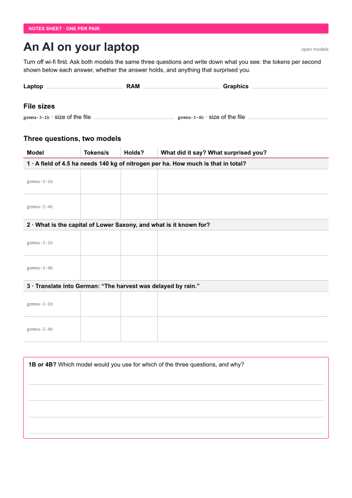

A language model is a file full of numbers that runs on your own laptop
without the internet, and its size decides how good, how fast and how hungry
it is. You switch off the internet and still get answers from a language model
on your own laptop. Then you look at the file that holds the whole model and
compare a small and a larger version of the same model on the same three
questions.

## What you need

- A laptop with at least 8 GB of memory, charged, and
  [LM Studio](https://lmstudio.ai) installed (free, for Windows, macOS and
  Linux); how to set it up is described in [[lm-studio|the page on LM Studio]].
- Two models from the same family, downloaded before the session, not in the
  room: Gemma 3 1B (`google/gemma-3-1b`, about 0.75 GB) and Gemma 3 4B
  (`google/gemma-3-4b`, about 2.4 GB).
- [The notes sheet](media/open-models-notes.pdf), one per pair.

The file sizes are those listed on lmstudio.ai and can differ slightly with
the version you download.

## Steps

Work in pairs and write your observations on the notes sheet.

1. Turn off wi-fi, load Gemma 3 1B in LM Studio and ask it what nitrogen
   fertiliser does for a wheat plant, in two sentences.
2. Find the model file (LM Studio → Library → the menu … next to the model →
   Open in File Explorer) and note its size and its name.
3. Ask both models, Gemma 3 1B and then Gemma 3 4B, the same three questions
   and note the tokens per second shown below each answer:
   - A field of 4.5 ha needs 140 kg of nitrogen per ha. How much is that in
     total?
   - What is the capital of Lower Saxony, and what is it known for?
   - Translate into German: "The harvest was delayed by rain."
4. Compare: which model was faster, and which answers held?

## Extensions

Each extension changes one thing, so that you can compare the result with the
basic experiment.

1. **Turn the dials:** load Gemma 4 E2B (`google/gemma-4-e2b`) and switch LM
   Studio to developer mode under Settings → Developer, as shown in
   [[lm-studio|the page on LM Studio]]; if the panel on the right shows no temperature, the
   developer mode is still off. Then ask the same question
   three times at temperature 0 and three times at temperature 1, set top k to
   0, top p to 1 and min p to 0 and raise the temperature step by step until
   the answer falls apart, limit the length of the answer to 20 tokens (Limit
   Response Length), and finally load the model with a very short context,
   paste a long text, ask about its beginning and repeat this with each
   strategy under Context Overflow (Rolling Window, Truncate Middle, Stop at
   Limit).
2. **Rounding:** download Gemma 3 4B in a second quantization (for example
   8 bit instead of 4 bit) and compare size, speed and answers.
3. **Another family:** ask Qwen3 4B (`qwen/qwen3-4b-2507`, 2.3 GB) the same
   questions and compare it with Gemma 3 4B of the same size.
4. **Cloud against laptop:** ask a cloud chatbot the same questions and fill
   in a table with quality, speed, cost and where your data goes.
5. **Your own document:** give the local model a text that must not leave your
   laptop, such as a draft of your thesis, and ask it for a summary.
6. **Watch the machine:** open the task manager while the model answers and
   watch memory, processor and graphics card.
7. **On your phone:** install Google's app
   [AI Edge Gallery](https://github.com/google-ai-edge/gallery) (Android and
   iOS), load a small Gemma model and ask it the same questions in flight mode.

## Discussion

Write down your own answers first, then discuss them in your group.

1. What surprised you about the size, speed or quality of the local model?
2. Which data would you trust a local model with, but not a cloud service?
3. When should a farm or a food company run its own model instead of renting
   one?

What a model is, why its size matters and how open and closed weights differ
is explained in [[open-models]]; how the model writes its answer one token at
a time, and what the settings in LM Studio change, in
[[next-token-prediction]].
