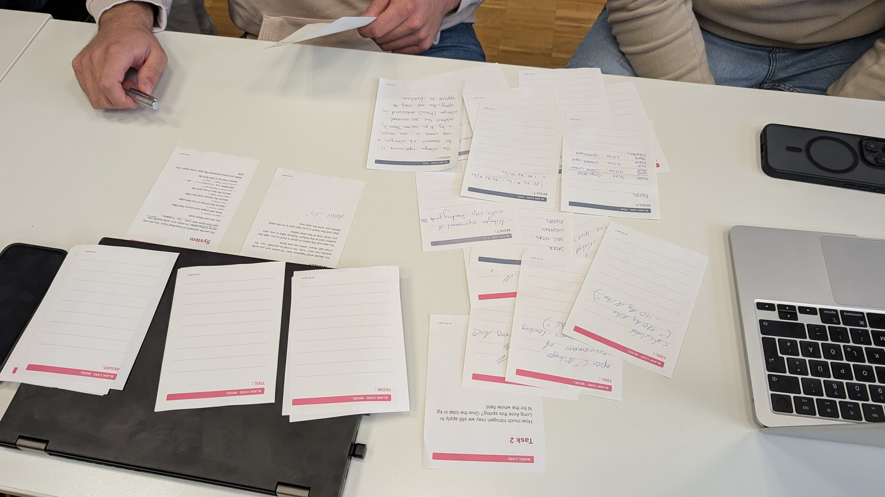
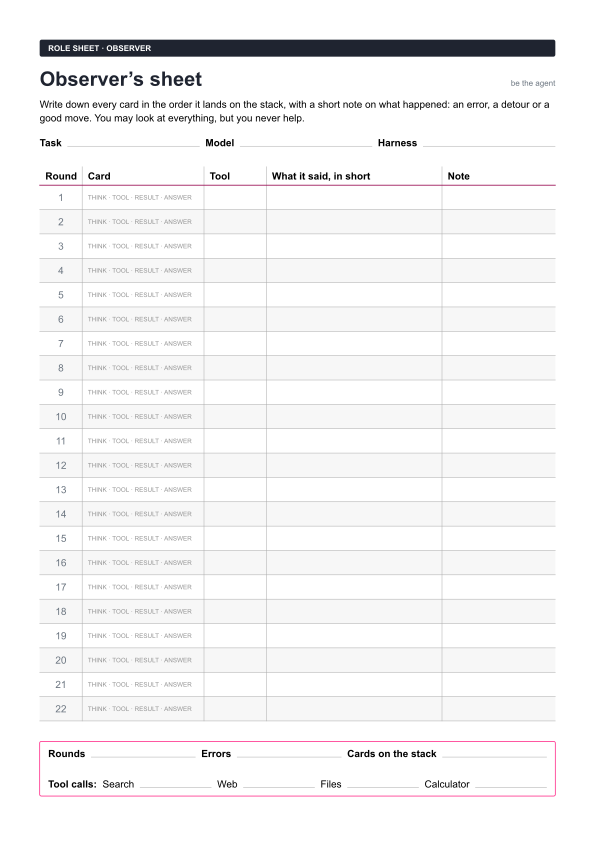
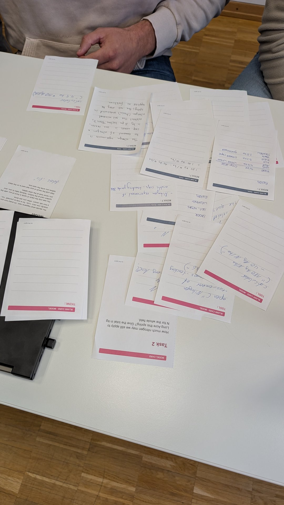

An AI agent is a large language model (LLM) that can only write text:
everything it does in the world happens through tools, which a program around
it, the harness, runs on its behalf. The model knows only what is in its
context, so its work can only be as good as the results that reach it. In this
game your group plays such an agent with cards instead of a computer, and by
the end you will have run by hand the loop that every AI agent runs on.



The slides lead through the game: the roles, the cards, the rules, the three
tasks and what you just played.


## What you need

- A group of seven; with five or six, one person takes two roles.
- [The cards](media/be-the-agent-cards.pdf), seven A4 sheets to cut along the
  dashed lines; print the sheet with blank cards several times, because a game
  uses twenty or more.
- [The Observer's sheet](media/be-the-agent-observer.pdf), one per group and
  task, with room for 22 rounds and the counts at the end.
- A pen for everyone, a calculator and room for the tools to sit apart from
  the Model.

All farm data and web pages are invented for this game and are not advice for
real fertilisation.



### The cards

Pink cards belong to the Model: the system card, the three tasks and the
blank cards it writes on. The dark role cards go one to each player, and the
grey cards are the material of the tools, which the Model never sees. Click a
card to read it large.

```gallery
download: media/be-the-agent-cards.pdf
groups:
  - title: The Model's cards
    images:
      - { src: media/cards/card-02.svg, alt: System card }
      - { src: media/cards/card-03.svg, alt: Task 1 }
      - { src: media/cards/card-04.svg, alt: Task 2 }
      - { src: media/cards/card-05.svg, alt: Task 3 }
      - { src: media/cards/card-25.svg, alt: Blank THINK card }
      - { src: media/cards/card-26.svg, alt: Blank TOOL card }
      - { src: media/cards/card-28.svg, alt: Blank ANSWER card }
  - title: Role cards
    images:
      - { src: media/cards/card-06.svg, alt: Role card Model }
      - { src: media/cards/card-07.svg, alt: Role card Harness }
      - { src: media/cards/card-09.svg, alt: Role card Search }
      - { src: media/cards/card-10.svg, alt: Role card Web }
      - { src: media/cards/card-11.svg, alt: Role card Files }
      - { src: media/cards/card-12.svg, alt: Role card Calculator }
      - { src: media/cards/card-08.svg, alt: Role card Observer }
  - title: The tools' material
    images:
      - { src: media/cards/card-13.svg, alt: Search index }
      - { src: media/cards/card-14.svg, alt: File fields }
      - { src: media/cards/card-15.svg, alt: File soil_tests }
      - { src: media/cards/card-16.svg, alt: File stock }
      - { src: media/cards/card-17.svg, alt: File weather }
      - { src: media/cards/card-24.svg, alt: Blank card for a new file }
      - { src: media/cards/card-18.svg, alt: "Web page: nitrogen requirement" }
      - { src: media/cards/card-19.svg, alt: "Web page: recommendations 2009" }
      - { src: media/cards/card-20.svg, alt: "Web page: splitting nitrogen" }
      - { src: media/cards/card-21.svg, alt: "Web page: when fertiliser may be spread" }
      - { src: media/cards/card-22.svg, alt: "Web page: calcium ammonium nitrate" }
      - { src: media/cards/card-23.svg, alt: "Web page: winter wheat varieties" }
      - { src: media/cards/card-27.svg, alt: Blank RESULT card }
```

## Steps

1. Hand out the role cards; the Model's stack starts with the system card and
   Task 1 on top.
2. Play Task 1, then swap roles and play Task 2.
3. The Observer reads the log aloud: rounds, tool calls per tool, errors and
   cards on the stack.
4. Play Task 3 if there is time, then compare your log with the log of a real
   agent.

While you play, four rules apply:

- The Model sees only its stack of cards, and nobody talks to it.
- It writes one card at a time, starting with `THINK:`, `TOOL:` or `ANSWER:`.
- The Harness carries every `TOOL:` card to the right tool and brings back the
  `RESULT:` card.
- A tool does exactly what the card says, nothing more, and never guesses what
  was meant.



## Extensions

Each extension changes the game in one respect, so that you can compare the
result with your first round.

1. **Limited memory:** the stack holds at most eight cards, and a `SUMMARY:`
   card replaces the oldest ones when it is full.
2. **Two tools at once:** the Model may write two tool cards per turn, which
   the Harness carries in parallel.
3. **A new tool:** someone becomes `forecast("date")`, added to the system
   card, and you watch whether the Model uses it unprompted.
4. **A wrong result:** one tool secretly returns a wrong value, and you find
   out whether the Model notices.
5. **Be the tool for a chatbot:** solve Task 2 with a chatbot in your browser,
   supplying every file, page and calculation yourself.

## Discussion

Write down your own answers first, then discuss them in your group.

1. In which round would the Model have been stuck without the tools, and which
   tool was used most?
2. What would have gone differently if the Model had had to give up its stack
   after ten cards?
3. Who did the thinking, who did the acting, and which of it could the Model
   actually do?

What you just ran by hand, the loop of thinking, acting and observing, is the
subject of [[ai-agents]].
