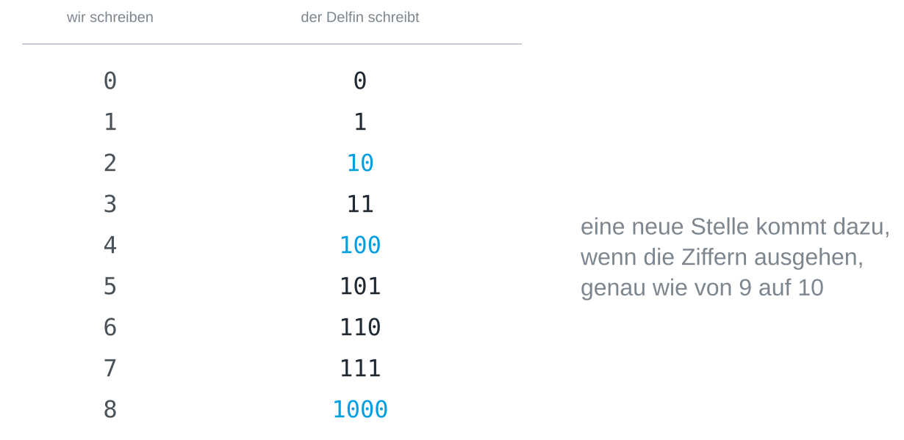

## Worum es geht

Die Basis 2 ist der [[place-value-systems|Trick mit dem Stellenwert]] am
Anschlag: Es bleiben nur die Ziffern 0 und 1. An der Bauanleitung ändert sich
nichts, und wer binär zählen, lesen und schreiben kann, hat alles gesehen, was
ein Zahlensystem ausmacht.

## Zählen mit zwei Ziffern

Gezählt wird wie immer, nur läuft eine Stelle fast sofort über, so wie ein
Kilometerzähler von 09 auf 10 springt. Stell dir einen Delfin vor, der an
seinen zwei Flossen zählt: Nach 0 und 1 sind seine Ziffern verbraucht, und er
muss eine neue Stelle aufmachen.



Die Regel ist in jeder Basis dieselbe: Ist die höchste Ziffer erreicht, geht
die Stelle auf 0 zurück, und die nächste Stelle zählt eins hoch. Binär
passiert das nur viel öfter, sodass auf 101 die 110 folgt und erst nach 111
mit 1000 eine vierte Stelle dazukommt.

## Eine Binärzahl lesen

Die Stellen sind von rechts an 1, 2, 4 und 8 wert, und jede weitere
verdoppelt. `110` ist also nicht einhundertzehn, sondern

    1 · 4  +  1 · 2  +  0 · 1  =  6

Die Einer stehen ganz rechts, wie im Dezimalsystem. Vom falschen Ende gelesen,
mit den Einern links, ergäben dieselben Ziffern 1 · 1 + 1 · 2 + 0 · 4 = 3.

## Eine Zahl binär schreiben

Andersherum gehst du von der größten Zweierpotenz aus, die passt. Für 13: 16
ist zu groß, 8 passt und lässt 5 übrig, 4 passt und lässt 1 übrig, 2 passt
nicht, 1 passt. Von links nach rechts aufgeschrieben ergibt das `1101`. Eine
schnelle Probe ist die letzte Ziffer, die bei jeder ungeraden Zahl 1 und bei
jeder geraden 0 ist.

Python kann deine Rechnung prüfen. `bin()` schreibt eine Zahl binär, mit `0b`
davor, das die Basis anzeigt:

```python
print(bin(13))
```

Und `int()` liest eine Ziffernfolge in der Basis, die du angibst:

```python
print(int("1101", 2))
```

> [!TIP]
> Rechne ein paar Zahlen erst im Kopf und dann in Python, etwa 6, 9, 16 und
> 31. Das Muster hinter 31, 63 und 127 lohnt einen zweiten Blick.

## Warum die Zahlen lang werden

Binärzahlen sind lang: 255 braucht acht Ziffern statt drei. Das ist der Preis
dafür, nur zwei Ziffern zu haben, und [[why-two-states]] erklärt, warum
Rechner ihn gern bezahlen. Eine binäre Stelle heißt [[bit]], und acht davon
bilden ein [[byte]].
