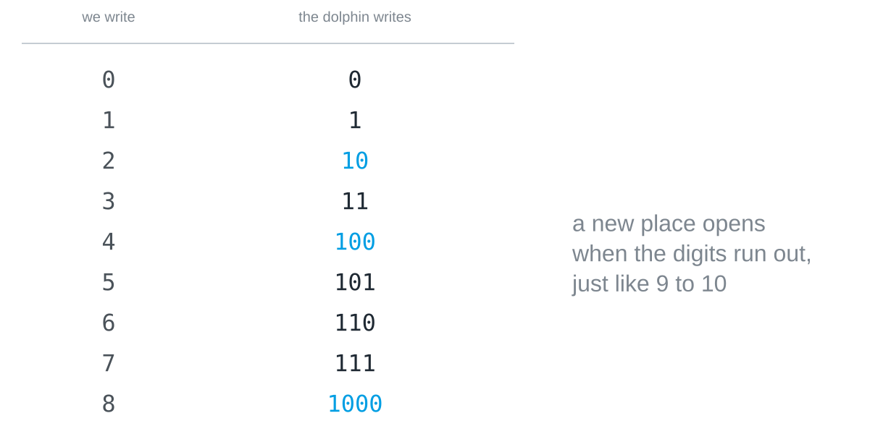

## What this is about

Base 2 is the [[place-value-systems|place value trick]] pushed to its limit:
only the digits 0 and 1 are left. Nothing about the recipe changes, so once
you can count, read and write in binary, you have seen everything there is to
a number system.

## Counting with two digits

Counting works as it always does, except that a place runs out almost
immediately, the way a car odometer rolls over from 09 to 10. Picture a
dolphin with two flippers that counts on them: after 0 and 1 it has used up
its digits and has to open a new place.



The rule is the same in every base: when the highest digit is reached, the
place goes back to 0 and the next place goes up by one. In binary this just
happens much more often, so 101 is followed by 110, and only after 111 does a
fourth place open with 1000.

## Reading a binary number

The places are worth 1, 2, 4, 8 from the right, and each further one doubles.
So `110` is not one hundred and ten but

    1 · 4  +  1 · 2  +  0 · 1  =  6

The ones are at the far right, as in decimal. Read from the wrong end, with
the ones at the left, the same digits would give 1 · 1 + 1 · 2 + 0 · 4 = 3.

## Writing a number in binary

The other way round, walk down from the largest power of two that fits. To
write 13: 16 is too big, 8 fits and leaves 5, 4 fits and leaves 1, 2 does not
fit, 1 does. Written from left to right, that gives `1101`. A quick check is
the last digit, which is 1 for every odd number and 0 for every even one.

Python can check your arithmetic. `bin()` writes a number in binary, with
`0b` in front to show the base:

```python
print(bin(13))
```

And `int()` reads a string of digits in the base you give it:

```python
print(int("1101", 2))
```

> [!TIP]
> Try a few numbers in your head first and only then in Python, for example
> 6, 9, 16 and 31. The pattern behind 31, 63 and 127 is worth noticing.

## Why the numbers get long

Binary numbers are long: 255 needs eight digits instead of three. That is the
price of having only two digits, and [[why-two-states]] explains why
computers pay it happily. A binary place is called a [[bit]], and eight of
them form a [[byte]].
