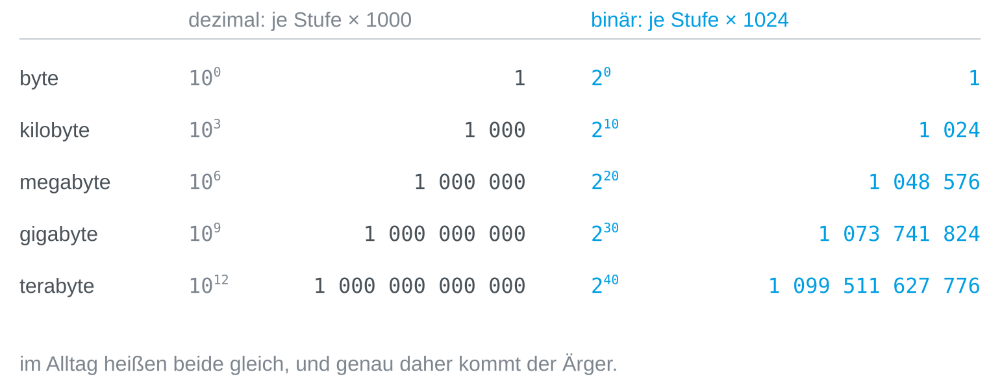
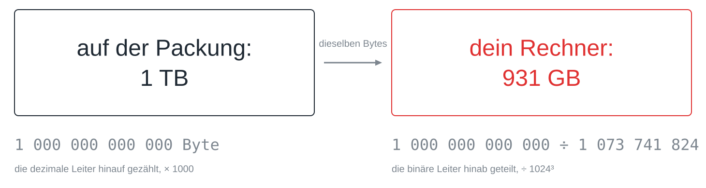

Auf der Packung steht 1 Terabyte, der Rechner zeigt 931 Gigabyte an, und es
ist kein einziges Byte verloren gegangen. Es gibt zwei Leitern von Einheiten,
und weil sie im Alltag dieselben Namen tragen, verwechselt man sie leicht.

## Zwei Leitern

Die dezimale Leiter multipliziert je Stufe mit 1000, wie Kilo, Mega und Giga
bei jeder anderen Einheit auch: Kilobyte, Megabyte, Gigabyte, Terabyte. Die binäre Leiter multipliziert mit 1024, weil Speicher in
Zweierpotenzen organisiert ist und 2¹⁰ = 1024 die Zweierpotenz ist, die 1000 am
nächsten kommt.



Der Abstand zwischen den Leitern wächst je Stufe um rund 2,4 Prozent: Ein
binäres Kilobyte ist 2,4 Prozent größer als ein dezimales, ein binäres Megabyte
4,9 Prozent, ein binäres Gigabyte 7,4 Prozent und ein binäres Terabyte 10
Prozent.

## Die fehlenden 69 Gigabyte

Der Hersteller zählt die dezimale Leiter hinauf, für ihn ist ein Terabyte also
eine Billion Byte. Das Betriebssystem nimmt dieselbe Billion und teilt sie die
binäre Leiter hinab, durch 1024³, und kommt auf 931.



Die Division kannst du selbst nachrechnen:

```python
print(10**12 / 1024**3)
```

Gerundet hat niemand und geschummelt auch nicht: Beide Angaben beschreiben
dieselbe Zahl von Bytes, ärgerlich ist nur, dass beide Seiten ihre Stufe
Gigabyte nennen.

## Saubere Namen

Seit 1998 gibt es saubere Namen für die binären Stufen: Kibibyte (KiB),
Mebibyte (MiB), Gibibyte (GiB) und Tebibyte (TiB), wobei *bi* für binär steht.
In dieser Schreibweise fasst die Platte 1 TB, das sind 931 GiB. Im Gespräch
benutzt die Namen fast niemand, deshalb hält sich die Verwechslung; auch die
Betriebssysteme unterscheiden sich, denn Windows zeigt binäre Werte mit den
dezimalen Namen an, während macOS seit 2009 in dezimalen Stufen zählt.

> [!TIP]
> Wenn es auf die Größe ankommt, sag dazu, welche Leiter du meinst. „2 KiB“
> sind 2048 Byte, „2 kB“ sind 2000 Byte, und „2 KB“ kann beides sein.
