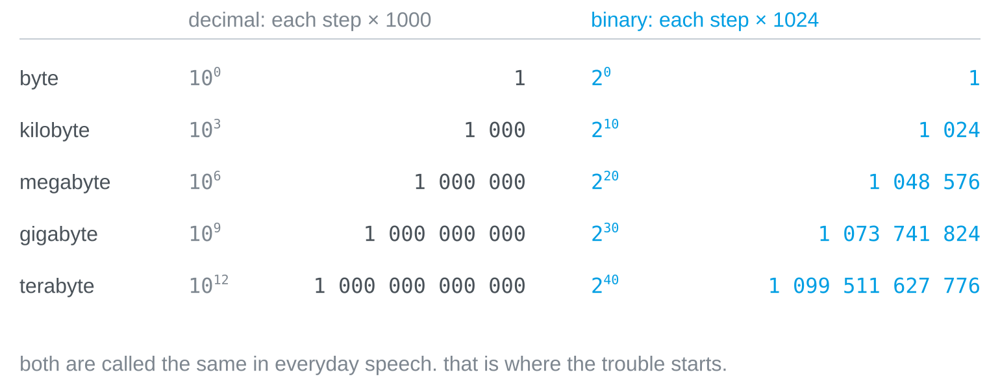
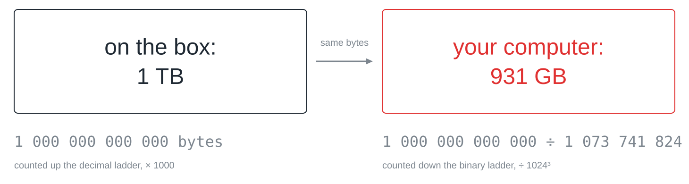

## What this is about

The box says 1 terabyte, the computer says 931 gigabytes, and not a single
byte has gone missing. There are two ladders of units, and because they share
their names in everyday speech, they are easy to confuse.

## Two ladders

The decimal ladder multiplies by 1000 per step, as kilo, mega and giga do in
every other unit: kilobyte, megabyte, gigabyte, terabyte. The binary ladder
multiplies by 1024, because memory is organised in powers of two and
2¹⁰ = 1024 is the power of two closest to 1000.



The gap between the ladders grows by about 2.4 percent per step: a binary
kilobyte is 2.4 percent larger than a decimal one, a binary megabyte 4.9
percent, a binary gigabyte 7.4 percent and a binary terabyte 10 percent.

## The missing 69 gigabytes

The manufacturer counts up the decimal ladder, so a terabyte is a trillion
bytes. The operating system takes that same trillion and divides it down the
binary ladder, by 1024³, and arrives at 931.



You can check the division yourself:

```python
print(10**12 / 1024**3)
```

Nobody rounded and nobody cheated: both figures describe the same number of
bytes, and the annoyance is only that both sides call their step a gigabyte.

## Clean names

Since 1998 there are clean names for the binary steps: kibibyte (KiB),
mebibyte (MiB), gibibyte (GiB) and tebibyte (TiB), where *bi* stands for
binary. In this notation the disk holds 1 TB, which is 931 GiB. Almost nobody
uses the names in conversation, which is why the confusion survives; operating
systems differ too, as Windows reports binary values with the decimal names,
while macOS has counted in decimal steps since 2009.

> [!TIP]
> When a size matters, say which ladder you mean. "2 KiB" is 2048 bytes,
> "2 kB" is 2000 bytes, and "2 KB" can be either.
