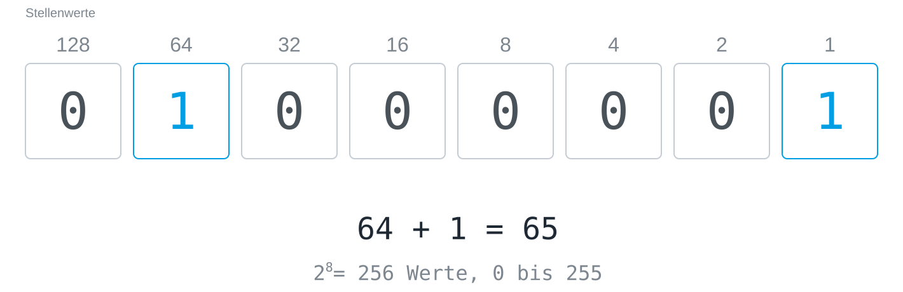

## Definition

Ein **Byte** ist ein Päckchen aus acht [[bit|Bit]]. Weil jede weitere Stelle
die Möglichkeiten verdoppelt, kann ein Byte 2⁸ = 256 verschiedene Werte
annehmen. Als Binärzahl gelesen reicht es von 0 (alle acht Bit 0) bis 255
(alle acht Bit 1).

Die Stellenwerte sind 128, 64, 32, 16, 8, 4, 2 und 1, jeder doppelt so groß
wie sein rechter Nachbar, und der Wert des Bytes ist die Summe der gesetzten
Stellen. Das Byte in der Abbildung, `01000001`, ist 64 + 1 = 65; als Text
gelesen ist es ein großes A, und warum das so ist, erklärt
[[code-as-agreement]].

## Eine Verpackung, keine Zahl

Ein Byte ist keine Zahl, sondern eine Verpackungseinheit: das kleinste Stück
Speicher, dem ein Rechner üblicherweise eine eigene Adresse gibt, und was seine
acht Bit bedeuten, legt eine Vereinbarung fest. Als Zahl gelesen ist es 0 bis
255, als Text ein Zeichen, als Helligkeit eines Bildpunkts ein Grauton.

## Beispiele

- Farbwerte in der Bildbearbeitung und auf Webseiten reichen je Kanal von 0
  bis 255, weil ein Kanal ein Byte ist; `#FF0000` ist Rot mit dem roten Kanal
  am Anschlag.
- Zwei [[hexadecimal|Hexadezimalziffern]] beschreiben genau ein Byte.
- Dateigrößen werden in Byte gezählt, und die Vorsilben Kilo, Mega und Giga
  haben dort zwei Bedeutungen, siehe [[binary-prefixes]].

Die acht Bit selbst umschalten kannst du an der [[byte-switchboard]].
