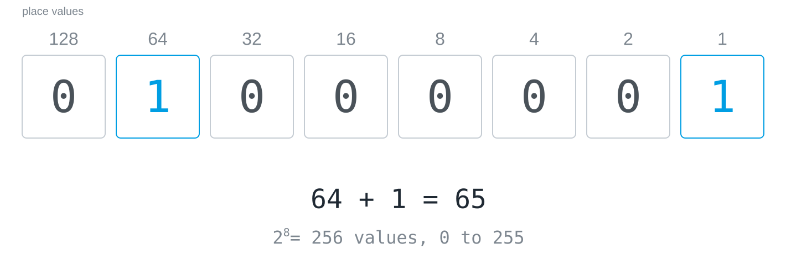

## Definition

A **byte** is a packet of eight [[bit|bits]]. Because every additional place
doubles the possibilities, a byte can take 2⁸ = 256 different values. Read as
a binary number, it runs from 0 (all eight bits 0) to 255 (all eight bits 1).

The place values are 128, 64, 32, 16, 8, 4, 2 and 1, each double its
right-hand neighbour, and the value of the byte is the sum of the places that
are set. The byte in the figure, `01000001`, is 64 + 1 = 65; read as text it
is a capital A, and why that is so is explained in [[code-as-agreement]].

## A unit of packaging, not a number

A byte is not a number but a unit of packaging: it is the smallest piece of
memory a computer usually gives its own address to, and what its eight bits
mean is decided by an agreement. Read as a number it is 0 to 255, read as text
a character, read as the brightness of a pixel a shade of grey.

## Examples

- Colour values in image editing and on web pages run from 0 to 255 per
  channel, because one channel is one byte; `#FF0000` is red with the red
  channel at its maximum.
- Two [[hexadecimal]] digits describe exactly one byte.
- File sizes are counted in bytes, and the prefixes kilo, mega and giga have
  two meanings there, see [[binary-prefixes]].

Flip the eight bits yourself in the [[byte-switchboard]].
