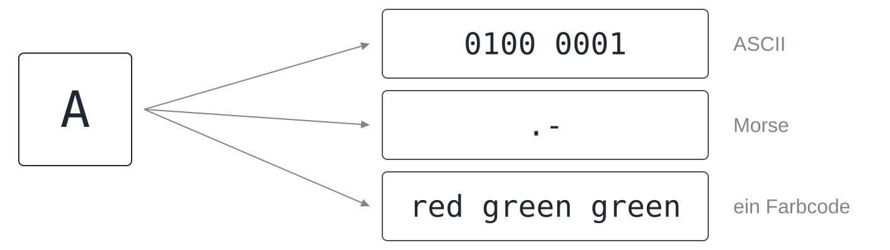
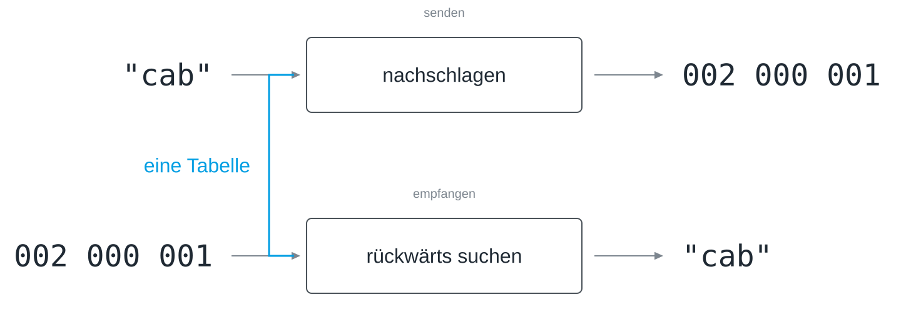
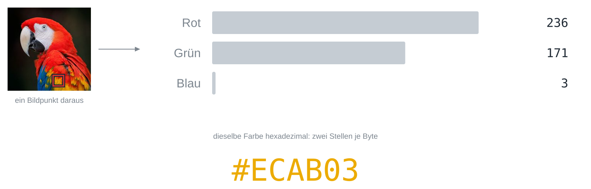
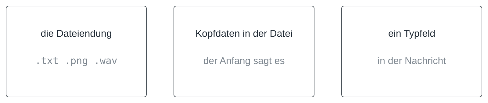
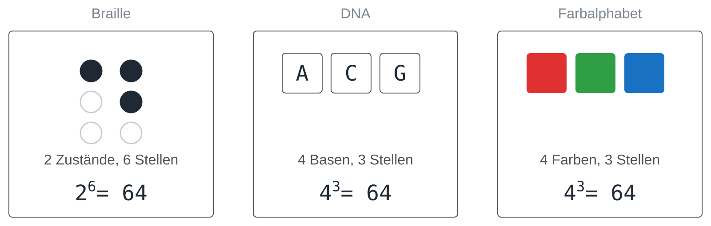

Im British Museum steht eine Granitplatte, im Jahr 196 vor Christus beschrieben,
die dasselbe dreimal sagt: einmal in Hieroglyphen, einmal in demotischer
Schrift, einmal auf Griechisch. Vierzehn Jahrhunderte lang konnte niemand das
obere Drittel lesen, und zwar nicht, weil die Zeichen verloren gewesen wären,
denn die lagen die ganze Zeit offen da, sondern weil die Vereinbarung verloren
war, welches Zeichen was bedeutet. Als Champollion sie in den 1820er-Jahren
schließlich herausfand, hat er den Stein weniger entziffert als eine Tabelle
zurückgewonnen, die zweitausend Jahre zuvor in den Köpfen der Menschen
existiert hatte und dann still außer Gebrauch geraten war. Davon handelt
diese Lektion, und es lohnt sich, das festzuhalten, bevor es um Bytes geht:
Nicht die Zeichen sind die Nachricht, sondern die Vereinbarung. Das
durchgehende Beispiel ist eine Strecke, die Farben statt Buchstaben sendet,
wie in [[symbols-and-information]].

## Die Vereinbarung ist alles

### Was ein Codesystem ist

Ein **Codesystem** ordnet Zeichen Folgen von Symbolen zu, und beide Seiten
haben sich auf diese Zuordnung geeinigt. Das ist schon die ganze Definition.
Damit sie nicht in der Luft hängt, hier eine echte Tabelle: **ASCII**, die
älteste dieser Vereinbarungen, die noch täglich benutzt wird. Das große A ist
65, B ist 66, das kleine a ist 97, und jede dieser Zahlen passt in ein Byte.


Zwei Einzelheiten lohnen einen zweiten Blick. Die 65 ist nicht die Position
des A im Alphabet: Die ersten 32 Plätze der Tabelle gehören den Steuerzeichen,
deshalb fangen die Buchstaben so spät an. Und das kleine a ist 97, eine ganz
andere Zahl und keine Spielart derselben, sodass `A` und `a` für den Rechner
zwei Zeichen sind, die nur für uns verwandt aussehen. Den Buchstaben selbst
gibt es erst wieder, wenn ein Programm die Zahl 65 nimmt, in derselben Tabelle
nachschlägt und die Form zeichnet; zwischen Tastatur und Bildschirm existiert
er als Buchstabe gar nicht. Python schlägt mit `ord()` und `chr()` in beide
Richtungen der Tabelle nach:

```python
print(ord("A"), ord("B"), ord("a"))
print(chr(65), chr(97))
print(format(ord("A"), "08b"))
```

### Derselbe Buchstabe, drei Codesysteme

Wenn ein Code eine Tabelle ist, kann es mehrere davon geben, und es gibt sie.
Dasselbe A ist in ASCII eine Folge von acht Bits, im Morsecode ein Punkt und
ein Strich und in einem Alphabet aus Farben drei Farben hintereinander.



Drei Dinge ist ein Code nicht, weil alle drei im Alltag mit ihm verwechselt
werden. Er ist keine Verschlüsselung: Ein Code verbirgt nichts und wird mit
Absicht veröffentlicht, damit beide Seiten ihn benutzen können. Er ist keine
Kompression: Manche Codes sind nebenbei sparsam, aber etwas kleiner zu machen
ist nicht ihr Zweck. Und er ist kein Quelltext, auch wenn beide gleich heißen.

### Wenn die Tabelle zu klein ist

Die 128 Plätze von ASCII reichen für Englisch und für sonst nichts: keine
Umlaute, kein Eurozeichen, kein Griechisch, kein Chinesisch, kein Emoji.


Die Tabelle war zu klein, also wurde eine größere vereinbart, und dabei lohnt
es sich, zwei Schritte auseinanderzuhalten, weil sie ständig verwechselt
werden. **Unicode** legt fest, welche *Nummer* ein Zeichen hat, und gibt jedem
Zeichen jeder Schrift eine, weit über 100.000 Stück. **UTF-8** legt fest, wie
diese Nummer als *Bytes* aufgeschrieben wird, und zwar mit wechselnder Länge:
Zeichen, die ständig vorkommen, bleiben bei einem Byte, seltenere kosten zwei,
drei oder vier. Das ist derselbe Gedanke, der dem E im Morsecode einen
einzigen Punkt gegeben hat, und er kommt weiter unten wieder, wo er Ärger macht.
`ord()` liefert die Nummer in Unicode, `encode()` die Bytes in UTF-8:

```python
for ch in ["A", "ä", "€", "π"]:
    print(ch, ord(ch), ch.encode("utf-8"), len(ch.encode("utf-8")), "Bytes")
```

### Zwei Tabellen, eine Nachricht

Jetzt der Fehler, der am meisten Zeit kostet, sobald zwei Leute an einer
Strecke arbeiten. Angenommen, beide haben die Codetabelle getrennt abgetippt,
und in einer Abschrift sind die Einträge für n und m vertauscht, während alles
andere übereinstimmt.


Technisch geht dabei nichts schief. Keine Ausnahme wird ausgelöst, keine
Prüfsumme schlägt fehl, kein Byte ist beschädigt: Der Empfänger schlägt jede
Gruppe von Bits nach, bekommt jedes Mal eine gültige Antwort und gibt ein Wort
aus, das genau wie ein Wort aussieht. Du hast `sonne` getippt, heraus kam
`somme`, und das Programm kann es nicht wissen. Das widerspricht dem Gefühl,
dass Rechner sich beschweren, wenn etwas falsch ist, denn sie beschweren sich,
wenn etwas kaputtgeht, und eine falsche Vereinbarung macht nichts kaputt: Sie
wird korrekt ausgeführt, und das Ergebnis ist Unsinn mit sauberem Gesicht.
[[symbols-and-information]] nennt das perfekten Empfang und perfekten Unsinn.

## Ein Codebuch bauen

### Wie viele Stellen je Buchstabe?

Angenommen, die Strecke kennt vier Farben und soll die 26 Buchstaben senden.
Wie lang muss jede Farbfolge sein? Die Rechnung ist die aus
[[place-value-systems]]: Mit *k* Symbolen und *n* Stellen gibt es *k*ⁿ
Codewörter.


Zwei Stellen reichen für 26 Buchstaben nicht, drei schon, und 26 Buchstaben
mit drei Farbstellen lassen 38 Codewörter übrig.

### Das Codebuch


Das Bild zeigt, was die Rechnung verbirgt: Die Tabelle ist viel leerer, als
sie sich anfühlt. Die übrigen Codewörter sind Vorrat für später und kein
Abfall. Wenn du mittendrin beschließt, auch ein Leerzeichen oder eine Ziffer zu
senden, sind die Plätze schon da, und an keiner Länge muss sich etwas ändern.
Welche Farbfolge zu welchem Platz gehört, entscheidest allein du: Die Plätze
liefert die Rechnung, die Zuordnung ist die Vereinbarung.

### Dieselbe Tabelle in beide Richtungen

Senden heißt, ein Zeichen nachzuschlagen und ein Codewort zu bekommen.
Empfangen heißt, dieselbe Tabelle andersherum zu lesen.



Solange keine zwei Zeichen dasselbe Codewort haben, ist das Nachschlagen in
Gegenrichtung eindeutig. Im Programm ist die Tabelle ein Dictionary, und die
zum Empfangen leitest du am besten in einer Zeile aus der zum Senden ab, statt
sie ein zweites Mal abzutippen, denn zwei getrennt gepflegte Tabellen sind zwei
Dinge, die auseinanderlaufen können, und wie das aussieht, hast du gerade
gesehen:

```python
code = {"a": "000", "b": "001", "c": "002"}
back = {word: letter for letter, word in code.items()}

sent = [code[ch] for ch in "cab"]
print(sent)
print("".join(back[word] for word in sent))
```

### Was nicht in der Tabelle steht

Eines deckt die Tabelle noch nicht ab, und es zeigt sich in den ersten
Minuten des ersten Tests: ein Zeichen, das nicht darin steht. Jemand tippt ein
Leerzeichen, einen Umlaut, eine Ziffer.


Drei Antworten sind vertretbar: das Zeichen in die Tabelle aufnehmen, es vor
dem Senden entfernen oder mit einer klaren Meldung ablehnen. Keine
Entscheidung zu treffen gehört nicht dazu, denn mit einem solchen Zeichen
geschieht so oder so etwas, und dann entscheidet der Zufall oder das Programm
stürzt vor allen ab. Im Dictionary oben löst `code[" "]` einen `KeyError` aus,
was immerhin ein ehrlicher Absturz ist. Und widersteh dem bequemen Gedanken,
ein Leerzeichen sei ja nichts: Für den Text ist es ein Zeichen wie jedes
andere, und ein Empfänger kann keine Lücke erfinden, die nie gesendet wurde.

## Wo endet ein Zeichen?

### Ein Code, der nicht funktioniert

Hier ist ein Code, der harmlos aussieht und nicht funktioniert. Vereinbart, a
sei `0`, b sei `01` und c sei `10`, tippt „a c“ und sendet die Folge `010`.


Beide Lesarten folgen der Tabelle, weil der Empfänger nicht sieht, wo ein
Zeichen endet. Er sieht einen Strom von Bits ohne Lücken und weiß nicht, ob
die erste `0` schon ein ganzes Zeichen war oder der Anfang eines längeren. Das
Problem ist nicht, dass die Codewörter verschieden lang sind. Das Problem ist,
dass das Codewort für a der *Anfang* des Codeworts für b ist, sodass nichts im
Strom die Grenze markiert.

### Probier es aus: die Präfix-Falle

In der Präfix-Falle legst du die Codewörter für a, b, c und d selbst fest,
tippst ein Wort und siehst jede Lesart, zwischen denen der Empfänger wählen
müsste. Bring die Liste auf eine einzige, ohne allen Codewörtern dieselbe Länge
zu geben, und bau danach einen Code mit so vielen Lesarten wie möglich.


### Drei Auswege

Es gibt drei Auswege, und keiner davon ist der offizielle.


**Feste Länge** ist der einfachste: Jedes Zeichen hat gleich viele Stellen,
also zählt der Empfänger ab, statt zu raten. Ein **Trennzeichen** verwendet
der Morsecode, in Form von Pausen zwischen den Buchstaben. Der dritte Weg ist
der interessante: Beginnt kein Codewort ein anderes, heißt der Code
**präfixfrei**, und er behält verschiedene Längen und lässt sich trotzdem
eindeutig lesen, denn sobald das Gelesene zu einem Eintrag passt, kann es nur
dieser Eintrag sein.

### Was feste Länge kostet

Warum sollte also überhaupt jemand variable Länge wollen, wenn sie so viel
Sorgfalt verlangt?


Weil feste Länge den Buchstaben, die man ständig sendet, keinen Rabatt gibt.
Gib den zehn häufigsten Buchstaben zwei Stellen und dem Rest vier, und ein
gewöhnliches Wort wird kürzer: `experiment` braucht 26 Stellen statt 30.
Variable Länge ist im Mittel kürzer, aber nicht bei jedem Wort, denn ein Wort
aus lauter seltenen Buchstaben wird länger. Wer diesen Gedanken weit genug
verfolgt, landet bei der Kompression; hier geht es nur darum, dass es eine Wahl
ist und beide Antworten etwas kosten.

## Dieselben Bits, andere Bedeutungen

### Eine Bytefolge, drei Lesarten

Bisher ging es nur um Text, aber nichts an der Überlegung hatte mit Text zu
tun, und hier ist der Beweis. Nimm acht aufeinanderfolgende Bytes aus der Mitte
eines Fotos.


Als Text gelesen sind es ein großes M, ein Dollarzeichen, ein großes E und
fünf Zeichen, die kein Editor anzeigen kann, und genau das bekommst du, wenn du
eine Bilddatei versehentlich im Texteditor öffnest. Als Grauwerte gelesen sind
es acht Helligkeiten, als Tonabtastwerte acht Punkte einer Welle. Die Bytes
sagen nicht, welche Lesart die richtige ist, und sie wehren sich gegen keine.
Zeichensalat auf dem Bildschirm ist keine Fehlfunktion, sondern eine korrekt
ausgeführte falsche Vereinbarung.

### Ein Bildpunkt, drei Zahlen

Bilder sind also derselbe Gedanke wie Text mit einer anderen Tabelle. Ein
Bildpunkt sind drei Zahlen zwischen 0 und 255, eine für den Rotanteil, eine für
Grün und eine für Blau.



Die Anteile werden multipliziert, nicht addiert, weil sich jede Rotstufe mit
jeder Grün- und Blaustufe kombinieren lässt: 256 · 256 · 256 ≈ 16,7 Millionen
Farben, also 24 Bit je Bildpunkt. Die Schreibweise `#ECAB03` ist kein anderes
System, nur eine kürzere Art, dieselben drei Bytes mit je zwei Stellen zu
schreiben, wie in [[place-value-systems|Hexadezimal]]. Eine RGB-LED mischt ihre Farbe aus denselben
drei Anteilen wie ein Bildpunkt auf dem Bildschirm, und ein Farbsensor misst
sie in denselben drei Kanälen zurück.

### Wer sagt, welche Lesart gilt?

Wenn die Bytes nicht sagen, welche Lesart die richtige ist, muss es etwas
anderes tun.



Die **Dateiendung** ist der schwächste, denn eine umbenannte Datei ändert
innen nichts. **Kopfdaten** am Anfang der Datei sind verlässlicher: Ein PNG
beginnt zum Beispiel immer mit denselben acht Bytes. Und ein **Typfeld** in
einer Nachricht sagt dem Empfänger, wie der Rest zu lesen ist, damit er nicht
raten muss. Welche Lesart gilt, ist eine weitere Vereinbarung, und ein eigenes
Protokoll braucht sie, sobald es mehr als eine Art von Inhalt sendet.

## Codes ohne Rechner

Für nichts davon brauchte es Strom. Ein Strichcode macht aus Strichbreiten
Ziffern. Die Notenschrift macht aus Lage und Form Tonhöhe und Dauer. Braille
macht aus sechs erhabenen Punkten ein Zeichen, und Louis Braille hat es 1825 mit
sechzehn Jahren entworfen. Die DNA macht aus drei Basen eine Aminosäure, und
diese Tabelle ist bei fast allen Lebewesen der Erde dieselbe, womit sie das
älteste Codesystem dieser Lektion ist und zugleich das bei Weitem
verbreitetste. Keines davon braucht einen Rechner, aber jedes braucht eine
Vereinbarung, und bei zweien lohnt es sich nachzurechnen.



Braille ist ein Sechs-Bit-Code, den man mit den Fingerspitzen liest: Jeder
Punkt ist erhaben oder nicht, sechs Punkte, 2⁶ = 64 Muster. Die DNA hat vier
Basen und drei Stellen je Aminosäure, 4³ = 64, und das Farbalphabet mit vier
Farben und drei Stellen hat ebenfalls 4³ = 64. Der Zufall ist keiner: Wer eine
feste Zahl von Stellen mit einer festen Zahl von Zuständen je Stelle
kombiniert, rechnet immer dieselbe Rechnung, ob die Stellen Fingerspitzen,
Moleküle oder Lichtblitze sind.

Und damit zurück zur Granitplatte: Schreib die Tabelle einmal auf, für beide
Seiten, und leite alles andere daraus ab.

## Das Wichtigste

- Ein Codesystem ist eine vereinbarte Tabelle von Zeichen zu Folgen von
  Symbolen; die Bits tragen keine eigene Bedeutung.
- ASCII gibt den Zeichen des Englischen die Nummern 0 bis 127, Unicode gibt
  jedem Zeichen jeder Schrift eine Nummer, und UTF-8 schreibt diese Nummern als
  ein bis vier Bytes.
- Zwei leicht verschiedene Tabellen erzeugen keine Fehlermeldung, sondern ein
  falsches Wort, deshalb gibt es die Tabelle einmal, und die Gegenrichtung wird
  aus ihr abgeleitet.
- Mit *k* Symbolen und *n* Stellen gibt es *k*ⁿ Codewörter; vier Farben
  brauchen für 26 Buchstaben drei Stellen, und 38 Codewörter bleiben frei.
- Ein Zeichen, das nicht in der Tabelle steht, braucht eine Entscheidung:
  aufnehmen, entfernen oder mit einer Meldung abbrechen.
- Ist ein Codewort der Anfang eines anderen, findet der Empfänger die Grenzen
  nicht; feste Länge, ein Trennzeichen oder ein präfixfreier Code lösen das.
- Dieselben Bytes sind je nach Tabelle Text, Bild oder Ton, und eine Endung,
  Kopfdaten oder ein Typfeld sagen, was davon gilt.


## Zum Weiterlesen

[[petzold-code]] baut in den Kapiteln 1 bis 3 einen Code von Grund auf, beginnend
mit einer Taschenlampe, die durchs Fenster blinkt, und kommt bei Morsecode und
Braille an, bevor das erste Byte auftaucht.

Simon Singh: *Geheime Botschaften*. Hanser, 2000 (englisch *The Code Book*,
1999). Das Kapitel über Linear B und die Entzifferung alter Schriften erzählt
die Geschichte des Steins von Rosetta ausführlich und zeigt, was es wirklich
heißt, eine verlorene Tabelle zurückzugewinnen.

Joel Spolsky: „The Absolute Minimum Every Software Developer Absolutely,
Positively Must Know About Unicode and Character Sets (No Excuses!)“, 2003,
<https://www.joelonsoftware.com/2003/10/08/the-absolute-minimum-every-software-developer-absolutely-positively-must-know-about-unicode-and-character-sets-no-excuses/>.
Zwanzig Jahre alt und noch immer die klarste kurze Erklärung, warum Text
kaputt ankommt (englisch).
