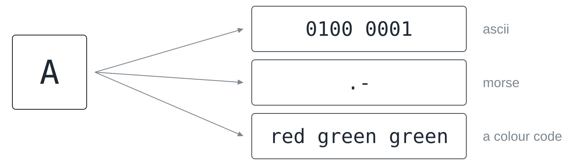
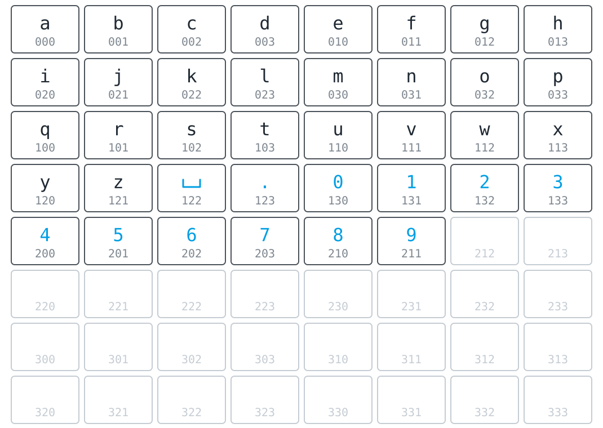
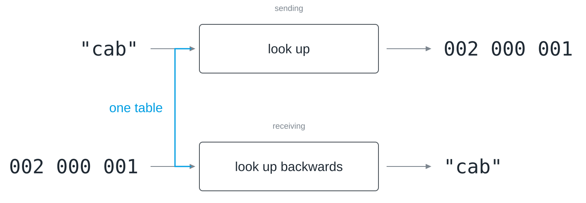
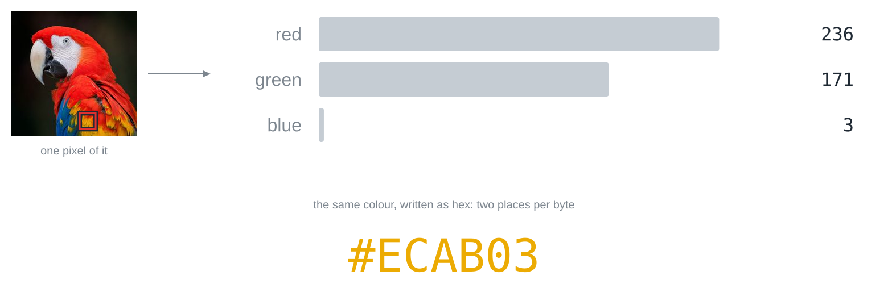
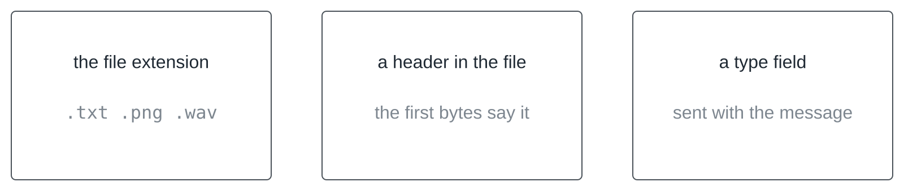
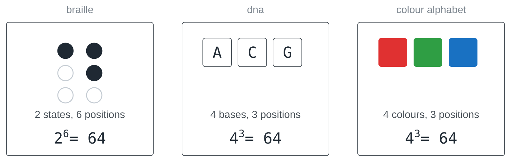

There is a slab of granite in the British Museum, carved in 196 BC, that says
the same thing three times: once in hieroglyphs, once in demotic script, once
in Greek. For fourteen centuries nobody could read the top third of it, and
not because the signs were lost, since they had been lying there in plain
sight the whole time, but because the agreement was lost: which sign means
what. When Champollion finally worked it out in the 1820s, he did not
decipher the stone so much as recover a table, one that had existed in
people's heads two thousand years earlier and had then quietly gone out of
use. That is the subject of this lesson, and it is worth holding on to before
we get to bytes: the marks are not the message, the agreement is. The running
example is a link that sends colours instead of letters, as in
[[symbols-and-information]].

## The agreement is everything

### What a code system is

A **code system** maps characters to sequences of symbols, and both sides
have agreed on that mapping. That is the entire definition. So that it does
not hang in the air, here is a real table: **ASCII**, the oldest of these
agreements still in daily use. Capital A is 65, B is 66, lower-case a is 97,
and each of these numbers fits in one byte.


Two details repay a second look. The 65 is not A's position in the alphabet:
the first 32 slots of the table are reserved for control characters, which is
why the letters start so late. And lower-case a is 97, a completely different
number and not a variant of the same one, so that to the computer `A` and `a`
are two characters that only look related to us. The letter itself comes back
into existence only when a program takes the number 65, looks it up in the
same table and draws the shape; between keyboard and screen it does not exist
as a letter at all. Python looks up both directions of the table with `ord()`
and `chr()`:

```python
print(ord("A"), ord("B"), ord("a"))
print(chr(65), chr(97))
print(format(ord("A"), "08b"))
```

### The same letter, three code systems

If a code is a table, there can be several of them, and there are. The same
A is a sequence of eight bits in ASCII, a dot and a dash in Morse code, and
three colours in a row in an alphabet of colours.



Three things a code is not, because all three get confused with it in
everyday speech. It is not encryption: a code hides nothing and is published
on purpose so that both sides can use it. It is not compression: some codes
happen to be economical, but making things smaller is not what they are for.
And it is not source code, despite the name they share.

### When the table is too small

ASCII's 128 slots are enough for English and nothing else: no umlauts, no
euro sign, no Greek, no Chinese, no emoji.


The table was too small, so a bigger one was agreed, and two steps are worth
keeping apart here, because they are constantly confused. **Unicode** says
which *number* a character has, and it gives one to every character of every
writing system, well over 100,000 of them. **UTF-8** says how that number is
written down as *bytes*, and it does so with a varying length: characters that
come up all the time stay at one byte, rarer ones cost two, three or four.
That is the same instinct that made Morse give the letter E a single dot, and
it comes back further down, where it causes trouble. `ord()` gives the number
in Unicode, `encode()` the bytes of UTF-8:

```python
for ch in ["A", "ä", "€", "π"]:
    print(ch, ord(ch), ch.encode("utf-8"), len(ch.encode("utf-8")), "bytes")
```

### Two tables, one message

Now the failure that costs the most time once two people work on one link.
Suppose both typed up the code table separately, and in one copy the entries
for n and m ended up swapped, while everything else matches.


Nothing goes wrong in the technical sense. No exception is raised, no
checksum fails, no byte is corrupted: the receiver looks up every group of
bits, gets a valid answer every time and prints a word that looks exactly
like a word. You typed `norm` and `morn` came out, and the program has no way
of knowing. This runs against the instinct that computers complain when
something is wrong, since they complain when something breaks, and a wrong
agreement does not break anything: it is carried out correctly, and the result
is nonsense with a clean face. [[symbols-and-information]] calls this perfect
reception and perfect nonsense.

## Building a codebook

### How many positions per letter?

Suppose the link knows four colours and is to send the 26 letters. How long
does each sequence of colours have to be? The arithmetic is the one from
[[place-value-systems]]: with *k* symbols and *n* positions there are *k*ⁿ
code words.


Two positions are not enough for 26 letters, three are, and 26 letters with 3
colour positions leave 38 code words to spare.

### The codebook



The picture makes a point that the arithmetic hides: the table is much emptier
than it feels. The spare code words are stock for later, not waste. When you
decide halfway through that you want to send a space or a digit as well, the
slots are already there, and the length of nothing has to change. Which
colour sequence goes with which slot is entirely yours to decide: the slots
are what the arithmetic gives you, and the assignment is the agreement.

### The same table, both directions

Sending means looking a character up and getting a code word. Receiving means
the same table read the other way.



As long as no two characters share a code word, the reverse lookup is
unambiguous. In a program the table is a dictionary, and the one for
receiving is best derived from the one for sending in a single line instead
of being typed a second time, because two separately maintained tables are two
things that can drift apart, and you have just seen what drifting apart looks
like:

```python
code = {"a": "000", "b": "001", "c": "002"}
back = {word: letter for letter, word in code.items()}

sent = [code[ch] for ch in "cab"]
print(sent)
print("".join(back[word] for word in sent))
```

### What is not in the table

There is one more thing the table does not cover, and it shows up within
minutes of the first test: a character that is not in it. Someone types a
space, an umlaut, a digit.


Three answers are defensible: put the character in the table, strip it before
sending, or refuse with a clear message. Making no decision is not one of
them, because something happens to such a character either way, and then
chance decides or the program crashes in front of everyone. In the dictionary
above, `code[" "]` raises a `KeyError`, which is at least an honest crash.
And resist the comfortable thought that a space is nothing anyway: to the text
it is a character like any other, and a receiver cannot invent a gap that was
never sent.

## Where does a character end?

### A code that does not work

Here is a code that looks harmless and does not work. Agree that a is `0`, b
is `01` and c is `10`, type "a c" and send the sequence `010`.


Both readings follow the table, because the receiver cannot see where a
character ends. It sees a stream of bits with no gaps in it and does not know
whether the first `0` was already a whole character or the beginning of a
longer one. The problem is not that the code words have different lengths.
The problem is that the code word for a is the *beginning* of the code word
for b, so that nothing in the stream marks the boundary.

### Try it: the prefix trap

In the prefix trap you write the code words for a, b, c and d yourself, type
a word and see every reading the receiver could choose between. Get the list
down to one without giving every code word the same length, and then build a
code with as many readings as you can.


### Three ways out

There are three ways out, and none of them is the official one.


**Fixed length** is the simplest: every character has the same number of
positions, so the receiver counts instead of guessing. A **separator** is what
Morse code uses, in the form of pauses between letters. The third option is
the interesting one: if no code word is the start of another, the code is
called **prefix-free**, and it keeps variable lengths and can still be read
without ambiguity, because as soon as what has been read matches an entry, it
can only be that entry.

### What fixed length costs

So why would anyone want variable length at all, given the extra care it
needs?


Because fixed length gives no discount to the letters you send all the time.
Give the ten most common letters two positions and the rest four, and an
ordinary word gets shorter: `experiment` needs 26 positions instead of 30.
Variable length is shorter on average, but not for every word, since a word
made only of rare letters comes out longer. Follow that thought far enough and
you arrive at compression; for now the point is only that this is a choice,
and both answers cost something.

## The same bits, other meanings

### One byte sequence, three readings

Everything so far has been about text, but nothing in the argument was about
text, and here is the proof. Take eight consecutive bytes out of the middle of
a photograph.


Read as text, they are a capital M, a dollar sign, a capital E and five
characters no editor can show, which is exactly what you get when you open an
image file in a text editor by mistake. Read as grey values, they are eight
brightnesses, and read as audio samples, they are eight points on a wave. The
bytes do not say which reading is right, and they object to none of them.
Character salad on your screen is not a malfunction but a wrong agreement,
carried out correctly.

### One pixel, three numbers

Pictures, then, are the same idea as text with a different table. One pixel is
three numbers between 0 and 255, one for the red share, one for green and one
for blue.



The shares multiply rather than add, because every level of red can be
combined with every level of green and blue: 256 · 256 · 256 ≈ 16.7 million
colours, which is 24 bits per pixel. The notation `#ECAB03` is not a
different system, only a shorter way of writing the same three bytes with two
places each, as in [[place-value-systems|hexadecimal]]. An RGB LED mixes its colour from the same
three shares as a pixel on a screen, and a colour sensor measures it back in
the same three channels.

### Who says which reading?

If the bytes do not say which reading is right, something else has to.



The **file extension** is the weakest, because renaming a file changes nothing
inside it. A **header** at the start of the file is more reliable: a PNG, for
example, always begins with the same eight bytes. And a **type field** in a
message tells the receiver how to read the rest, so that it does not have to
guess. Which reading applies is one more agreement, and a protocol of your own
needs it as soon as it sends more than one kind of thing.

## Codes without computers

None of this needed electricity. A barcode turns bar widths into digits.
Sheet music turns position and shape into pitch and duration. Braille turns
six raised dots into a character, and Louis Braille designed it in 1825, at
sixteen. DNA turns three bases into an amino acid, and that table is the same
in almost every living thing on the planet, which makes it both the oldest
code system in this lesson and by far the most widely deployed. None of them
needs a computer, but every one of them needs an agreement, and two of them
are worth doing the arithmetic on.



Braille is a six-bit code you read with your fingertips: each dot is raised
or not, six dots, 2⁶ = 64 patterns. DNA has four bases and three positions per
amino acid, 4³ = 64, and the colour alphabet with four colours and three
positions has 4³ = 64 as well. The coincidence is not one: whenever a fixed
number of positions is combined with a fixed number of states per position,
it is the same calculation, whether the positions are fingertips, molecules
or flashes of light.

Which brings us back to the granite slab: write the table down once, for both
sides, and derive everything else from it.

## Takeaways

- A code system is an agreed table from characters to sequences of symbols;
  the bits carry no meaning of their own.
- ASCII gives the characters of English the numbers 0 to 127, Unicode gives
  every character of every script a number, and UTF-8 writes these numbers as
  one to four bytes.
- Two slightly different tables produce no error message but a wrong word, so
  the table exists once, and its reverse is derived from it.
- With *k* symbols and *n* positions there are *k*ⁿ code words; four colours
  need three positions for 26 letters, and 38 code words stay free.
- A character that is not in the table needs a decision: add it, drop it, or
  stop with a message.
- If one code word is the beginning of another, the receiver cannot find the
  boundaries; fixed length, a separator or a prefix-free code solve this.
- The same bytes are text, picture or sound, depending on the table, and an
  extension, a header or a type field says which one applies.


## Further reading

[[petzold-code]], chapters 1 to 3, builds a code from scratch, starting with a
torch signalling through a window, and arrives at Morse code and Braille
before a single byte appears.

Simon Singh: *The Code Book*. Fourth Estate, 1999. The chapter on Linear B and
the decipherment of ancient scripts tells the story of the Rosetta Stone at
length and shows what recovering a lost table actually takes.

Joel Spolsky: "The Absolute Minimum Every Software Developer Absolutely,
Positively Must Know About Unicode and Character Sets (No Excuses!)", 2003,
<https://www.joelonsoftware.com/2003/10/08/the-absolute-minimum-every-software-developer-absolutely-positively-must-know-about-unicode-and-character-sets-no-excuses/>.
Twenty years old and still the clearest short explanation of why text arrives
broken.
