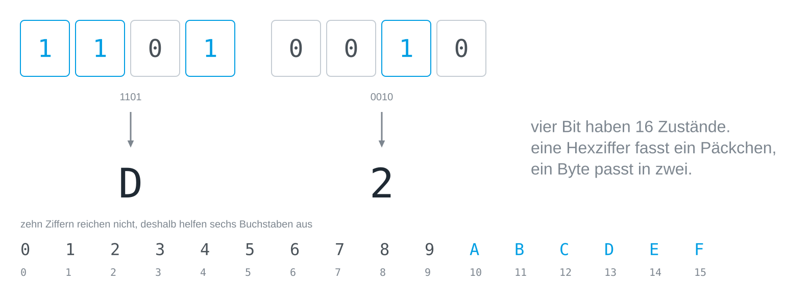
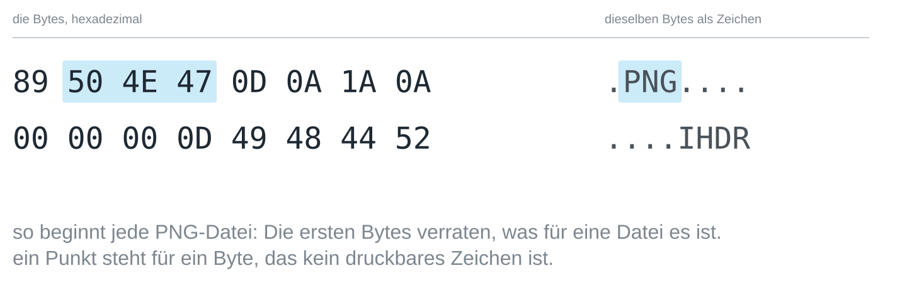

## Worum es geht

Acht Nullen und Einsen kann niemand auf einen Blick lesen. Hexadezimal ist die
Kurzschrift dafür, und es ist keine neue Zahlenwelt, sondern dieselbe
[[place-value-systems|Stellenwert-Bauanleitung]] zur Basis 16.

## Vier Bit, eine Ziffer

Der Grund für die Sechzehn liegt im [[byte]]. Vier Bit haben 2⁴ = 16 Zustände,
genau so viele, wie es Hexziffern gibt; eine Hexziffer deckt also ein Päckchen
aus vier Bit ab, und ein ganzes Byte passt in zwei Ziffern. Weil unsere zehn
Ziffern nicht für sechzehn Werte reichen, helfen sechs Buchstaben aus: A steht
für 10, B für 11 und so weiter bis F für 15.



Ein Päckchen aus vier Bit heißt manchmal *Nibble*, ein halbes Byte. Zwischen
binär und hexadezimal umzurechnen braucht deshalb keine Rechnung, nur die
Tabelle der sechzehn Päckchen: `1101 0010` ist `D2`, weil 1101 die 13 ist und
0010 die 2.

## Hexzahlen lesen

Als Zahl ist eine Hexziffer ihren Wert mal ihren Stellenwert wert, und die
Stellen sind 1, 16, 256 und so weiter wert. `FF` ist 15 · 16 + 15 = 255, das
volle Byte, und `AC` ist 10 · 16 + 12 = 172, was sich leichter liest als
`10101100`. Wo die Basis nicht aus dem Zusammenhang klar ist, werden Hexzahlen
gekennzeichnet, meist mit `0x` davor, wie in `0xAC`.

Auch Python liest und schreibt hexadezimal. `hex()` schreibt eine Zahl zur
Basis 16:

```python
print(hex(172))
```

Und `int()` liest sie zurück:

```python
print(int("AC", 16))
```

## Farben in Hex

Die Farbangaben von Webseiten sind hexadezimal: `#AC8909` sind drei Bytes zu je
zwei Ziffern, ein Byte je Farbkanal. Rot ist `AC` = 172, Grün `89` = 137 und
Blau `09` = 9, ein dunkles Ocker. `#FF0000` ist reines Rot, mit dem roten Kanal
am Anschlag und den anderen auf null.

## Eine Datei, zweimal

Ein Hex-Dump zeigt die Bytes einer Datei hexadezimal und daneben dieselben
Bytes als Zeichen, mit einem Punkt überall dort, wo ein Byte kein druckbares
Zeichen ist. Das sind die ersten sechzehn Bytes jedes PNG-Bildes:



Zwei Dinge fallen auf. Die ersten Bytes verraten, was für eine Datei es ist,
denn jede PNG-Datei beginnt mit denselben acht Bytes, und andere Formate haben
ihre eigenen Kennungen. Und zwischen den lesbaren Stellen stehen genauso viele
unlesbare, die aus demselben Stoff sind: Eine Datei ist nichts als eine Folge
von Zahlen, und erst das Programm, das sie liest, entscheidet, was sie
bedeuten.

> [!TIP]
> Jeder Programmiereditor kann eine Datei als Hex-Dump zeigen, und auf der
> Kommandozeile leisten `xxd` (Linux, macOS) oder `Format-Hex` (Windows
> PowerShell) dasselbe. Sieh dir die ersten Bytes eines PDFs, eines JPEGs und
> einer Textdatei an.
