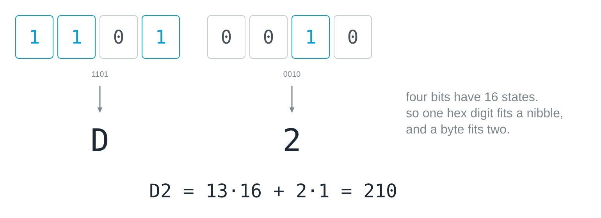
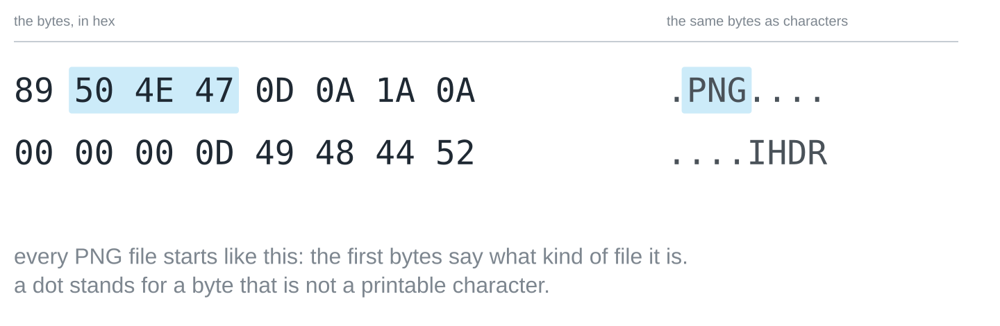

## What this is about

Nobody reads eight zeroes and ones at a glance. Hexadecimal is the shorthand
for them, and it is not a new number world but the same
[[place-value-systems|place value recipe]] with base 16.

## Four bits, one digit

The reason for sixteen lies in the [[byte]]. Four bits have 2⁴ = 16 states,
which is exactly the number of hex digits, so one hex digit covers a packet of
four bits, and a whole byte fits into two digits. Since our ten digits do not
stretch to sixteen values, six letters help out: A stands for 10, B for 11,
and so on up to F for 15.



A packet of four bits is sometimes called a *nibble*, half a byte. Converting
between binary and hex therefore needs no arithmetic at all, only the table of
sixteen packets: `1101 0010` is `D2`, because 1101 is 13 and 0010 is 2.

## Reading hex numbers

As a number, a hex digit is worth its value times its place value, and the
places are worth 1, 16, 256 and so on. `FF` is 15 · 16 + 15 = 255, the full
byte, and `AC` is 10 · 16 + 12 = 172, which is easier on the eye than
`10101100`. Where the base is not clear from the context, hex numbers are
marked, usually with `0x` in front, as in `0xAC`.

Python reads and writes hex as well. `hex()` writes a number in base 16:

```python
print(hex(172))
```

And `int()` reads it back:

```python
print(int("AC", 16))
```

## Colours in hex

The colour notation of web pages is hex: `#AC8909` is three bytes, two digits
each, one byte per colour channel. Red is `AC` = 172, green `89` = 137 and
blue `09` = 9, a dark ochre. `#FF0000` is pure red, with the red channel at its
maximum and the others at zero.

## A file, twice

A hex dump shows the bytes of a file in hex, and next to them the same bytes as
characters, with a dot wherever a byte is not a printable character. These are
the first sixteen bytes of every PNG image:



Two things stand out. The first few bytes give away what kind of file it is,
because every PNG file starts with the same eight bytes, and other formats have
signatures of their own. And between the readable positions there are just as
many unreadable ones, which are the same stuff: a file is nothing but a
sequence of numbers, and only the program that reads it decides what they
mean.

> [!TIP]
> Every programming editor can show a file as a hex dump, and on the command
> line `xxd` (Linux, macOS) or `Format-Hex` (Windows PowerShell) does the
> same. Look at the first bytes of a PDF, a JPEG and a text file.
