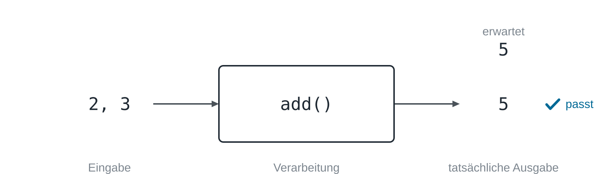
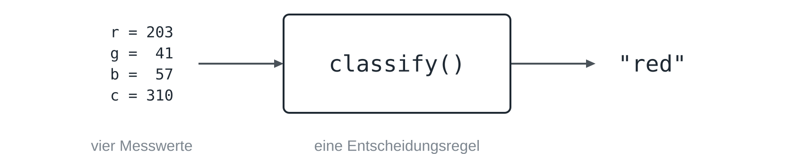
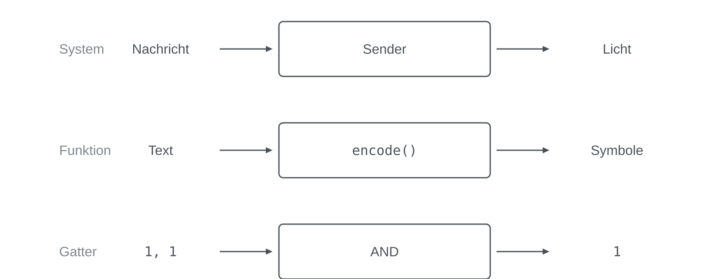
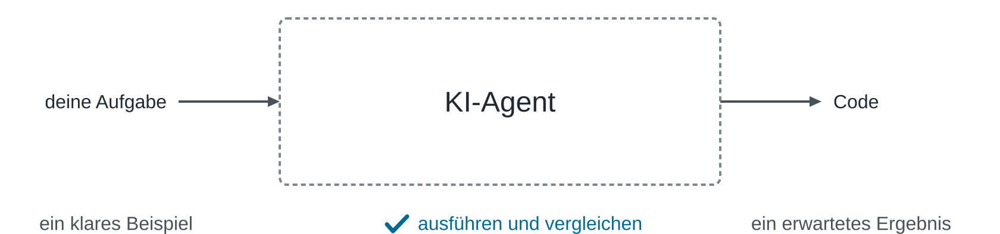

Denk an das Bestellterminal in einem Schnellrestaurant. Du tippst ein paar
Bilder an und bezahlst, und wenig später steht ein Tablett bereit, während
die Küche dazwischen unsichtbar bleibt. Du musst sie nicht sehen, denn du
weißt, was du hineingibst und was herauskommen soll, und liegt das falsche
Essen auf dem Tablett, weißt du auch, dass zwischen diesen beiden Rändern
etwas schiefgegangen ist. Die [[programming-principles|Grundideen des
Programmierens]] haben diese Form am Pfandautomaten als Eingabe,
Verarbeitung und Ausgabe vorgestellt. Diese Lektion setzt sie ein, denn klare
Ränder erlauben dir, ein Stück eines Problems zu prüfen, Stücke miteinander
zu verbinden und das Stück zu finden, das versagt.

## Ein Kasten, den du prüfen kannst

Angenommen, ein kleines Stück Code namens `add()` soll 2 und 3 addieren. Die
beiden Zahlen sind die **Eingabe**, die Arbeit in `add()` ist die
**Verarbeitung**, und das Ergebnis ist die **Ausgabe**; zusammen heißt diese
Form das **EVA-Modell**, nach den englischen Wörtern input, processing und
output auch **IPO**. Noch bevor der Code läuft, kannst du sagen, was
herauskommen soll, nämlich 5, und damit ist ein Test geschrieben: Eingabe
hineingeben, Verarbeitung laufen lassen und die tatsächliche Ausgabe mit der
erwarteten vergleichen.



Im Code ist ein solcher Test ein einziger Vergleich:

```python static
def add(a, b):
    return a + b

print(add(2, 3) == 5)
```

Stünde in `add()` versehentlich `a * b`, käme 6 heraus und der Test fiele
durch. Um das zu entscheiden, musst du keine einzige Zeile in `add()` lesen,
denn die Ränder des Kastens genügen. Deshalb müssen die Stücke, in die du
[[problem-decomposition|ein Problem zerlegst]], prüfbar sein: Ein Kasten mit
unscharfen Rändern ist schwer zu lösen und unmöglich zu prüfen, während ein
Kasten mit einer konkreten Eingabe und einer erwarteten Ausgabe genau sagt,
was fertig heißt.

Die Erwartung muss vor dem Ergebnis feststehen. Wer `add(2, 3)` aufruft und
nur ansieht, was herauskommt, nickt fast alles ab, und wer nur prüft, dass
keine Fehlermeldung erscheint, erfährt, dass der Computer den Code ausführen
konnte, aber nicht, dass er richtig gerechnet hat. In der Übung
[[input-processing-output]] lässt du diesen Test selbst laufen und bringst
ihn zum Scheitern.

## Was der Kasten wirklich bekommt

Halt eine rote Lampe vor einen Farbsensor. Deine Augen sehen Rot, der
Computer nicht. Ein gängiger Farbsensor hat vier Messkanäle, einen, der vor
allem auf rotes Licht anspricht, einen für Grün, einen für Blau und einen für
die Gesamthelligkeit, und für eine einzelne Messung liefert er vielleicht
203, 41, 57 und 310. Diese vier Zahlen sind alles, was das Programm bekommt.



Die Eingabe des Kastens sind also vier Zahlen und keine Farbe, während das
Wort `red` seine Ausgabe ist. Dazwischen liegt eine Regel, die entscheidet,
zum Beispiel: Ist das Licht zu schwach, gilt die Lampe als aus, und sonst
gewinnt der stärkste der drei Farbkanäle. Mit dem Rot, das du siehst, kann
ein Computer nicht arbeiten, weil er eine Darstellung braucht, die er
verarbeiten kann, und auch die Zahlen tragen die Entscheidung nicht von
selbst, denn die Regel kommt aus dem Programm. In Python sieht diese Regel so
aus:

```python static
def classify(r, g, b, c):
    if c < 100:
        return "off"
    strongest = max(r, g, b)
    if strongest == r:
        return "red"
    if strongest == g:
        return "green"
    return "blue"
```

Eine Regel kann zu vielen Messungen passen und an einer einzigen scheitern.
Steht die rote Lampe weiter vom Sensor entfernt, misst er vielleicht 60, 14,
19 und 95; die Helligkeit liegt dann unter der Schwelle von 100, und die
Regel erklärt die Lampe für aus. Keine Zeile ist kaputt, aber Regel und
Wirklichkeit passen nicht zusammen, und erst ein Test mit dieser Messung und
der erwarteten Ausgabe `red` deckt das auf. Senkst du die Schwelle, besteht
der Test, obwohl sich kein Messwert geändert hat, denn Eingabe und Regel
entscheiden gemeinsam, was herauskommt.

## Kästen in einer Reihe

Die meisten Systeme sind Ketten solcher Kästen, in denen die Ausgabe des
einen zur Eingabe des nächsten wird. Eine Strecke, die Text mit Licht
überträgt, wie im Projekt [[lifi]], ist eine solche Kette: Der Sender macht
mit `encode()` aus dem Text `"hi"` eine Folge von Farben, das Licht trägt die
Farben hinüber, und der Empfänger macht mit `decode()` wieder `"hi"` daraus.


Kästen passen nur zusammen, wenn ihre Ränder übereinstimmen. Verwendet der
Sender Blau für den Buchstaben `a`, liest der Empfänger Blau aber als `b`,
können beide Kästen genau so arbeiten, wie sie geschrieben sind, und das
ganze System versagt trotzdem; jede Grenze braucht deshalb eine Vereinbarung
über Form und Bedeutung der Daten.

Die Kette sagt dir auch, wie du suchst, wenn etwas schiefgeht. Kommt am Ende
nicht `"hi"` an, hilft es wenig, auf das ganze System zu starren, und es ist
besser, den Daten zu folgen und eine Grenze nach der anderen zu prüfen: ob
`encode()` die richtigen Farben erzeugt hat, ob die Lampe sie gezeigt hat, ob
der Sensor plausible Zahlen geliefert hat und ob `decode()` aus diesen Zahlen
den richtigen Text gemacht hat. Die erste Grenze, an der die Daten falsch
sind, sagt dir, welchen Kasten du öffnen musst.

## Kästen in Kästen

Von außen kann der ganze Sender ein einziger Kasten sein: Eine Nachricht
geht hinein, Licht kommt heraus, und `send()` ist der Name für die gesamte
Verarbeitung darin. Hat dieser Kasten die richtige Größe für deine Frage,
hörst du dort auf. Schlägt ein Test fehl und du musst wissen, warum, öffnest
du den Kasten und findest eine Kette kleinerer: einen, der den Text kodiert,
einen, der die nächste Farbe wählt, und einen, der die Lampe schaltet, jeder
mit eigener Eingabe, Verarbeitung, Ausgabe und eigenem Test, und jeden davon
kannst du wieder öffnen.



Die Form übersteht jede Ebene. Ein ganzes System, eine einzelne Funktion und
ein einzelnes [[logic-gates|Logikgatter]], das zwei Bits nimmt und eines
zurückgibt, haben alle eine Eingabe, eine feste Verarbeitung und eine
Ausgabe; ihre Größe ändert sich, ihre Form bleibt dieselbe.

Zwei Arten von Beziehung zwischen Kästen solltest du auseinanderhalten.
Kästen in einer Reihe zeigen, wohin die Daten als Nächstes gehen, was man
**Datenfluss** nennt, während Kästen in einem Kasten zeigen, welche kleinere
Arbeit darin geschieht, was eine **Hierarchie** ergibt, die Zerlegung eines
Kastens in seine Teile.


Keine Ebene passt für jede Frage. Die richtige ist die, auf der deine
aktuelle Frage eine klare Eingabe und eine erwartete Ausgabe hat, und kannst
du für einen Kasten keinen Test schreiben, sind seine Ränder noch unscharf
oder der Kasten ist noch zu groß.

## Zwei Fragen in jedem Kasten

Sind die Ränder klar, hinterlässt jeder Kasten zwei Fragen. Die erste fragt,
wie der Kasten seine Arbeit verrichtet, und ihre Antwort ist ein Programm,
ein Algorithmus, der so aufgeschrieben ist, dass ein Computer ihn ausführen
kann; dieser Frage folgt [[algorithms-and-programs]]. Die zweite fragt, wie
das, was die Ränder überquert, aufgeschrieben ist, damit eine Maschine damit
arbeiten kann. Der Sensor hat sichtbares Licht in vier Zahlen verwandelt,
und andere Antworten machen aus Zahlen, Buchstaben, Bildern und Dateien
Bits, wie [[place-value-systems]] und [[binary-numbers]] zeigen.


## Auch ein schwarzer Kasten braucht einen Test

Ein KI-Agent passt in dasselbe Bild, denn du gibst ihm eine Aufgabe und
bekommst Code. Was darin geschieht, ist viel schwerer einzusehen als bei
`add()`, und umso wichtiger sind klare Ränder: Gib ihm ein konkretes Beispiel
als Eingabe, schreib das Ergebnis auf, das du erwartest, und lass dann den
Code laufen, den du bekommen hast, und vergleiche.



Mit einem Test musst du einem Kasten, in den du nicht hineinsehen kannst,
nicht vertrauen. Im Restaurant ist es genauso, denn du musstest die Küche
nicht sehen, um dein Tablett zu prüfen, aber sobald das Tablett falsch ist,
reicht der große Kasten nicht mehr, und du verfolgst die Bestellung von
Station zu Station.

## Zum Mitnehmen

- Jedes Stück eines Problems, das ein Computer lösen kann, hat eine Eingabe,
  eine Verarbeitung und eine Ausgabe.
- Eine bekannte Eingabe mit einer erwarteten Ausgabe ist ein Test, der ohne
  Blick in den Kasten auskommt; die Erwartung steht vor dem Ergebnis.
- Ein Computer bekommt nie, was du siehst, sondern eine Darstellung, etwa
  vier Messwerte, und das Programm liefert die Regel, die daraus eine
  Entscheidung macht.
- Kästen in einer Reihe zeigen den Datenfluss und brauchen an jeder Grenze
  eine Vereinbarung; Kästen in einem Kasten zeigen die Hierarchie, und die
  richtige Ebene ist die, die du prüfen kannst.
- Jeder Kasten stellt zwei Fragen: wie er arbeitet, was ein Programm
  beantwortet, und wie seine Eingaben und Ausgaben dargestellt sind.
