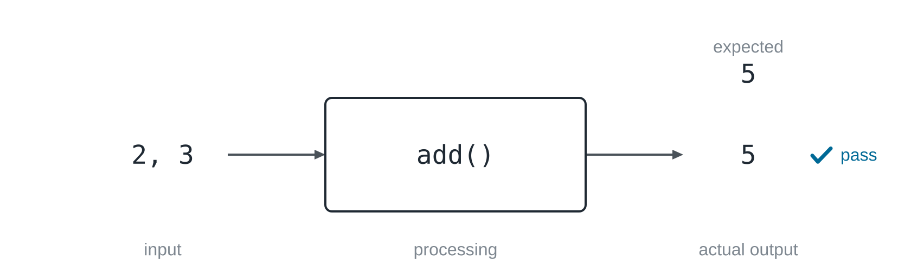
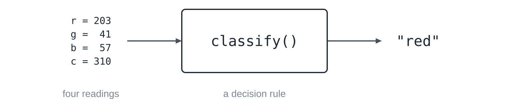
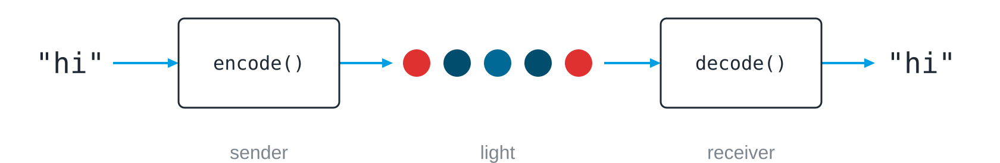
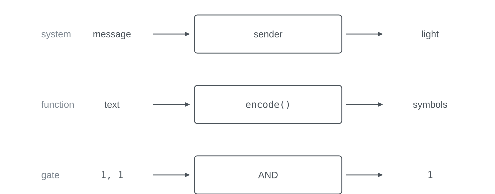
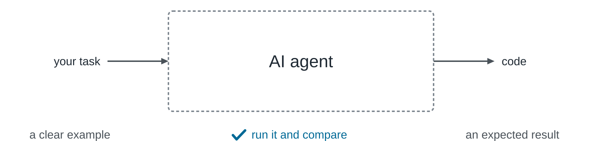

Think of the self-service terminal in a fast-food restaurant. You tap a few
pictures and pay, and a little later a tray appears, while the kitchen in
between stays out of sight. You do not need to see it, because you know what
you put in and what should come out, and if the tray holds the wrong meal,
you also know that something between those two edges went wrong. The
[[programming-principles|basic ideas of programming]] introduced this shape
with a bottle deposit machine as input, processing and output. This lesson
puts it to work, since clear edges let you test a piece of a problem,
connect pieces with each other and find the piece that fails.

## A box you can test

Suppose a small piece of code called `add()` is to add 2 and 3. The two
numbers are the **input**, the work inside `add()` is the **processing**,
and the result is the **output**; together this shape is called the **IPO
model**. Before the code runs, you can already say what should come out,
namely 5, and with that a test is written: put in the input, run the
processing and compare the actual output with the expected one.



In code, such a test is a single comparison:

```python static
def add(a, b):
    return a + b

print(add(2, 3) == 5)
```

If `add()` said `a * b` by mistake, 6 would come out and the test would
fail. You would not need to read a single line inside `add()` to decide
that, since the edges of the box are enough. This is why the pieces into
which you [[problem-decomposition|cut a problem]] have to be testable: a box
with vague edges is hard to solve and impossible to check, while a box with
a concrete input and an expected output says exactly what done means.

The expectation has to come before the result. Whoever calls `add(2, 3)` and
only looks at what comes out will nod at almost anything, and whoever only
checks that no error message appears learns that the computer could carry
out the code, not that it computed the right thing. In the exercise here
you run this test yourself and make it fail.


## What the box really receives

Hold a red lamp in front of a colour sensor. Your eyes see red, but the
computer does not. A common colour sensor has four measuring channels, one
that responds mostly to red light, one to green, one to blue and one to the
overall brightness, and for a single reading it might return 203, 41, 57 and
310. Those four numbers are all the program receives.



The input of the box is therefore four numbers and not a colour, while the
word `red` is its output. In between lies a rule that decides, for example:
if the light is too weak, the lamp counts as off, and otherwise the
strongest of the three colour channels wins. A computer cannot work with the
red you see, because it needs a representation it can process, and the
numbers do not carry the decision by themselves either, since the rule comes
from the program. In Python, this rule looks like this:

```python static
def classify(r, g, b, c):
    if c < 100:
        return "off"
    strongest = max(r, g, b)
    if strongest == r:
        return "red"
    if strongest == g:
        return "green"
    return "blue"
```

A rule can fit many readings and fail on a single one. If the red lamp is
further away from the sensor, it might measure 60, 14, 19 and 95; the
brightness then lies below the threshold of 100, and the rule calls the lamp
off. No line is broken, but the rule and reality disagree, and only a test
with this reading and the expected output `red` reveals it. Lower the
threshold and the test passes, although no reading has changed, because the
input and the rule together decide what comes out.

## Boxes in a row

Most systems are chains of such boxes, in which the output of one becomes
the input of the next. A link that sends text with light, as in the
[[lifi]] project, is such a chain: the sender turns the text `"hi"` into a
sequence of colours with `encode()`, the light carries the colours across,
and the receiver turns them back into `"hi"` with `decode()`.



Boxes connect only when their edges agree. If the sender uses blue for the
letter `a` but the receiver reads blue as `b`, both boxes may work exactly as
written and the whole system still fails, so every boundary needs an
agreement about the form and the meaning of the data.

The chain also tells you how to search when something goes wrong. If `"hi"`
does not arrive at the end, staring at the whole system helps little, and it
is better to follow the data and test one boundary after the other: whether
`encode()` produced the right colours, whether the lamp showed them, whether
the sensor delivered plausible numbers and whether `decode()` turned those
numbers into the right text. The first boundary at which the data are wrong
tells you which box to open.

## Boxes inside boxes

From the outside, the whole sender can be one box: a message goes in, light
comes out, and `send()` is the name for all the processing inside. If that
is the right size for your question, you stop there. If a test fails and you
need to know why, you open the box and find a chain of smaller ones, one
that encodes the text, one that chooses the next colour and one that
switches the lamp, each with its own input, processing, output and test, and
each of them can be opened again.



The shape survives on every level. A whole system, a single function and a
single [[logic-gates|logic gate]], which takes two bits and returns one, all
have an input, a fixed processing and an output, so their size changes while
their shape stays the same.

Two kinds of relationship between boxes are worth keeping apart. Boxes in a
row show where the data go next, which is called **data flow**, whereas
boxes inside a box show what smaller work happens inside, which forms a
**hierarchy**, the decomposition of a box into its parts.


No level is right for every question. The right one is the level at which
your current question has a clear input and an expected output, and if you
cannot write a test for a box, its edges are still vague or the box is still
too large.

## Two questions in every box

Once the edges are clear, every box leaves two questions. The first asks how
the box does its work, and its answer is a program, an algorithm written
down so that a computer can carry it out; [[algorithms-and-programs]]
follows this question. The second asks how what crosses the edges is written
so that a machine can work with it. The sensor turned visible light into
four numbers, and other answers turn numbers, letters, pictures and files
into bits, as [[place-value-systems]] shows.


## A black box still needs a test

An AI agent fits the same picture, since you give it a task and receive
code. What happens inside is much harder to inspect than `add()`, which
makes clear edges matter all the more: give it a concrete example as input,
write down the result you expect, and then run the code you received and
compare.



With a test you do not have to trust a box you cannot look into. The
restaurant works the same way, because you did not need to see the kitchen
to check your tray, but once the tray is wrong, the big box is no longer
enough, and you follow the order from station to station.

## Takeaways

- Every piece of a problem that a computer can solve has an input, a
  processing and an output.
- A known input with an expected output is a test, which works without
  looking inside the box; the expectation comes before the result.
- A computer never receives what you see but a representation, such as four
  readings, and the program supplies the rule that turns it into a decision.
- Boxes in a row show data flow and need an agreement at every boundary;
  boxes inside a box show a hierarchy, and the right level is the one you
  can test.
- Every box raises two questions: how it works, which a program answers, and
  how its inputs and outputs are represented.


