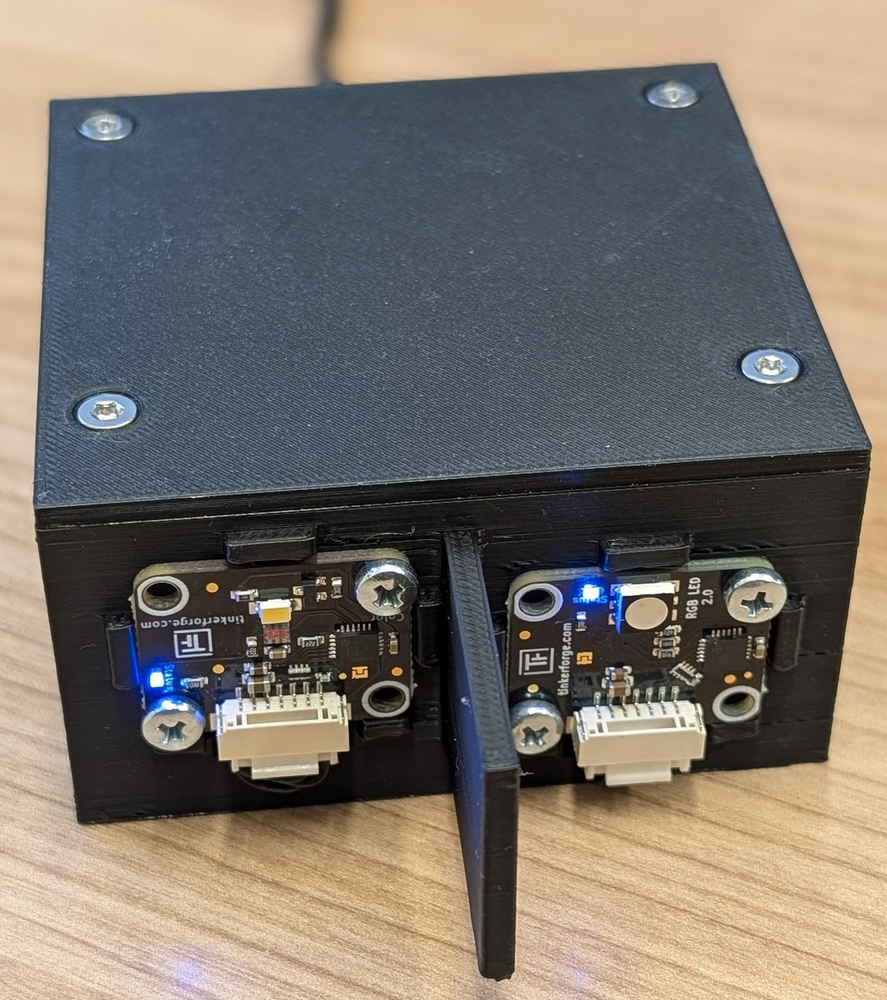
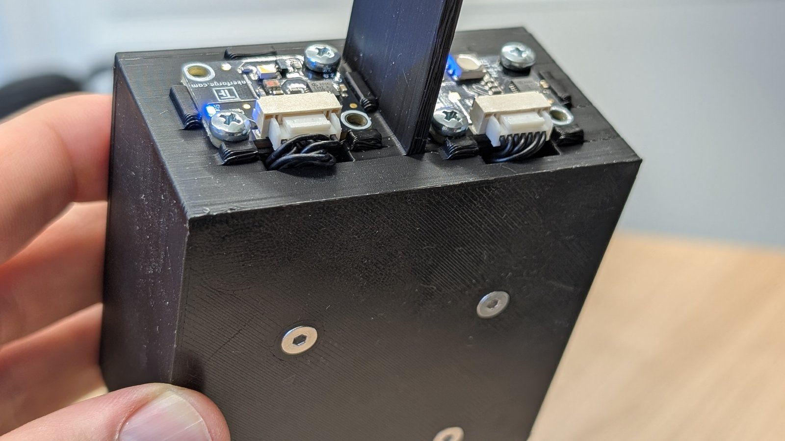
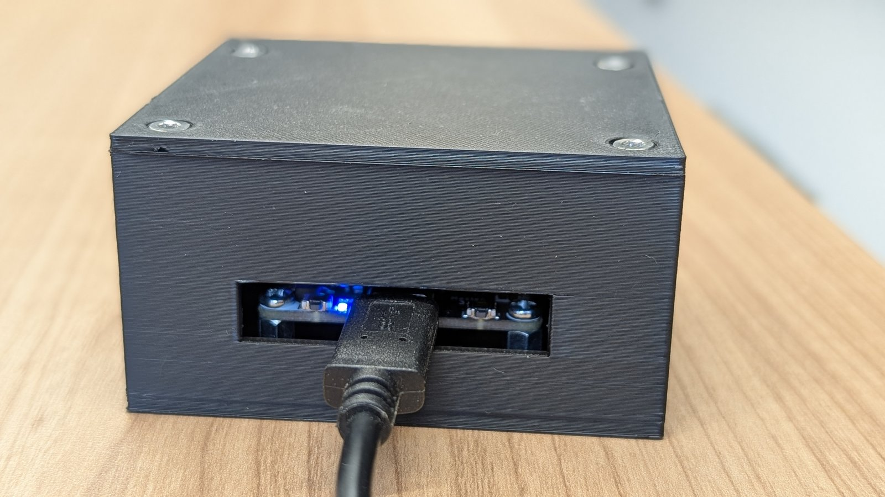

Euer Gerät besteht aus drei Teilen in einem Gehäuse aus dem 3D-Drucker:

- einem **RGB LED Bricklet 2.0**, der Lampe, die sendet,
- einem **Color Bricklet 2.0**, dem Auge, das empfängt,
- einem **Master Brick**, der kleinen Steuerplatine, die beide über USB mit
  eurem Laptop verbindet.

Alle drei stammen von Tinkerforge, einem deutschen Hersteller modularer
Elektronik. Die beiden kleinen Platinen, die Bricklets, sitzen vorn am Gehäuse,
der Master Brick steckt darin.

Die beiden Geräte eines Teams stehen sich auf dem Tisch gegenüber. Weil Lampe
und Auge symmetrisch zur Mitte der Vorderseite sitzen, steht nach dem Umdrehen
eines Geräts seine Lampe vor dem Auge des anderen und sein Auge vor dessen
Lampe. Eine kurze Wand zwischen beiden, das Septum, hält das eigene Licht vom
eigenen Auge fern.



Daraus folgt etwas, das ihr erst spät im Projekt braucht: Weil jedes Gerät
senden **und** empfangen kann, funktioniert die Strecke in beide Richtungen.
Bis einschließlich [[lifi-challenge-3]] nutzt ihr trotzdem nur eine Richtung,
den Rückweg öffnet erst [[lifi-challenge-4]].

## Die LED

Was wie eine Lampe aussieht, sind in Wahrheit drei, eine rote, eine grüne und
eine blaue, so dicht beieinander, dass euer Auge sie nicht trennen kann. Jeder
der drei sagt ihr, wie hell sie leuchten soll, als Zahl von 0 (aus) bis 255
(volle Helligkeit), und weil sie so dicht sitzen, seht ihr keine drei Lichter,
sondern eine gemischte Farbe.

Drei Zahlen also, und jede Kombination, die ihr auf der anderen Seite sicher
wiedererkennt, ist ein Zeichen, das ihr senden könnt. Rot mit voller
Helligkeit und die anderen beiden aus ergibt Rot, alle drei voll ergeben Weiß,
alle drei auf null ist dunkel. Rot voll mit etwas Blau ist eine Farbe ohne
Namen im Alltag, und sie ist ein ebenso gutes Zeichen wie die anderen, solange
das Auge gegenüber sie von ihren Nachbarn unterscheiden kann.

Wie schnell die LED von einer Farbe zur nächsten wechselt und was der Sensor
während des Wechsels sieht, steht in keinem Datenblatt, dem ihr trauen solltet.
Es gehört zu den ersten Dingen, die sich zu messen lohnen.

## Der Farbsensor

**Was er misst.** Vor dem Sensor sitzen winzige Farbfilter, einer lässt vor
allem rotes Licht durch, einer vor allem grünes, einer vor allem blaues, und
hinter jedem Filter wird das durchkommende Licht gezählt. So bekommt ihr drei
Zahlen, die sagen, wie viel Rot, Grün und Blau gerade auf den Sensor fällt. Auf
das „vor allem“ kommt es an: Die Filter trennen nicht sauber, etwas grünes
Licht kommt auch durch den roten Filter. Deshalb ergibt rotes Licht nicht eine
hohe Zahl und zwei Nullen, sondern drei Werte über null in anderem Verhältnis.

**Vier Kanäle, nicht drei.** Neben den drei Farbwerten gibt es einen vierten,
den **Klarkanal** (C). Er sitzt hinter keinem Filter und zählt einfach alles
Licht. Das macht ihn empfindlicher als die anderen drei und oft zum nützlichsten
der vier, wenn ihr nur Helligkeiten unterscheiden wollt. Jeder Messwert sind
also vier Zahlen, Rot, Grün, Blau und Klar; behaltet die vierte im Blick, denn
viele Teams übersehen sie und verschenken Signal.

**Die Lampe auf der Sensorplatine.** Die Platine trägt eine eigene kleine
weiße Lampe. Sie ist dafür gedacht, die Farbe von Oberflächen zu messen, die
man dazu erst beleuchten muss. Für euer Gerät ist sie nur eine Quelle von
Streulicht, also bleibt sie aus.

**Integrationszeit und Verstärkung.** Der Sensor hat zwei Einstellungen, und
sie sind der zentrale Tausch des ganzen Projekts. Die **Integrationszeit** ist,
wie lange der Sensor Licht sammelt, bevor er eine Zahl meldet; ihr wählt aus
fünf Werten zwischen etwa 2 und 700 Millisekunden. Eine lange Zeit gibt ruhige
Zahlen, weil sich zufälliges Flackern ausmittelt, aber auch weniger Messungen
pro Sekunde: Bei 700 Millisekunden bekommt ihr kaum mehr als eine Messung pro
Sekunde, und eure Symbole können nicht schneller kommen. Eine kurze Zeit gibt
viele Messungen, aber jede rauscht stärker. Die **Verstärkung** ist, wie stark
der Sensor das Gesammelte verstärkt, in vier Stufen von 1 bis 60. Eine hohe
Verstärkung macht ein schwaches Signal sichtbar, lässt die Zahlen aber auch
früher an die Obergrenze stoßen, und dann sehen hell und sehr hell gleich aus.

Ab Werk stellt das Kursmodul `lifi_hardware` eine mittellange Integrationszeit
und die Verstärkung 16 ein, ein sicherer Anfang und fast sicher nicht das, wo
ihr landet. Beide Einstellungen lassen sich mit Absicht leicht ändern, also
ändert sie und messt, was passiert; das Kursmodul beschreibt
[[lifi-software]].

**Die Zahlen kommen nicht so zurück, wie ihr sie gesendet habt.** Gebt ihr der
LED die Werte (255, 0, 60), meldet der Sensor etwas völlig anderes. Das ist kein
Fehler, denn seine Zahlen hängen nicht nur vom gesendeten Licht ab, sondern
auch vom Abstand, von der Helligkeit im Raum und davon, wie ihr Verstärkung und
Integrationszeit eingestellt habt. Zurückrechnen lässt sich das nicht. Wie ihr
trotzdem zuverlässig überträgt, ist das Thema von [[lifi-challenge-1]].

## Eure Optik

Zwischen den beiden Geräten dürft ihr selbst bauen, und das solltet ihr auch:
Röhren, Blenden, Reflektoren, Linsen. Ein guter Lichtkanal ist einer der
wirksamsten Hebel im ganzen Projekt.

**Erlaubt** ist alles Passive, also Röhren, Pappe, Farbe, Alufolie, Spiegel,
Linsen, Acrylstäbe, Klemmen, Ständer und Teile aus dem 3D-Drucker. **Nicht
erlaubt** sind zusätzliche Sensoren, zusätzliche Lichtquellen, Laser oder ein
Austausch von LED oder Farbsensor.

**Budget:** Bauen ist freiwillig, und wenn euer Team baut, darf das Material
höchstens 10 Euro kosten, die ihr selbst tragt, denn eine Erstattung gibt es
nicht. Haltet mit einem Foto und einer kurzen Erklärung fest, was ihr gebaut
habt und warum so.

**Der Abstand ist fest.** Der Abstand zwischen der Vorderseite der Lampe und
der Vorderseite des Auges ist vorgegeben und für alle gleich. Er ist so
gewählt, dass ein nacktes Gerät gerade so funktioniert und ein guter
Lichtkanal einen echten Unterschied macht.

**Bevor ihr etwas kauft,** messt, was euer Aufbau ohne Hilfsmittel schafft.
Nach unserer Erfahrung bringt eine mattschwarz gestrichene Innenwand mehr als
eine gekaufte Linse.

## Im Team und allein

Jede Person bekommt ein fertig montiertes Gerät, ein Team hat also beide Enden
der Strecke. Das ist mehr wert, als es klingt: Wer nur den Sender baut, muss
raten, was der Empfänger sieht, und ihr könnt nachsehen. Jede Person arbeitet
an ihrem eigenen Laptop mit ihrem eigenen Gerät; teilt die Arbeit nach den
beiden Enden auf und tauscht ab und zu die Rollen, damit ihr beide beide
Seiten kennt. Wenn eine Seite nicht funktioniert, liegt die Antwort meist auf
der anderen.

**Allein geht es auch.** Wer das Projekt ohne Partner angeht, schließt beide
Geräte an einen Laptop an und startet Sender und Empfänger als zwei Programme.
Jedes Programm sagt dann, welches Gerät es meint, mit der Kennung des Master
Bricks, die der Brick Viewer anzeigt:

```python static
from lifi_hardware import led, sensor, use_device

use_device("abc123")  # replace with the UID of your master brick
led.set_color(255, 0, 0)
```

Ihr verliert dabei den Partner, nicht das Projekt. Nur der Interop-Test in
[[lifi-challenge-3]] braucht ein anderes Team; wer allein ist, gibt seine
Protokollbeschreibung jemandem, der den Code nicht kennt, oder einem
KI-Assistenten in einer neuen Sitzung, und lässt sich den Empfänger
beschreiben, den er danach bauen würde. Die Lücken zeigen sich genauso.

## Das Gehäuse

Das Gehäuse wird in zwei Teilen gedruckt, der Wanne mit eingebauter
Frontwand und dem Deckel. Die Quelle ist eine parametrische OpenSCAD-Datei,
[lifi-device-case.scad](media/lifi-device-case.scad), freigegeben unter
[CC0](https://creativecommons.org/publicdomain/zero/1.0/deed.de): Ihr dürft sie
ohne jede Bedingung verwenden und ändern.

 

Zum Herunterladen und selbst Drucken: [Wanne (STL)](media/lifi-device-case-wanne.stl)
und [Deckel (STL)](media/lifi-device-case-deckel.stl).

**Stückliste.** Alles, was in ein Gerät gehört. Die Geräte kommen fertig
montiert; die Liste braucht ihr, wenn etwas ersetzt werden muss oder ihr ein
eigenes Gerät bauen wollt.

| Anzahl | Teil | Hinweis |
|---:|---|---|
| 1 | [Master Brick](https://www.tinkerforge.com/de/shop/master-brick.html) (Tinkerforge) | verbindet die Bricklets per USB-C mit dem Laptop; [Dokumentation](https://www.tinkerforge.com/de/doc/Hardware/Bricks/Master_Brick.html) |
| 1 | [RGB LED Bricklet 2.0](https://www.tinkerforge.com/de/shop/rgb-led-v2-bricklet.html) | der Sender; [Dokumentation](https://www.tinkerforge.com/de/doc/Hardware/Bricklets/RGB_LED_V2.html) |
| 1 | [Color Bricklet 2.0](https://www.tinkerforge.com/de/shop/color-v2-bricklet.html) | der Empfänger, misst Rot, Grün, Blau und Klar; [Dokumentation](https://www.tinkerforge.com/de/doc/Hardware/Bricklets/Color_V2.html) |
| 2 | [Bricklet-Kabel, 7-polig, 15 cm](https://www.tinkerforge.com/de/shop/accessories/cable/bricklet-cable-15cm-7p-7p.html) | Bricklets zum Master Brick |
| 1 | [USB-A-auf-USB-C-Kabel, 100 cm](https://shop.tinkerforge.com/de/accessories/cable/usb-a-to-usb-c-cable-100cm.html) (Tinkerforge) | Gerät zum Laptop; jedes andere USB-C-Datenkabel geht auch |
| 1 | [Befestigungskit 12 mm](https://www.tinkerforge.com/de/shop/accessories/mounting/mounting-kit-12mm.html) (Tinkerforge) | alle Kleinteile für Brick und Bricklets: vier Abstandshalter 10 mm (beidseitig Innengewinde) für den Master Brick, acht Schrauben M3 (vier für die Bricklets vorn, vier für den Brick auf den Abstandshaltern), acht Muttern und Unterlegscheiben |
| 4 | Schraube M3 × 8, Senkkopf, DIN 965 ([Suche](https://www.amazon.de/s?k=M3x8+Senkkopf+DIN+965)) | von unten durch den Boden in die Abstandshalter; Senkkopf, damit die Köpfe bündig in den Vertiefungen sitzen (die Linsenköpfe aus dem Kit stünden vor) |
| 4 | gewindeformende Schraube EJOT Delta PT WN 5454, Senkkopf 3,0 × 8, Torx ([DW Bendler, SW34172](https://dw-bendler.de/shop/public/FE-Schraube-EJOT-Delta-PT-WN5454-Senkkopf-3-0x8-Innensechsrund-Antrieb-verzinkt/SW34172)) | für den Deckel; dafür gemacht, ihr Gewinde in Kunststoff zu formen, keine Blechschrauben |
| 4 | selbstklebender Gummifuß, Ø 10 × 3 mm, schwarz ([Delock 18309 bei Reichelt](https://www.reichelt.com/de/de/shop/produkt/gummifuesse_rund_selbstklebend_10_x_3_mm_50_stk_schwarz-371081), Packung mit 50) | in die Vertiefungen auf der Unterseite |
| 2 | gedruckte Teile, Wanne und Deckel | STL-Dateien oben, schwarzes mattes Filament |

Die Tinkerforge-Links führen direkt in den Shop des Herstellers, die Links für
die Normteile sind Beispiele; jeder Werkzeug- oder Elektronikhandel führt sie.

**Drucken.** Druckt die Wanne mit der offenen Seite nach oben und den Deckel
flach. Empfohlen sind schwarzes, mattes Filament (PETG oder PLA), 0,2 mm
Schichthöhe und mindestens vier Perimeter, damit die Schraubdome massiv werden.
Nur das Septum, das vorn aus der Frontwand ragt, braucht Stützmaterial; innen
gibt es mit Absicht keine Hohlräume, die der Slicer stützen müsste.

**Zusammenbauen.**

1. Schraubt die vier Abstandshalter 10 mm aus dem Kit von unten durch den
   Boden fest (M3 × 8 Senkkopf, die Köpfe verschwinden in den Vertiefungen),
   dann den Master Brick von oben mit vier Kit-Schrauben auf die
   Abstandshalter.
2. Setzt die Bricklets für LED und Farbsensor von vorn in ihre Halterungen und
   befestigt jedes mit zwei Kit-Schrauben. Die Muttern aus dem Kit haltet ihr
   von innen dagegen, mit den Fingern oder einem kleinen Schlüssel; innen ist
   zu diesem Zeitpunkt noch alles offen.
3. Führt die Bricklet-Kabel durch die Schlitze unter den Halterungen zum
   Master Brick und steckt das USB-C-Kabel durch den Schlitz in der Rückwand
   ein.
4. Setzt den Deckel auf und befestigt ihn mit den vier gewindeformenden
   Schrauben. Beim allerersten Mal dreht ihr sie von Hand ein und nicht mit
   dem Akkuschrauber, denn sie schneiden sich dabei ihr Gewinde in die Dome.
5. Klebt die Gummifüße in die vier Vertiefungen auf der Unterseite.

 
