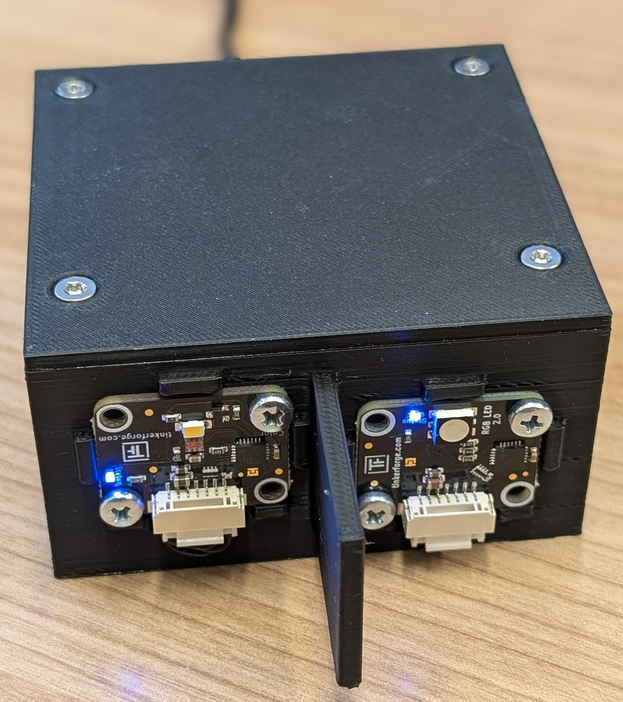
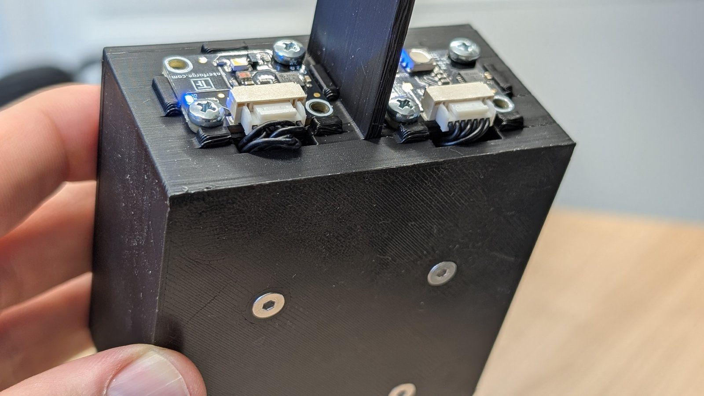
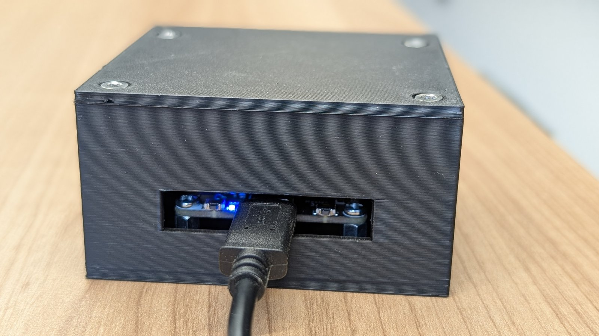

Your device is three parts in a 3D-printed case:

- an **RGB LED Bricklet 2.0**, the lamp that sends,
- a **Color Bricklet 2.0**, the eye that receives,
- a **Master Brick**, the small controller board that connects both to your
  laptop over USB.

All three come from Tinkerforge, a German maker of modular electronics. The
two small boards, the Bricklets, sit on the front of the case, the Master Brick
inside.

The two devices of a team stand on the table facing each other. Because lamp
and eye sit symmetrically to the middle of the front, turning one device
around puts its lamp in front of the other's eye, and its eye in front of the
other's lamp. A short wall between the two, the septum, keeps your own lamp out
of your own eye.



Something follows from this that you will only need late in the project:
since every device can send **and** receive, the link works in both
directions. Up to and including [[lifi-challenge-3]] you use only one direction
all the same; the way back is opened in [[lifi-challenge-4]].

## The LED

What looks like one lamp is really three, a red one, a green one and a blue
one, packed so closely together that your eye cannot separate them. You tell
each of the three how brightly to shine, as a number from 0 (off) to 255 (full
brightness), and because they sit so close, you do not see three lights but
one mixed colour.

Three numbers, then, and every combination you can reliably recognise on the
other side is a sign you can send. Red at full brightness with the other two
off gives you red, all three at full give you white, and all three at zero is
dark. Red at full with a little blue mixed in is a colour that has no everyday
name, and it is just as good a sign as the others, provided the eye across the
table can tell it from its neighbours.

How fast the LED can switch from one colour to the next, and what the sensor
sees during the switch, is not written in any datasheet you should trust. It is
one of the first things worth measuring.

## The colour sensor

**What it measures.** In front of the sensor sit tiny colour filters: one lets
through mostly red light, one mostly green, one mostly blue, and behind each
filter the light that gets through is counted. So you get three numbers that
say how much red, green and blue is falling on the sensor right now. The word
"mostly" matters, because the filters do not separate cleanly and some green
light gets through the red filter too. That is why red light does not give you
one high number and two zeros but three values above zero in different
proportions.

**Four channels, not three.** Next to the three colour values there is a
fourth, the **clear channel** (C). It sits behind no filter and simply counts
all the light, which makes it more sensitive than the other three and often the
most useful of the four when all you want to tell apart is brightness. Every
reading is therefore four numbers, red, green, blue and clear; keep the fourth
in view, since many teams ignore it and give away signal for nothing.

**The lamp on the sensor board.** The sensor board carries a small white lamp
of its own. It is meant for measuring the colour of surfaces, where you have to
light the object first. For your device it is a source of stray light and
nothing else, so leave it off.

**Integration time and gain.** The sensor has two settings, and they are the
central trade-off of the whole project. The **integration time** is how long
the sensor collects light before it reports a number; you choose between five
values from about 2 to 700 milliseconds. A long time gives calm, steady
numbers, because random flicker averages out, but also fewer readings per
second: at 700 milliseconds you get little more than one reading a second, and
your symbols cannot come faster than that. A short time gives many readings per
second, but each one is noisier. The **gain** is how strongly the sensor
amplifies what it collects, in four steps from 1 to 60. A high gain makes a weak
signal visible, but it also makes the numbers hit the top of their range sooner,
at which point bright and very bright look the same.

Out of the box the course module `lifi_hardware` sets a medium-long
integration time and a gain of 16, which is a safe place to start and almost
certainly not where you will end up. The two settings are deliberately easy to
change, so change them and measure what happens; the course module is
described in [[lifi-software]].

**The numbers do not come back the way you sent them.** When you give the LED
the values (255, 0, 60), the sensor reports something completely different.
That is not a bug: its numbers depend not only on the light that was sent but
also on how far away it is, how bright the room is, and how you have set gain
and integration time. There is no way to calculate backwards. How you transmit
reliably all the same is the subject of [[lifi-challenge-1]].

## Your optics

Between the two devices you may build things yourself, and you should: tubes,
apertures, reflectors, lenses. A good light channel is one of the most
effective levers in the whole project.

**Allowed** is anything passive: pipes, cardboard, paint, aluminium foil,
mirrors, lenses, acrylic rods, clamps, stands and 3D-printed parts. **Not
allowed** are additional sensors, additional light sources, lasers, or swapping
out the LED or the colour sensor.

**Budget:** building is optional, and if your team builds, the material may be
worth at most 10 euros, which you pay yourselves because there is no
reimbursement. Document what you built with a photo and a short explanation of
why you built it that way.

**The distance is fixed.** The distance between the front of the lamp and the
front of the eye is the same for everyone. It is chosen so that a bare device
just about works and a good light channel makes a real difference.

**Before you buy anything,** measure what your setup manages without any aids.
In our experience an inside wall painted matt black does more than a bought
lens.

## As a team and on your own

Each person gets a fully assembled device, so a team has both ends of the link.
That matters more than it sounds: whoever builds only the sender has to guess
what the receiver sees, and you can look. Each person works on their own
laptop with their own device; split the work by the two ends and swap roles
now and then, so that both of you know both sides. When one side does not
work, the answer is usually on the other.

**On your own works too.** If you take on the project without a partner,
connect both devices to one laptop and run the sender and the receiver as two
programs. Each program then says which device it means, by the UID of the
master brick, which the Brick Viewer shows:

```python static
from lifi_hardware import led, sensor, use_device

use_device("abc123")  # replace with the UID of your master brick
led.set_color(255, 0, 0)
```

You lose the partner, not the project. Only the interop test in
[[lifi-challenge-3]] needs another team; on your own, you hand your protocol
description to someone who does not know your code, or to an AI assistant in a
fresh session, and ask them to describe the receiver they would build. The gaps
show up just the same.

## The case

The case is 3D-printed in two parts, the tray with the front wall built in, and
the lid. The source is a parametric OpenSCAD file,
[lifi-device-case.scad](media/lifi-device-case.scad), released under
[CC0](https://creativecommons.org/publicdomain/zero/1.0/deed.en), so you may use
and change it without any conditions.

 

To download and print yourself: [tray (STL)](media/lifi-device-case-wanne.stl)
and [lid (STL)](media/lifi-device-case-deckel.stl).

**Parts list.** Everything that goes into one device. The devices come
assembled; you need the list when something has to be replaced or you want to
build a device of your own.

| Qty | Part | Note |
|---:|---|---|
| 1 | [Master Brick](https://www.tinkerforge.com/en/shop/master-brick.html) (Tinkerforge) | connects the Bricklets to the laptop over USB-C; [documentation](https://www.tinkerforge.com/en/doc/Hardware/Bricks/Master_Brick.html) |
| 1 | [RGB LED Bricklet 2.0](https://www.tinkerforge.com/en/shop/rgb-led-v2-bricklet.html) | the sender; [documentation](https://www.tinkerforge.com/en/doc/Hardware/Bricklets/RGB_LED_V2.html) |
| 1 | [Color Bricklet 2.0](https://www.tinkerforge.com/en/shop/color-v2-bricklet.html) | the receiver, measures red, green, blue and clear; [documentation](https://www.tinkerforge.com/en/doc/Hardware/Bricklets/Color_V2.html) |
| 2 | [Bricklet cable, 7-pin, 15 cm](https://www.tinkerforge.com/en/shop/accessories/cable/bricklet-cable-15cm-7p-7p.html) | Bricklets to the Master Brick |
| 1 | [USB-A to USB-C cable, 100 cm](https://shop.tinkerforge.com/en/accessories/cable/usb-a-to-usb-c-cable-100cm.html) (Tinkerforge) | device to laptop; any other USB-C data cable works too |
| 1 | [Mounting kit 12 mm](https://www.tinkerforge.com/en/shop/accessories/mounting/mounting-kit-12mm.html) (Tinkerforge) | all the small parts for Brick and Bricklets: the four 10 mm spacers (threaded inside at both ends) for the Master Brick, eight M3 screws (four for the Bricklets at the front, four for the Brick on the spacers), eight nuts and washers |
| 4 | Screw M3 × 8, countersunk, DIN 965 ([search](https://www.amazon.de/s?k=M3x8+Senkkopf+DIN+965)) | from below through the floor into the spacers; countersunk so the heads sit flush in the recesses (the pan-head screws from the kit would stick out) |
| 4 | Thread-forming screw EJOT Delta PT WN 5454, countersunk 3.0 × 8, Torx ([DW Bendler, SW34172](https://dw-bendler.de/shop/public/FE-Schraube-EJOT-Delta-PT-WN5454-Senkkopf-3-0x8-Innensechsrund-Antrieb-verzinkt/SW34172)) | for the lid; made to form their thread in plastic, not sheet-metal screws |
| 4 | Self-adhesive rubber foot, Ø 10 × 3 mm, black ([Delock 18309 at Reichelt](https://www.reichelt.com/de/de/shop/produkt/gummifuesse_rund_selbstklebend_10_x_3_mm_50_stk_schwarz-371081), pack of 50) | into the recesses on the underside |
| 2 | Printed parts, tray and lid | STL files above, black matt filament |

The Tinkerforge links go straight to the maker's shop. The search links for the
standard parts are examples; any hardware or electronics shop carries them.

**Printing.** Print the tray with the open side up and the lid flat.
Recommended are black, matt filament (PETG or PLA), 0.2 mm layer height and at
least four perimeters, so the screw bosses are solid. Only the septum
protruding from the front needs support; inside there are deliberately no
cavities the slicer would have to support.

**Assembly.**

1. Screw the four 10 mm spacers from the mounting kit in from below through
   the floor (M3 × 8 countersunk, the heads disappear into the recesses), then
   screw the Master Brick onto the spacers from above with four kit screws.
2. Set the LED and colour sensor Bricklets into their mounts from the front and
   fasten each with two kit screws. Hold the kit nuts against them from inside,
   with your fingers or a small spanner; the inside is still open at this
   point.
3. Run the Bricklet cables through the slots below the mounts to the Master
   Brick, and plug the USB-C cable in through the slot in the back wall.
4. Put the lid on and fasten it with the four thread-forming screws. The very
   first time, turn them in by hand and not with a power screwdriver, because
   they cut their own thread into the bosses as they go.
5. Stick the rubber feet into the four recesses on the underside.

 
