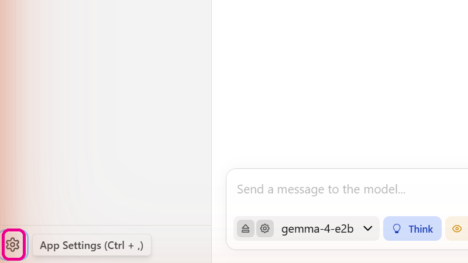
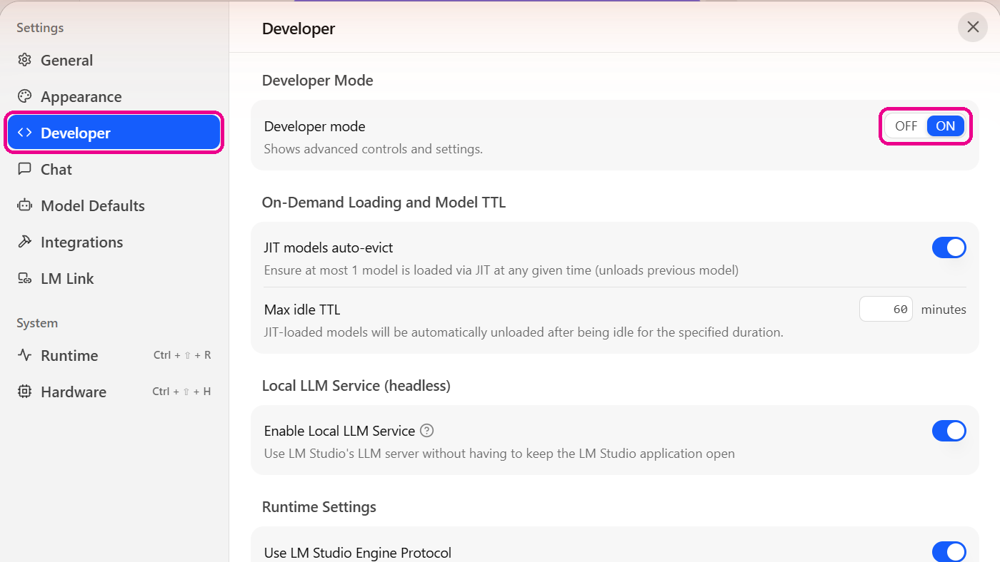

LM Studio is a free program that downloads language models with open weights
and runs them on your own laptop. Once a model is on your disk, it answers
without a connection to the internet, and nothing you type leaves your
computer. LM Studio runs on Windows, macOS and Linux and may be used free of
charge at university and at work. The experiment [[an-ai-on-your-laptop]]
works with it, and what a model file is and why its size matters is explained
in [[open-models]].

The screenshots on this page show LM Studio 0.4.26 on Windows; other versions
may look slightly different.

## Setting up

1. **Install LM Studio** from [lmstudio.ai](https://lmstudio.ai). A laptop
   with 8 GB of memory is enough for the small models of the experiment.
2. **Download a model** under *Model Search* in the bar on the left: search
   for its name, such as `google/gemma-3-1b`, and start the download. Models
   are large files, so download them at home and not in the lecture room.
3. **Chat with it** under *Chat*: choose the model in the model picker, wait
   until it is loaded and type your question into the box at the bottom.

## Switch on the developer mode

After installing, LM Studio starts in a simple mode that shows only the chat
and chooses every setting of the model by itself. The settings that decide how
the model picks its next token, such as the temperature, top k and top p, stay
hidden until you switch on the **developer mode**. The experiments with these
settings only work once it is on.

You can tell that it is off by the panel on the right: under *Model
Parameters* it shows only *System Prompt*, *Custom Fields* and *Reasoning*.
To switch it on:

1. Open the settings with the **gear at the bottom left** of the window, or
   with **Ctrl + ,** (on a Mac **Cmd + ,**).
2. Choose **Developer** in the list on the left and set **Developer mode** to
   **ON**.
3. Close the settings. In the panel on the right, the sections *Settings* and
   *Sampling* now appear below *Reasoning*.

If the panel on the right is closed, open it with the button at the top right
of the window. The developer mode is a setting of the program, not of a chat,
so it stays on until you switch it off again.

> [!NOTE]
> Older versions had three buttons at the bottom of the window instead,
> *User*, *Power User* and *Developer*. There, *Power User* or *Developer*
> shows the settings; newer versions combine both in the developer mode.

## The settings of a model

With the developer mode on, the panel on the right shows the settings for the
model of the current chat. What they do, and why, is explained in
[[next-token-prediction]]; here is only where to find them.

- **Settings:** *Temperature*, *Limit Response Length* with the maximum
  number of tokens of an answer, and *Context Overflow* with the strategies
  *Rolling Window*, *Truncate Middle* and *Stop at Limit* for a conversation
  that grows beyond the context.
- **Sampling:** *Top K Sampling*, *Top P Sampling* and *Min P Sampling*, each
  with a box that switches it on or off, and the penalties for repeated
  tokens.

A changed setting applies from the next answer on. LM Studio marks it as
*Unsaved Preset*; with *Save Preset As…* you keep a combination of settings
for later.

## Context length and the model file

The length of the context is not set in the chat but when the model is
loaded, because LM Studio reserves memory for it. Under *Library*, select the
model and open the tab *Load*: *Context Length* shows the current value and
the maximum the model supports. A change takes effect the next time the model
is loaded.

The same list in *Library* leads to the model file: the menu *…* next to a
model opens its folder with *Open in File Explorer*. The file there is the
whole model, and its size depends on the number of parameters and on how many
bits each of them is stored with.
