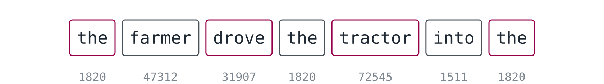
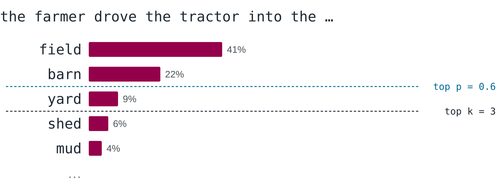

However long and clever the answer of a chatbot is, it is written one token at a time: the model looks at the text so far and computes, for every possible next piece of text, how likely it is to come next. One piece is chosen and appended, and the whole process starts again with the slightly longer text. These pieces are called **tokens**, the text the model looks at is its **context**, and the architecture that lets it take the whole context into account is the **transformer**. This page follows the slides above and answers:

- What is a token, and how many of them does a model know?
- How does a model turn probabilities for the next token into a whole answer?
- Why does the same question get different answers, and what do temperature, top k and top p change?
- What is the context, and why is it limited?
- What is the basic idea of a transformer?

You meet this concept in the experiment [[an-ai-on-your-laptop]], where you measure how many tokens per second your laptop manages and change the settings of a local model in LM Studio.

## Tokens

A language model does not read letters or words but **tokens**, pieces of text from a fixed list. Before the model sees a text, a program called the tokenizer cuts it into tokens and replaces each one by its number in the list, so that the model receives a sequence of numbers. Frequent words are a single token, often together with the space in front of them.

A rare word falls apart into several pieces, so that *unbelievable* may become *un*, *believ* and *able*, and German technical terms fall apart into particularly many. In English, a token is on average about three quarters of a word; German and most other languages need more tokens for the same content, because the lists were built mainly from English text. [Tiktokenizer](https://tiktokenizer.vercel.app/?model=gpt-3.5-turbo) shows how a real tokenizer cuts a sentence of your own, with every token coloured and numbered.

The list of all tokens a model knows is its **vocabulary**. The vocabulary of Gemma 4 E2B, the model on the slides, has about 262,000 entries, and so does that of Gemma 3; everything the model writes is put together from them. How these numbers come to carry meaning is a concept of its own.

## One token at a time

In one step, the model computes neither the next word nor the whole answer, but a probability for every token in its vocabulary: how likely it is that this token comes next. After *the farmer drove the tractor into the*, the token *field* might get 41 per cent, *barn* 22 per cent, *yard* 9 per cent, and each of the remaining hundreds of thousands of tokens a tiny share.

The numbers in this example are made up, but every real model produces exactly such a list, and this list is all it produces. The [next-token prediction demo](https://alonsosilva-nexttokenprediction.hf.space/) shows the real list of a small model for any beginning of a sentence you type.

To write an answer, the program around the model draws one token from the list, appends it to the context and asks the model again, which now sees its own token as part of the input and computes the next list from the slightly longer text. This is called **autoregressive** generation: every output becomes input.

The loop ends when the model picks a special end token, or when the maximum number of tokens is reached, even in the middle of a sentence. Every round is one pass through all parameters of the model, which is why the speed of a model is measured in tokens per second.

Two things follow from the loop, and both explain why fluent is not the same as true. A token, once written, is never taken back: the model can only continue, and if it took a wrong turn early, it builds on it. And the model writes the most likely continuation, which is not always the true one. As long as the true continuation is also the most plausible, that does no harm, but where it is not, the model writes something fluent and wrong with the same confidence. This is where hallucinations come from.

## Choosing the next token

Ask the same question twice and you get two different answers, although the model does not change between two questions and learns nothing in the chat. The difference comes from the draw: which token is taken from the list is decided not by the model but by a few settings, the **sampling parameters**, and every drawn token changes everything that follows.

The **temperature** makes the list sharper or flatter. At 0, the most likely token is always taken, and the same question gets the same answer every time. At 1, the list is used as the model computed it, so the answer varies. At 2, the many unlikely tokens together take almost everything, and the text drifts into nonsense.

The values for temperature 2 are calculated from the same made-up list, with the rest of the vocabulary taken as a thousand equally likely tokens; with 262,000 of them, the effect would be even stronger. The [Transformer Explainer](https://poloclub.github.io/transformer-explainer/) shows this live for a small real model, with a slider for the temperature.

Two further settings cut off the tail of the list before a token is drawn. **Top k** keeps only the k most likely tokens, so that with top k = 1 the model always takes the first one. **Top p** keeps as many of the most likely tokens as are needed for their probabilities to add up to p: with top p = 0.6, only *field* and *barn* remain, which together have 63 per cent. When the model is sure, few candidates remain, and when it is unsure, many.

**Turn the dial yourself** in LM Studio. First switch on the developer mode under Settings → Developer, as shown in [[lm-studio|the page on LM Studio]]: without it, the panel on the right shows neither the temperature nor top k and top p. Then ask the same question three times at temperature 0 and three times at temperature 1. After that, switch off the filters with top k = 0, top p = 1 and min p = 0, because by default they cut off the tail of the list and keep the answer sensible even at a high temperature, and raise the temperature step by step until the answer falls apart. The model stays the same throughout; only the way a token is drawn from the list changes. To see the maximum length at work, tick *Limit Response Length*, set it to 20 tokens and watch where the answer stops.

## The context

The **context** is everything the model sees when it computes the next token: the system prompt, the whole conversation so far, any document you added, and the part of its own answer it has already written. A chat feels like talking to someone with a memory, but the model remembers nothing between two calls. With every new message, the program sends the entire conversation again, written into one long text with special tokens that mark who said what.

The context has a maximum length, the **context window**, counted in tokens. For Gemma 4 E2B it is 131,072 tokens, which model cards write as 128K, because the K stands for 1,024 here; the same holds for Gemma 3 4B, while Gemma 3 1B manages 32K, that is 32,768 tokens, and large models in the cloud reach a million and more. 131,072 is also the maximum LM Studio offers when it loads such a model.

There are three reasons why the context is limited. The model was trained on texts up to a certain length and handles longer ones poorly. Every new token is related to every token before it, so that the computing effort grows much faster than the length, as the last part of this page shows. And every token in the context needs memory for intermediate results, which is why LM Studio needs more RAM when you load a model with a longer context. When the context is full, something has to go, and what goes is decided by the program around the model, not by the model itself:

- **Stop at limit:** the answer ends when the window is full.
- **Rolling window:** the oldest messages are dropped.
- **Truncate middle:** the middle is cut out, so that the beginning and the latest messages stay.
- **Summarise:** the old part is replaced by a short summary, as agents like Claude Code do.

Whatever is dropped no longer exists for the model. In LM Studio, the setting is called *Context Overflow* and offers *Rolling Window*, *Truncate Middle* and *Stop at Limit*. Load Gemma 4 E2B with a very short context length, paste a long text, ask about its first paragraph, then switch the strategy and ask again.

## The transformer, from far away

Almost every language model today is a **transformer**, an architecture published by researchers at Google in 2017. Earlier models read a text word by word and carried along a summary that became blurred the further back a word was. A transformer, by contrast, looks at all tokens of the context at once when it computes the next one, and it learns how much each of them matters for the current step. This mechanism is called **attention**.

An example shows why this matters. In *the tractor did not fit through the gate because it was too wide*, the word *it* means the tractor; if the sentence ends with *too narrow*, it means the gate. To continue such a text correctly, the model has to connect *it* with a word several tokens back, and which word that is depends on a third word at the very end.

Attention relates every token with every token before it. A grid with one row and one column per word shows this, with words standing in for tokens: each cell says how strongly the word of its row draws on the word of its column, and the row of *it* draws most strongly on *tractor*. The upper half of the grid stays empty, because a token only looks at the tokens before it, but the grid as a whole still has n × n cells. A sentence of 13 tokens gives 169 cells, 1,000 tokens give a million, and the 131,072 tokens of a full context give over 17 billion, in every layer of the model. Twice the context therefore means four times the cells, which is why long contexts are so expensive.

![A grid of 13 by 13 cells, with the words of the sentence the tractor did not fit through the gate because it was too wide as row and column labels. The cells on and below the diagonal are filled with different strengths, the cells above it are empty frames, and the row of it is framed, with its strongest cell in the column of tractor. On the right, a table of tokens and cells: 13 tokens give 169 cells, 1,000 tokens 1,000,000 cells and 131,072 tokens 17,179,869,184 cells, and below it the sentence twice the context means four times the cells.](media/attention-grid.en.svg "Every token is related to every token before it, so the cells grow with the square of the context.")

How attention computes these strengths is a topic for later. For now it is enough to know the one thing the slides end with: a language model writes one token at a time, and the whole context flows into the prediction of every single one.

## Further reading

- Ashish Vaswani et al.: [Attention Is All You Need](https://arxiv.org/abs/1706.03762), NeurIPS 2017, the paper that introduced the transformer.
- [Transformer Explainer](https://poloclub.github.io/transformer-explainer/): a small language model in the browser that shows the probabilities for the next token and lets you change the temperature, top k and top p.
- [Next-Token Prediction demo](https://alonsosilva-nexttokenprediction.hf.space/): type the beginning of a sentence and see the probabilities a small language model gives each possible next token.
- [Tiktokenizer](https://tiktokenizer.vercel.app/?model=gpt-3.5-turbo): shows how the tokenizer of gpt-3.5-turbo cuts a text into tokens, with every token coloured and numbered.
- Google DeepMind: [Gemma 4 model card](https://ai.google.dev/gemma/docs/core/model_card_4), with the context length and the vocabulary of Gemma 4 E2B.
- Gemma Team, Google DeepMind: [Gemma 3 Technical Report](https://arxiv.org/abs/2503.19786), 2025, with the context lengths and the vocabulary of the models used in the experiment.
