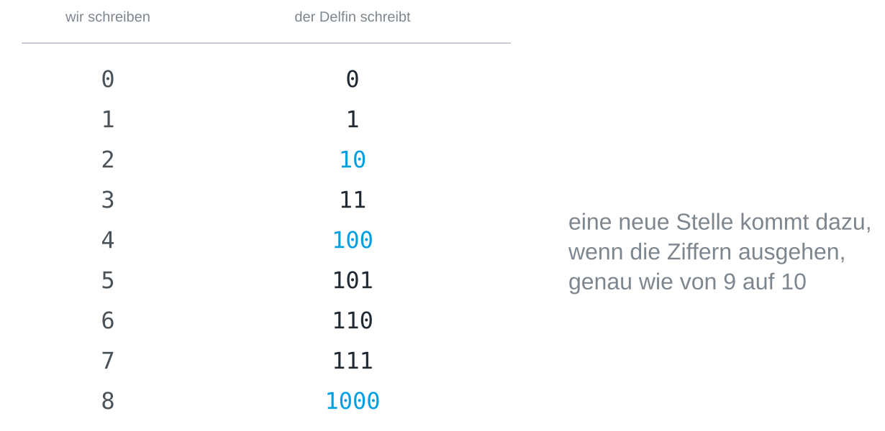
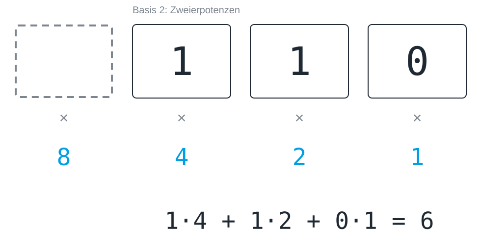
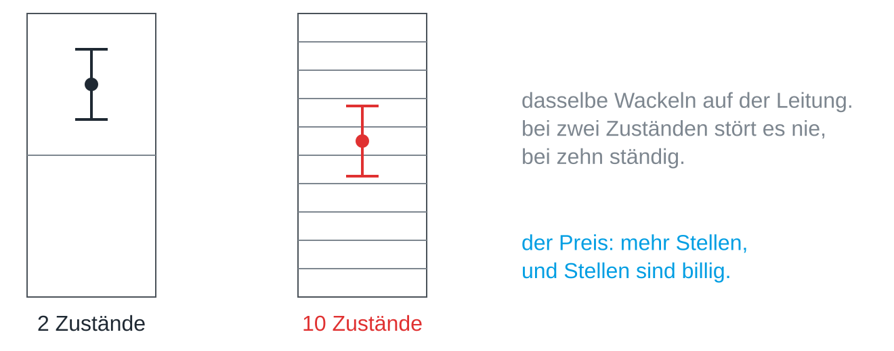
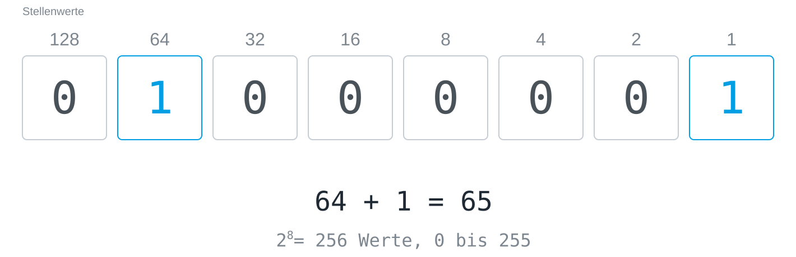
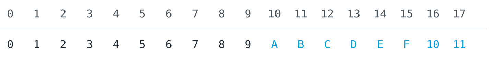
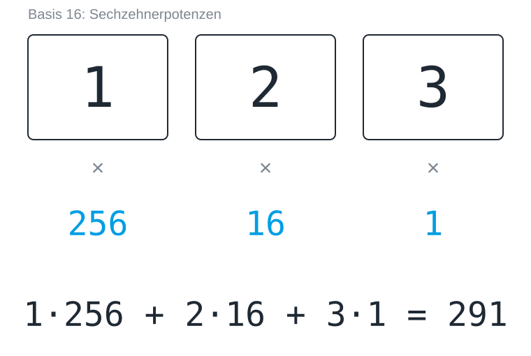
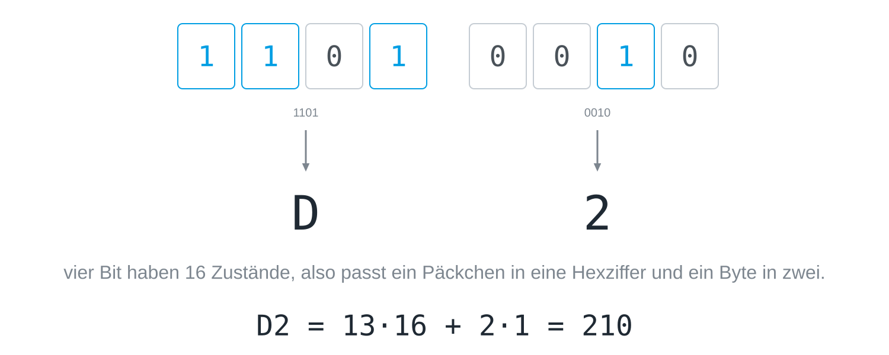
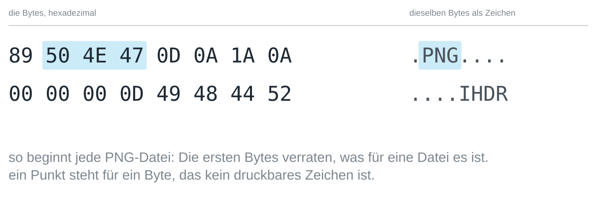
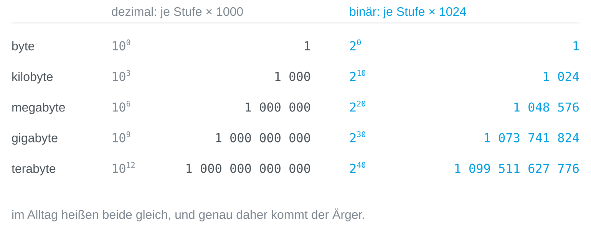
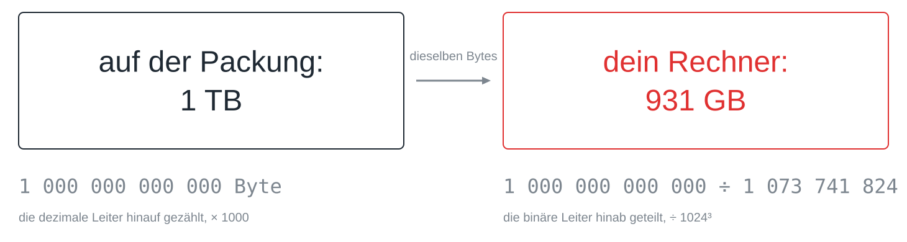

Dass `123` einhundertdreiundzwanzig bedeutet, ist eine Vereinbarung und kein
Naturgesetz. Jede Stelle der Zahl trägt eine Zehnerpotenz, die Ziffer sagt,
wie oft sie vorkommt, und die Zehn selbst kommt von nichts Tieferem als der
Zahl der Finger an zwei Händen. Diese Lektion nimmt unsere eigene
Schreibweise auseinander, denn sie zerfällt in zwei Teile: einen, der reine
Gewohnheit ist, und einen, der Mathematik ist und in jedem Zahlensystem
gleich funktioniert. Der zweite Teil führt dich dann in den Rechner hinein,
von den Binärzahlen über Bytes und Hexadezimal bis zu den zwei Leitern von
Einheiten, auf denen Dateigrößen gezählt werden.

## Warum zehn?

Fragt man, warum wir bis zehn zählen, werden die Antworten ehrfürchtig: weil
sich die Zehn gut teilen lässt, weil sie mathematisch praktisch ist, weil es
so gewachsen ist. Die wahre Antwort ist banaler, denn wir haben zehn Finger,
und mehr steckt nicht dahinter.

## Was 123 wirklich sagt

Nimm die Zahl `123`. Sie sagt nicht „eins, zwei, drei“, sondern einhundert,
zwei Zehner und drei Einer: Jede Stelle trägt eine Zehnerpotenz, und die
Ziffer sagt nur, wie oft diese Potenz vorkommt.


Diese Bauanleitung heißt **Stellenwertsystem**, und sie ist der einzige Grund,
warum zehn Ziffern für unendlich viele Zahlen reichen: Statt für jede Zahl ein
neues Zeichen zu erfinden, geben wir der Position eine Bedeutung. Die
Stellenwerte wachsen von rechts nach links, die Einer stehen also immer ganz
rechts; andersherum gelesen ergäben dieselben Ziffern 321.

## Das Wesen mit acht Fingern

Stell dir ein Wesen mit acht Fingern vor. Es hat dieselbe Bauanleitung
erfunden, aber seine Stellen laufen schon nach acht über, und es schreibt
`123` auf einen Zettel. Welche Zahl meint es? Rechne es aus, bevor du dir die
Abbildung ansiehst.


Die Ziffern sind dieselben und das Verfahren ist dasselbe, aber die Zahl ist
eine andere. Eine Ziffernfolge bedeutet für sich gar nichts, solange man die
Basis nicht kennt, in der sie geschrieben ist; deshalb schreibt man sie im
Zweifel dazu, etwa als 123₈ oder `0x7B`.

## Jede Basis

Die Bauanleitung funktioniert mit jeder Basis ab zwei. Eine Basis *b* hat die
Ziffern 0 bis *b* − 1, die Basis 8 also 0 bis 7 und die Basis 2 nur 0 und 1,
und die Stellen sind von rechts an 1, *b*, *b*², *b*³ und so weiter wert. Um
eine Zahl zu lesen, multiplizierst du jede Ziffer mit dem Wert ihrer Stelle
und zählst alles zusammen. Jede Basis kann jede Zahl darstellen; eine kleinere
Basis braucht dafür nur mehr Stellen. Die Ziffer 0 braucht jede Basis, weil
sich eine leere Stelle sonst nicht von einer fehlenden unterscheiden ließe.

> [!TIP]
> Wenn du für eine neue Basis eine neue Regel lernst, halt inne: Es gibt
> keine. Es ist immer Ziffer mal Stellenwert, aufsummiert.

## Binär zählen

Die Basis 2 ist die Bauanleitung am Anschlag, mit nur noch den Ziffern 0 und
1. Gezählt wird wie immer, nur läuft eine Stelle fast sofort über, so wie ein
Kilometerzähler von 09 auf 10 springt. Stell dir einen Delfin vor, der an
seinen zwei Flossen zählt: Nach 0 und 1 sind seine Ziffern verbraucht, und er
muss eine neue Stelle aufmachen.



Die Regel ist in jeder Basis dieselbe: Ist die höchste Ziffer erreicht, geht
die Stelle auf 0 zurück, und die nächste Stelle zählt eins hoch. Binär
passiert das nur viel öfter, sodass auf 101 die 110 folgt und erst nach 111
mit 1000 eine vierte Stelle dazukommt.

## Eine Binärzahl lesen

Der Delfin schreibt `110`. Seine Stellen sind von rechts an 1, 2 und 4 wert,
jede doppelt so viel wie ihre rechte Nachbarin, und deshalb ist `110` nicht
einhundertzehn, sondern sechs. Welchen Wert hätte eine vierte Stelle links
davon? Rechne es aus, bevor du dir die Abbildung ansiehst.



Die Einer stehen ganz rechts, wie im Dezimalsystem. Vom falschen Ende gelesen,
mit den Einern links, ergäben dieselben Ziffern 1 · 1 + 1 · 2 + 0 · 4 = 3.

## Eine Zahl binär schreiben

Andersherum gehst du von der größten Zweierpotenz aus, die passt. Für 13: 16
ist zu groß, 8 passt und lässt 5 übrig, 4 passt und lässt 1 übrig, 2 passt
nicht, 1 passt. Von links nach rechts aufgeschrieben ergibt das `1101`. Eine
schnelle Probe ist die letzte Ziffer, die bei jeder ungeraden Zahl 1 und bei
jeder geraden 0 ist.

Python kann deine Rechnung prüfen. `bin()` schreibt eine Zahl binär, mit `0b`
davor, das die Basis anzeigt:

```python
print(bin(13))
```

Und `int()` liest eine Ziffernfolge in der Basis, die du angibst:

```python
print(int("1101", 2))
```

> [!TIP]
> Rechne ein paar Zahlen erst im Kopf und dann in Python, etwa 6, 9, 16 und
> 31. Das Muster hinter 31, 63 und 127 lohnt einen zweiten Blick.

## Warum ausgerechnet zwei?

Binärzahlen sind lang, denn 255 braucht acht Ziffern statt drei. Ein Rechner
könnte im Prinzip mit jeder Basis arbeiten, und in der Frühzeit gab es
tatsächlich Dezimalrechner. Sie sind ausgestorben, und der Grund dafür ist
keine Mathematik, sondern Technik.

Stell dir eine Leitung vor, auf der eine Spannung irgendwo zwischen null und
fünf Volt liegt. Um zehn Ziffern zu senden, musst du diesen Bereich in zehn
Fächer von je einem halben Volt teilen. Für zwei Ziffern bekommst du zwei
Fächer von je zweieinhalb Volt. Jede echte Leitung wackelt: Kabel wirken als
Antennen, Bauteile werden warm, Netzteile brummen. Dasselbe Wackeln, das bei
zwei Fächern nie stört, wirft die Ziffer bei zehn Fächern regelmäßig ins
Nachbarfach.



Je mehr Zustände in denselben Bereich passen müssen, desto kleiner werden die
Abstände zwischen ihnen und desto eher gewinnt das Rauschen. Zwei Zustände
haben den größtmöglichen Abstand und lassen sich deshalb milliardenfach
hintereinander sicher unterscheiden. Der Preis sind mehr Stellen, und Rechner
zahlen ihn gern, weil eine Stelle fast nichts kostet, eine falsche Ziffer aber
alles kosten kann. Dieselbe Abwägung taucht überall auf, wo Information über
einen echten Kanal läuft, ob Kabel, Funk oder Licht: Mehr unterscheidbare
Zustände tragen mehr Information je Zeichen, aber jeder zusätzliche Zustand
macht Fehler wahrscheinlicher.

## Drei Generationen desselben Schalters

Die Geschichte des Computers bestätigt das, denn jeder Rechner, der je gebaut
wurde, besteht aus Schaltern mit zwei Zuständen. Die ersten waren **Relais**,
in denen ein Elektromagnet einen Kontakt mit hörbarem Klicken schließt; Konrad
Zuses Z3 von 1941 kam mit rund 2.600 davon aus. Dann kam die
**Elektronenröhre**, die ohne bewegte Teile und deshalb rund tausendmal
schneller schaltet; der ENIAC von 1945 hatte 17.468 davon, und ständig brannte
eine durch. Der **Transistor**, 1947 erfunden, ist derselbe Schalter aus einem
Halbleiter, und er wurde so klein, dass heute Milliarden davon auf einen
einzigen Chip passen. Die Technik hat dreimal gewechselt, während das Prinzip
aus an und aus dasselbe blieb.

> [!NOTE]
> Das kurze Einmaleins der Basis 2 ist eine angenehme Nebenwirkung, aber
> nicht der Grund. Der Grund ist physikalisch: Zwei Zustände überstehen
> Rauschen am besten.

## Acht Bit ergeben ein Byte

Eine binäre Stelle heißt [[bit]], und acht davon bilden ein [[byte]]. Die
Stellenwerte sind 128, 64, 32, 16, 8, 4, 2 und 1, jeder doppelt so groß wie
sein rechter Nachbar, und der Wert des Bytes ist die Summe der gesetzten
Stellen.



Acht Stellen mit je zwei Möglichkeiten ergeben 2⁸ = 256 Werte, als Zahl
gelesen 0 bis 255. Deshalb laufen Farbkanäle in der Bildbearbeitung von 0 bis
255, denn ein Kanal ist genau ein Byte. Ein Byte ist allerdings keine Zahl,
sondern eine Verpackungseinheit: Was seine acht Bit bedeuten, legt eine
Vereinbarung fest. Als Zahl gelesen ist `01000001` die 65, als Text gelesen
nach der ASCII-Tabelle ein großes A.

Das Wort *Bit* ist auch ein Maß für Information, und hier taucht es als Ziffer
auf. Das ist kein Wortspiel, denn eine Stelle mit zwei möglichen Werten fasst
genau eine Ja-Nein-Antwort, und so heißt der Behälter nach seinem Inhalt.

Leg die acht Bit selbst um und finde heraus, welcher Schalter die Zahl am
stärksten verändert und was einen Schritt nach 255 passiert:


## Das hast du schon gesehen

Acht Nullen und Einsen kann niemand auf einen Blick lesen, und es gibt eine
Kurzschrift dafür, die in der Informatik überall auftaucht. Was haben diese
Zeichenfolgen gemeinsam?


Es sind Zahlen, geschrieben mit sechzehn Ziffern statt zehn. Diese
Schreibweise heißt **hexadezimal**, kurz Hex, und sie ist keine neue
Zahlenwelt, sondern dieselbe Stellenwert-Bauanleitung zur Basis 16.

## Sechzehn Finger: in Hex zählen

Um Hex zu lesen, brauchst du nur ein Wesen mit sechzehn Fingern, etwa ein
Alien mit vier Händen zu je vier Fingern. Es zählt bis fünfzehn, bevor eine
Stelle überläuft, und braucht deshalb sechzehn verschiedene Ziffern. Bis 9
schreibt es dasselbe wie wir. Für zehn sind unsere Ziffern verbraucht, also
helfen sechs Buchstaben aus: A steht für 10, B für 11 und so weiter bis F für
15.



Nach F gehen auch dem Alien die Ziffern aus, und es passiert dasselbe wie bei
uns zwischen 9 und 10 und beim Delfin zwischen 1 und 10: Eine neue Stelle
kommt dazu, und `10` bedeutet sechzehn.

## Hexzahlen lesen

Auch das Alien schreibt `123`, und die Bauanleitung ist zum vierten Mal
dieselbe, jetzt mit Sechzehnerpotenzen: 256, 16 und 1.



Mit Buchstaben geht es genauso. `FF` ist 15 · 16 + 15 = 255, das volle Byte,
und `AC` ist 10 · 16 + 12 = 172, was sich leichter liest als `10101100`. Wo
die Basis nicht aus dem Zusammenhang klar ist, werden Hexzahlen
gekennzeichnet, meist mit `0x` davor, wie in `0xAC`.

Auch Python liest und schreibt hexadezimal. `hex()` schreibt eine Zahl zur
Basis 16:

```python
print(hex(172))
```

Und `int()` liest sie zurück:

```python
print(int("AC", 16))
```

## Vier Bit, eine Ziffer

Warum ausgerechnet sechzehn? Der Grund liegt im Byte. Vier Bit haben
2⁴ = 16 Zustände, genau so viele, wie es Hexziffern gibt; eine Hexziffer deckt
also ein Päckchen aus vier Bit ab, und ein ganzes Byte passt in zwei Ziffern.



Ein Päckchen aus vier Bit heißt manchmal *Nibble*, ein halbes Byte. Zwischen
binär und hexadezimal umzurechnen braucht deshalb keine Rechnung, nur die
Tabelle der sechzehn Päckchen: `1101 0010` ist `D2`, weil 1101 die 13 ist und
0010 die 2. Mit der Bauanleitung der Basis 16 zurückgerechnet ist D2 die 210,
dieselbe Zahl, die die acht Bit mit Zweierpotenzen ergeben.

Die Farbangaben von Webseiten funktionieren genauso: `#ECAB03` sind drei
Bytes zu je zwei Ziffern, ein Byte je Farbkanal. Rot ist `EC` = 236, Grün
`AB` = 171 und Blau `03` = 3, ein warmes Gelb. `#FF0000` ist reines Rot, mit
dem roten Kanal am Anschlag und den anderen auf null.

## Eine Datei, zweimal

Ein Hex-Dump zeigt die Bytes einer Datei hexadezimal und daneben dieselben
Bytes als Zeichen, mit einem Punkt überall dort, wo ein Byte kein druckbares
Zeichen ist. Das sind die ersten sechzehn Bytes jedes PNG-Bildes:



Zwei Dinge fallen auf. Die ersten Bytes verraten, was für eine Datei es ist,
denn jede PNG-Datei beginnt mit denselben acht Bytes, und andere Formate haben
ihre eigenen Kennungen. Und zwischen den lesbaren Stellen stehen genauso viele
unlesbare, die aus demselben Stoff sind: Eine Datei ist nichts als eine Folge
von Zahlen, und erst das Programm, das sie liest, entscheidet, was sie
bedeuten.

Sieh dir im Hex-Betrachter die ersten Bytes eines PDFs, eines JPEGs und einer
Textdatei von deinem Rechner an, such die Zeilenumbrüche in einem Text, und
tippe einen Umlaut oder ein Emoji, um zu sehen, wie viele Bytes es braucht:


> [!TIP]
> Jeder Programmiereditor kann eine Datei als Hex-Dump zeigen, und auf der
> Kommandozeile leisten `xxd` (Linux, macOS) oder `Format-Hex` (Windows
> PowerShell) dasselbe.

## Zwei Leitern von Einheiten

Dateigrößen werden in Bytes gezählt, und die Vorsilben Kilo, Mega und Giga
haben dort zwei Bedeutungen. Die dezimale Leiter multipliziert je Stufe mit
1000, wie Kilo, Mega und Giga bei jeder anderen Einheit auch. Die binäre
Leiter multipliziert mit 1024, weil Speicher in Zweierpotenzen organisiert ist
und 2¹⁰ = 1024 die Zweierpotenz ist, die 1000 am nächsten kommt.



Als Potenzen geschrieben ist der Unterschied offensichtlich: Die dezimale
Leiter steigt in Schritten von 10³, die binäre in Schritten von 2¹⁰. Der
Abstand zwischen den Leitern wächst je Stufe um rund 2,4 Prozent, ein binäres
Kilobyte ist also 2,4 Prozent größer als ein dezimales, ein binäres Gigabyte
7,4 Prozent und ein binäres Terabyte 10 Prozent.

## Die fehlenden 69 Gigabyte

Auf der Packung steht 1 Terabyte, der Rechner zeigt 931 Gigabyte an, und es
ist kein einziges Byte verloren gegangen. Der Hersteller zählt die dezimale
Leiter hinauf, für ihn ist ein Terabyte also eine Billion Byte. Das
Betriebssystem nimmt dieselbe Billion und teilt sie die binäre Leiter hinab,
durch 1024³, und kommt auf 931.



Die Division kannst du selbst nachrechnen:

```python
print(10**12 / 1024**3)
```

Gerundet hat niemand und geschummelt auch nicht: Beide Angaben beschreiben
dieselbe Zahl von Bytes, ärgerlich ist nur, dass beide Seiten ihre Stufe
Gigabyte nennen. Seit 1998 gibt es saubere Namen für die binären Stufen:
Kibibyte (KiB), Mebibyte (MiB), Gibibyte (GiB) und Tebibyte (TiB), wobei *bi*
für binär steht. In dieser Schreibweise fasst die Platte 1 TB, das sind
931 GiB. Im Gespräch benutzt die Namen fast niemand, deshalb hält sich die
Verwechslung; auch die Betriebssysteme unterscheiden sich, denn Windows zeigt
binäre Werte mit den dezimalen Namen an, während macOS seit 2009 in dezimalen
Stufen zählt.

> [!TIP]
> Wenn es auf die Größe ankommt, sag dazu, welche Leiter du meinst. „2 KiB“
> sind 2048 Byte, „2 kB“ sind 2000 Byte, und „2 KB“ kann beides sein.

## Ziffern müssen nicht wie Ziffern aussehen

Eine Ziffer ist nur ein Zeichen, das nach einer Vereinbarung für einen Wert
steht. Wer vier Farben sicher auseinanderhalten kann, hat vier Ziffern, und es
genügt zu vereinbaren, welche Farbe für welchen Wert steht, damit eine Folge
von Farben eine Zahl zur Basis 4 wird.


Daraus folgen zwei Dinge, die für jeden Code dieser Art gelten. Die
Reihenfolge gehört zur Nachricht: Rot-Gelb-Grün und Grün-Gelb-Rot sind
verschiedene Codewörter, aus genau dem Grund, aus dem 123 und 321
verschiedene Zahlen sind. Und die Rechnung geht in beide Richtungen: Mit *k*
Zeichen und *n* Stellen lassen sich *k*ⁿ Codewörter unterscheiden, und wer
weiß, wie viele Zeichen er braucht, kann ausrechnen, wie viele Stellen das
kostet. Vier Farben und zwei Stellen ergeben 16 Kombinationen, zu wenig für 26
Buchstaben; drei Stellen ergeben 64, und das reicht.

## Kurz gesagt

Die Zehn war nie etwas Besonderes, sie ist die Zahl der Finger an zwei Händen
und sonst nichts. Wer das einmal gesehen hat, hält keine Basis mehr für
natürlich und keine für schwierig: Binär, hexadezimal und ein Farbcode sind
dieselbe Bauanleitung aus Ziffer mal Stellenwert mit anderen Ziffern.


