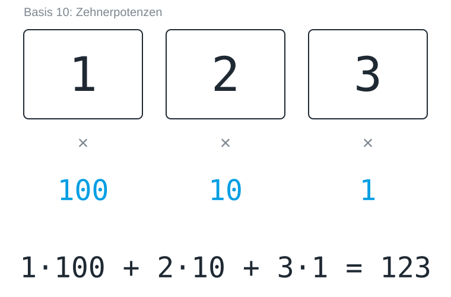
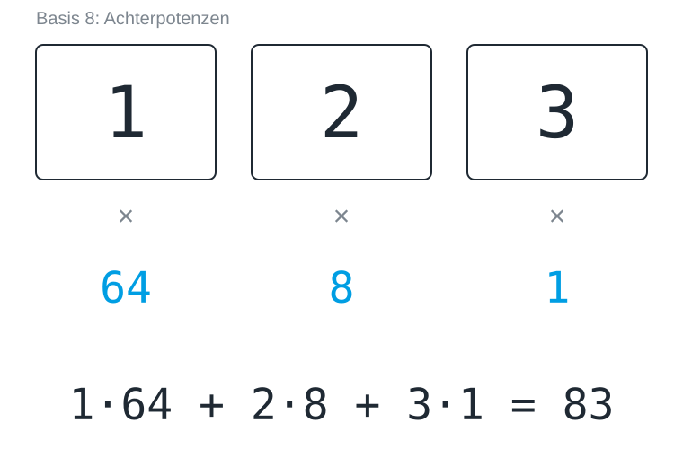
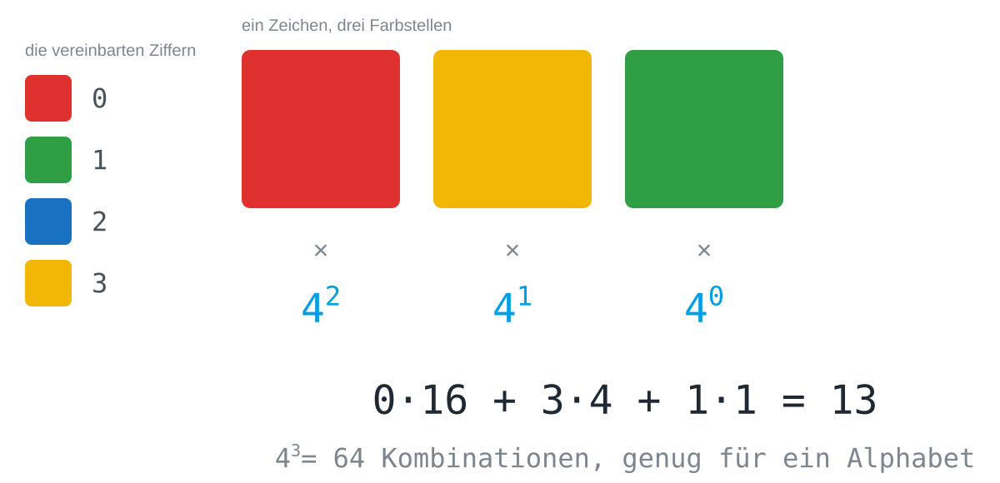

## Worum es geht

Dass `123` einhundertdreiundzwanzig bedeutet, ist eine Vereinbarung und kein
Naturgesetz. Jede Stelle der Zahl trägt eine Zehnerpotenz, die Ziffer sagt,
wie oft sie vorkommt, und die Zehn selbst kommt von nichts Tieferem als der
Zahl der Finger an zwei Händen. Diese Lektion nimmt unsere eigene
Schreibweise auseinander, denn sie zerfällt in zwei Teile: einen, der reine
Gewohnheit ist, und einen, der Mathematik ist und in jedem Zahlensystem
gleich funktioniert. Alles Weitere, die Bits eingeschlossen, gehört zum
zweiten Teil.

## Warum zehn?

Fragt man, warum wir bis zehn zählen, werden die Antworten ehrfürchtig: weil
sich die Zehn gut teilen lässt, weil sie mathematisch praktisch ist, weil es
so gewachsen ist. Die wahre Antwort ist banaler, denn wir haben zehn Finger,
und mehr steckt nicht dahinter.

## Der Trick mit dem Stellenwert

Nimm die Zahl `123`. Sie sagt nicht „eins, zwei, drei“, sondern einhundert,
zwei Zehner und drei Einer: Jede Stelle trägt eine Zehnerpotenz, und die
Ziffer sagt nur, wie oft diese Potenz vorkommt.

Diese Bauanleitung heißt **Stellenwertsystem**, und sie ist der einzige Grund,
warum zehn Ziffern für unendlich viele Zahlen reichen: Statt für jede Zahl ein
neues Zeichen zu erfinden, geben wir der Position eine Bedeutung. Die
Stellenwerte wachsen von rechts nach links, die Einer stehen also immer ganz
rechts; andersherum gelesen ergäben dieselben Ziffern 321.

## Das Wesen mit acht Fingern

Stell dir ein Wesen mit acht Fingern vor. Es hat dieselbe Bauanleitung
erfunden, aber seine Stellen laufen schon nach acht über, und es schreibt
`123` auf einen Zettel. Welche Zahl meint es? Rechne es aus, bevor du dir die
Abbildung ansiehst.

Die Ziffern sind dieselben und das Verfahren ist dasselbe, aber die Zahl ist
eine andere. Eine Ziffernfolge bedeutet für sich gar nichts, solange man die
Basis nicht kennt, in der sie geschrieben ist; deshalb schreibt man sie im
Zweifel dazu, etwa als 123₈ oder `0x7B`.

## Jede Basis

Die Bauanleitung funktioniert mit jeder Basis ab zwei. Eine Basis *b* hat die
Ziffern 0 bis *b* − 1, die Basis 8 also 0 bis 7 und die Basis 2 nur 0 und 1,
und die Stellen sind von rechts an 1, *b*, *b*², *b*³ und so weiter wert. Um
eine Zahl zu lesen, multiplizierst du jede Ziffer mit dem Wert ihrer Stelle
und zählst alles zusammen. Jede Basis kann jede Zahl darstellen; eine kleinere
Basis braucht dafür nur mehr Stellen. Die Ziffer 0 braucht jede Basis, weil
sich eine leere Stelle sonst nicht von einer fehlenden unterscheiden ließe.

> [!TIP]
> Wenn du für eine neue Basis eine neue Regel lernst, halt inne: Es gibt
> keine. Es ist immer Ziffer mal Stellenwert, aufsummiert.

## Ziffern müssen nicht wie Ziffern aussehen

Eine Ziffer ist nur ein Zeichen, das nach einer Vereinbarung für einen Wert
steht. Wer vier Farben sicher auseinanderhalten kann, hat vier Ziffern, und es
genügt zu vereinbaren, welche Farbe für welchen Wert steht, damit eine Folge
von Farben eine Zahl zur Basis 4 wird.

Daraus folgen zwei Dinge, die für jeden Code dieser Art gelten. Die
Reihenfolge gehört zur Nachricht: Rot-Gelb-Grün und Grün-Gelb-Rot sind
verschiedene Codewörter, aus genau dem Grund, aus dem 123 und 321
verschiedene Zahlen sind. Und die Rechnung geht in beide Richtungen: Mit *k*
Zeichen und *n* Stellen lassen sich *k*ⁿ Codewörter unterscheiden, und wer
weiß, wie viele Zeichen er braucht, kann ausrechnen, wie viele Stellen das
kostet. Vier Farben und zwei Stellen ergeben 16 Kombinationen, zu wenig für 26
Buchstaben; drei Stellen ergeben 64, und das reicht. Wie aus einer Tabelle
solcher Codewörter ein Code wird, behandelt [[code-as-agreement]].

## Kurz gesagt

Die Zehn war nie etwas Besonderes, sie ist die Zahl der Finger an zwei Händen.
Was zählt, ist die Bauanleitung aus Ziffer mal Stellenwert, und sie führt
geradewegs zu [[binary-numbers|den Binärzahlen]], mit denen ein Rechner
arbeitet.
