That `123` means one hundred and twenty-three is an agreement, not a law of
nature. Every place in the number carries a power of ten, the digit says how
often, and the ten itself comes from nothing deeper than the number of
fingers on two hands. This lesson pulls our own notation apart, because it
falls into two pieces: one that is pure convention, and one that is
mathematics and works the same way in every number system. The second piece
then carries you into the computer, from binary numbers through bytes and
hexadecimal to the two ladders of units on which file sizes are counted.

## Why ten?

Ask people why we count to ten and the answers get reverent: because ten
divides nicely, because it works out well mathematically, because that is how
it grew. The true answer is more banal, because we have ten fingers, and that
is all there is to it.

## What 123 really says

Take the number `123`. It does not say "one, two, three" but one hundred, two
tens and three ones: every place carries a power of ten, and the digit only
says how often that power occurs.

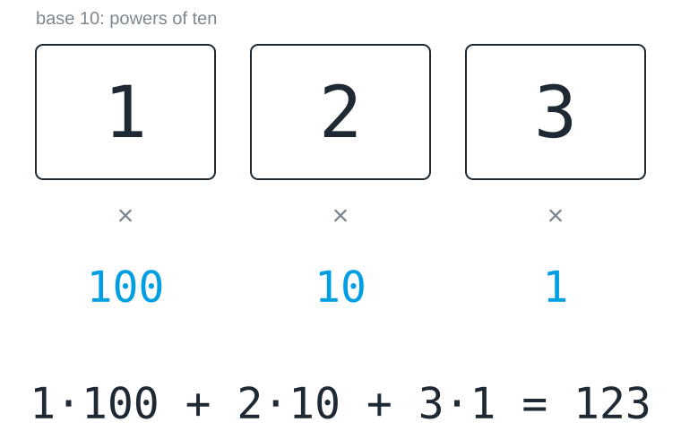

This recipe is called a **place value system**, and it is the only reason ten
digits are enough for infinitely many numbers: instead of inventing a new
symbol for every number, we give the position a meaning. The place values
grow from right to left, so the ones are always at the far right; read the
other way round, the same digits would give 321.

## The creature with eight fingers

Now picture a creature with eight fingers. It invented the same recipe, but
its places run out after eight, and it writes `123` on a sheet of paper. Which
number does it mean? Work it out before you look at the figure.

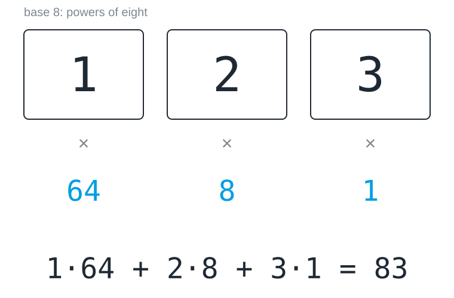

The digits are the same and the procedure is the same, but the number is
not. A string of digits means nothing at all until you know the base it was
written in, which is why programmers write it next to the number when there
is any doubt, as in 123₈ or `0x7B`.

## Any base

The recipe works with every base from two upwards. A base *b* has the digits
0 to *b* − 1, so base 8 uses 0 to 7 and base 2 only 0 and 1, and the places
are worth 1, *b*, *b*², *b*³ and so on from the right. To read a number, you
multiply every digit by the value of its place and add everything up. Every
base can represent every number; a smaller base only needs more places for
it. The digit 0 is needed in every base, because without it an empty place
could not be told apart from a missing one.

> [!TIP]
> If you find yourself learning a new rule for a new base, stop: there is
> none. It is always digit times place value, added up.

## Counting in binary

Base 2 is the recipe pushed to its limit, with only the digits 0 and 1 left.
Counting works as it always does, except that a place runs out almost
immediately, the way a car odometer rolls over from 09 to 10. Picture a
dolphin with two flippers that counts on them: after 0 and 1 it has used up
its digits and has to open a new place.

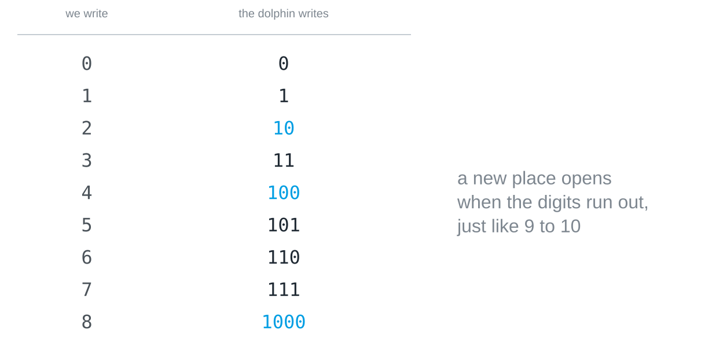

The rule is the same in every base: when the highest digit is reached, the
place goes back to 0 and the next place goes up by one. In binary this just
happens much more often, so 101 is followed by 110, and only after 111 does a
fourth place open with 1000.

## Reading a binary number

The dolphin writes `110`. Its places are worth 1, 2 and 4 from the right,
each double its right-hand neighbour, so `110` is not one hundred and ten but
six. Which value would a fourth place on the left have? Work it out before
you look at the figure.

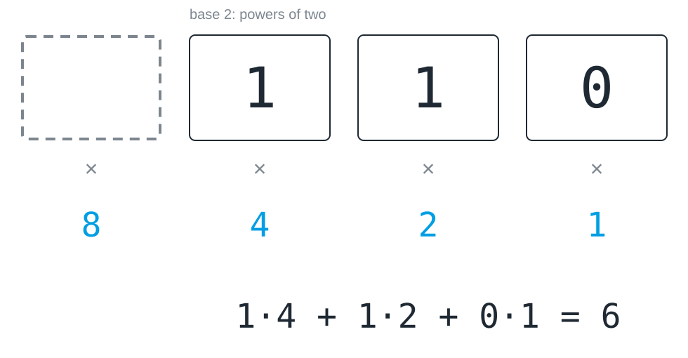

The ones are at the far right, as in decimal. Read from the wrong end, with
the ones at the left, the same digits would give 1 · 1 + 1 · 2 + 0 · 4 = 3.

## Writing a number in binary

The other way round, walk down from the largest power of two that fits. To
write 13: 16 is too big, 8 fits and leaves 5, 4 fits and leaves 1, 2 does not
fit, 1 does. Written from left to right, that gives `1101`. A quick check is
the last digit, which is 1 for every odd number and 0 for every even one.

Python can check your arithmetic. `bin()` writes a number in binary, with
`0b` in front to show the base:

```python
print(bin(13))
```

And `int()` reads a string of digits in the base you give it:

```python
print(int("1101", 2))
```

> [!TIP]
> Try a few numbers in your head first and only then in Python, for example
> 6, 9, 16 and 31. The pattern behind 31, 63 and 127 is worth noticing.

## Why two, of all things?

Binary numbers are long, since 255 needs eight digits instead of three. A
computer could in principle use any base, and decimal computers really did
exist in the early days. They died out, and the reason is not mathematics but
engineering.

Imagine a wire carrying a voltage somewhere between zero and five volts. To
send ten digits you have to cut that range into ten compartments, each half a
volt wide. To send two digits you get two compartments of two and a half
volts each. Every real wire wobbles: cables act as antennas, components warm
up, power supplies hum. The same wobble that never matters with two
compartments regularly throws the digit into its neighbour's compartment with
ten.

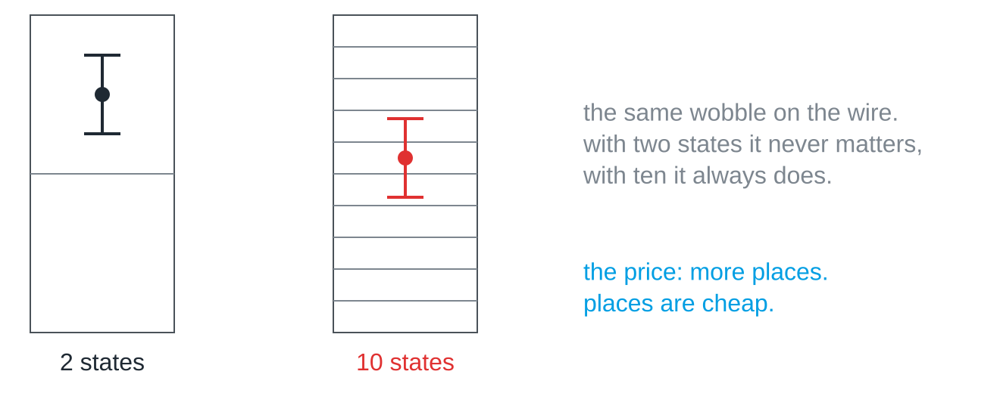

The more states you squeeze into the same range, the smaller the gaps between
them, and the sooner noise wins. Two states have the largest possible gap, so
they can be told apart reliably billions of times in a row. The price is more
places, and computers pay it happily, because a place costs almost nothing to
build while a wrong digit can cost everything. The same trade-off appears
wherever information travels over a real channel, whether a cable, radio or
light: more distinguishable states carry more information per symbol, but
each additional state makes errors more likely.

## Three generations of the same switch

The history of the computer confirms this, because every computer ever built
consists of switches with two states. The first ones were **relays**, in which
an electromagnet pulls a contact closed with an audible click; Konrad Zuse's
Z3 of 1941 used about 2,600 of them. Then came the **vacuum tube**, which
switches without moving parts and therefore about a thousand times faster; the
ENIAC of 1945 had 17,468 of them, and they burnt out constantly. The
**transistor**, invented in 1947, is the same switch made of a semiconductor,
and it became so small that billions of them fit on a single chip today. The
technology changed three times, while the principle of on and off stayed the
same.

> [!NOTE]
> The short multiplication table of base 2 is a pleasant side effect, not the
> reason. The reason is physical: two states survive noise best.

## Eight bits make a byte

A binary place is called a [[bit]], and eight of them form a [[byte]]. The
place values are 128, 64, 32, 16, 8, 4, 2 and 1, each double its right-hand
neighbour, and the value of the byte is the sum of the places that are set.

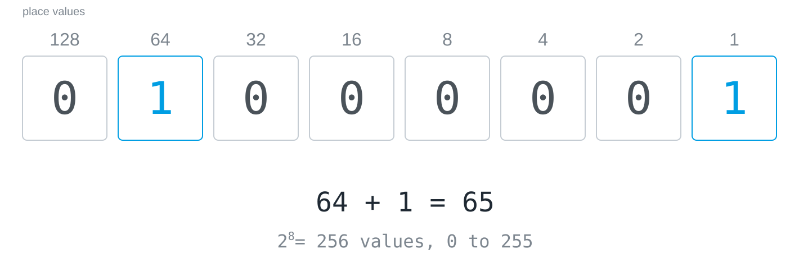

Eight places with two possibilities each give 2⁸ = 256 values, read as a
number 0 to 255. That is why colour channels in image editing run from 0 to
255, since one channel is exactly one byte. A byte is not a number, though,
but a unit of packaging: what its eight bits mean is decided by an agreement.
Read as a number, `01000001` is 65; read as text, it is a capital A according
to the ASCII table.

The word *bit* is also a measure of information, and here it turns up as a
digit. That is no pun, because a place with two possible values holds exactly
one yes/no answer, so the container is named after its content.

Flip the eight bits yourself, and find out which switch changes the number the
most and what happens one step past 255:


## You have seen these before

Nobody reads eight zeroes and ones at a glance, and there is a shorthand for
them that turns up everywhere in computing. What do these strings have in
common?

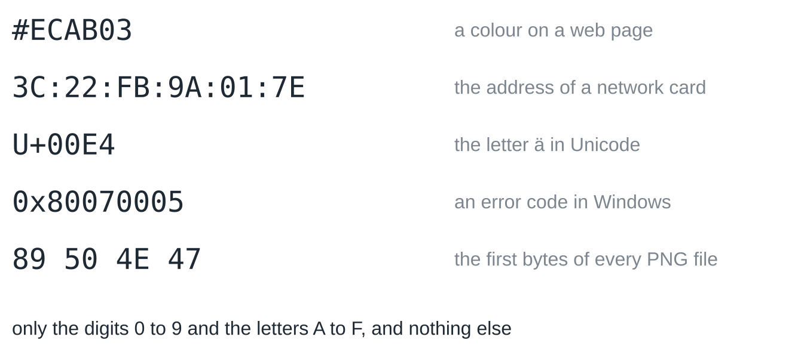

They are numbers, written with sixteen digits instead of ten. This notation
is called **hexadecimal**, or hex for short, and it is not a new number world
but the same place value recipe with base 16.

## Sixteen fingers: counting in hex

To read hex, all you need is a creature with sixteen fingers, say an alien
with four hands of four fingers each. It counts to fifteen before a place
overflows, so it needs sixteen different digits. Up to 9 it writes what we
write. For ten our digits are used up, so six letters help out: A stands for
10, B for 11, and so on up to F for 15.

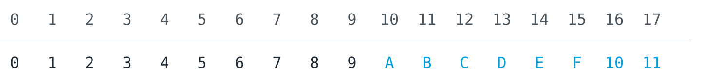

After F the alien runs out of digits too, and the same thing happens as for
us between 9 and 10 and for the dolphin between 1 and 10: a new place opens,
and `10` means sixteen.

## Reading hex numbers

The alien also writes `123`, and the recipe is the same for the fourth time,
now with powers of sixteen: 256, 16 and 1.

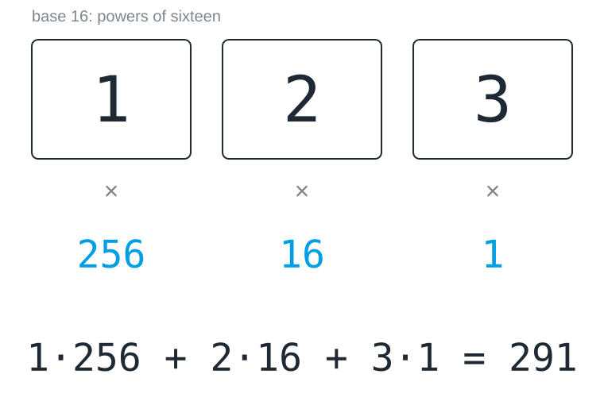

With letters it works just the same. `FF` is 15 · 16 + 15 = 255, the full
byte, and `AC` is 10 · 16 + 12 = 172, which is easier on the eye than
`10101100`. Where the base is not clear from the context, hex numbers are
marked, usually with `0x` in front, as in `0xAC`.

Python reads and writes hex as well. `hex()` writes a number in base 16:

```python
print(hex(172))
```

And `int()` reads it back:

```python
print(int("AC", 16))
```

## Four bits, one digit

Why sixteen, of all numbers? The reason lies in the byte. Four bits have
2⁴ = 16 states, which is exactly the number of hex digits, so one hex digit
covers a packet of four bits, and a whole byte fits into two digits.

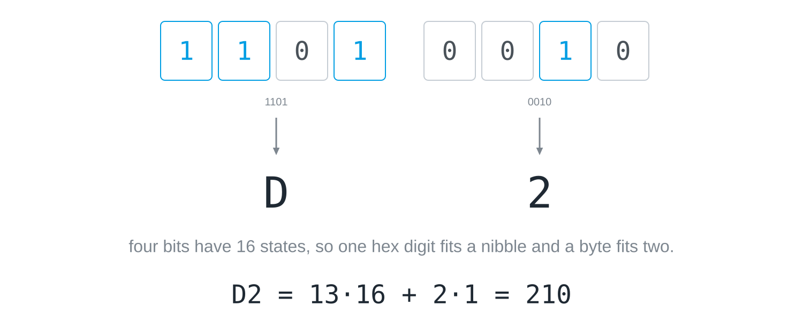

A packet of four bits is sometimes called a *nibble*, half a byte. Converting
between binary and hex therefore needs no arithmetic at all, only the table of
sixteen packets: `1101 0010` is `D2`, because 1101 is 13 and 0010 is 2. Read
back with the recipe of base 16, D2 is 210, the same number that the eight
bits give with powers of two.

The colour notation of web pages works the same way: `#ECAB03` is three bytes,
two digits each, one byte per colour channel. Red is `EC` = 236, green `AB` =
171 and blue `03` = 3, a warm yellow. `#FF0000` is pure red, with the red
channel at its maximum and the others at zero.

## A file, twice

A hex dump shows the bytes of a file in hex, and next to them the same bytes as
characters, with a dot wherever a byte is not a printable character. These are
the first sixteen bytes of every PNG image:

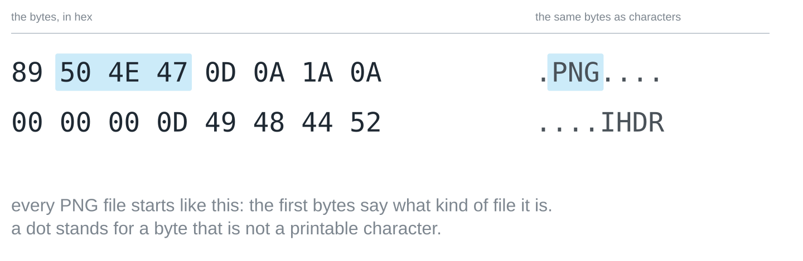

Two things stand out. The first few bytes give away what kind of file it is,
because every PNG file starts with the same eight bytes, and other formats have
signatures of their own. And between the readable positions there are just as
many unreadable ones, which are the same stuff: a file is nothing but a
sequence of numbers, and only the program that reads it decides what they
mean.

Look at the first bytes of a PDF, a JPEG and a text file of your own in the
hex viewer, find the line breaks in a text, and type an umlaut or an emoji to
see how many bytes it takes:


> [!TIP]
> Every programming editor can show a file as a hex dump, and on the command
> line `xxd` (Linux, macOS) or `Format-Hex` (Windows PowerShell) does the
> same.

## Two ladders of units

File sizes are counted in bytes, and the prefixes kilo, mega and giga have two
meanings there. The decimal ladder multiplies by 1000 per step, as kilo, mega
and giga do in every other unit. The binary ladder multiplies by 1024, because
memory is organised in powers of two and 2¹⁰ = 1024 is the power of two
closest to 1000.

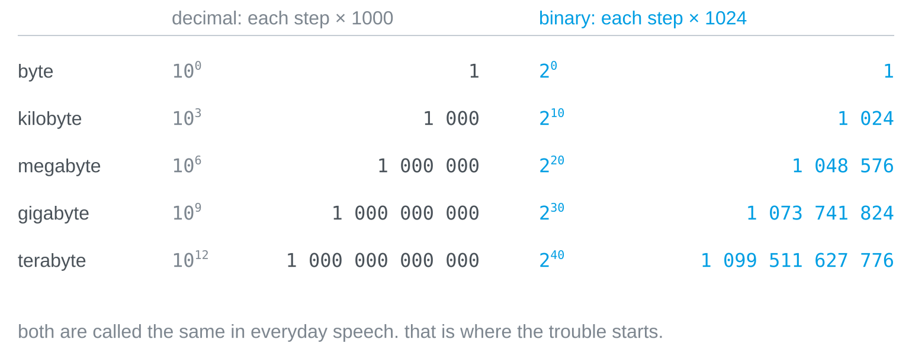

Written as powers, the difference is plain: the decimal ladder climbs in steps
of 10³, the binary one in steps of 2¹⁰. The gap between the ladders grows by
about 2.4 percent per step, so a binary kilobyte is 2.4 percent larger than a
decimal one, a binary gigabyte 7.4 percent and a binary terabyte 10 percent.

## The missing 69 gigabytes

The box says 1 terabyte, the computer says 931 gigabytes, and not a single
byte has gone missing. The manufacturer counts up the decimal ladder, so a
terabyte is a trillion bytes. The operating system takes that same trillion
and divides it down the binary ladder, by 1024³, and arrives at 931.

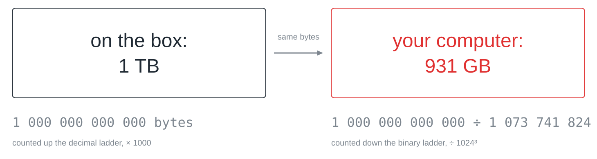

You can check the division yourself:

```python
print(10**12 / 1024**3)
```

Nobody rounded and nobody cheated: both figures describe the same number of
bytes, and the annoyance is only that both sides call their step a gigabyte.
Since 1998 there are clean names for the binary steps: kibibyte (KiB),
mebibyte (MiB), gibibyte (GiB) and tebibyte (TiB), where *bi* stands for
binary. In this notation the disk holds 1 TB, which is 931 GiB. Almost nobody
uses the names in conversation, which is why the confusion survives; operating
systems differ too, as Windows reports binary values with the decimal names,
while macOS has counted in decimal steps since 2009.

> [!TIP]
> When a size matters, say which ladder you mean. "2 KiB" is 2048 bytes,
> "2 kB" is 2000 bytes, and "2 KB" can be either.

## Digits do not have to look like digits

A digit is only a symbol that stands for a value by agreement. If you can
reliably tell four colours apart, you have four digits, and agreeing which
colour stands for which value is enough to make a sequence of colours a number
in base 4.

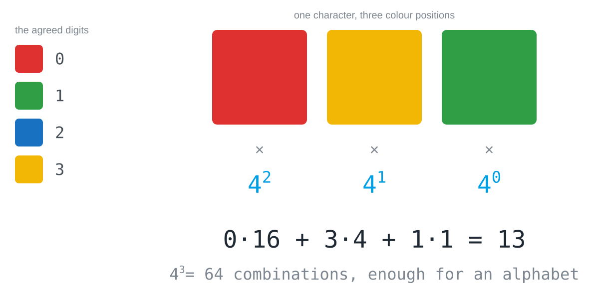

Two things follow from this, and they hold for every code of this kind. The
order is part of the message: red-yellow-green and green-yellow-red are
different code words, for exactly the reason that 123 and 321 are different
numbers. And the arithmetic runs both ways: with *k* symbols and *n* positions
you can distinguish *k*ⁿ code words, so if you know how many characters you
need, you can work out how many positions that costs. Four colours and two
positions give 16 combinations, which is not enough for 26 letters; three
positions give 64, which is.

## In short

Ten was never special, since it is the number of fingers on two hands and
nothing else. Once you have seen that, no base looks natural and none looks
difficult any more: binary, hexadecimal and a colour code are the same recipe
of digit times place value with different digits.


