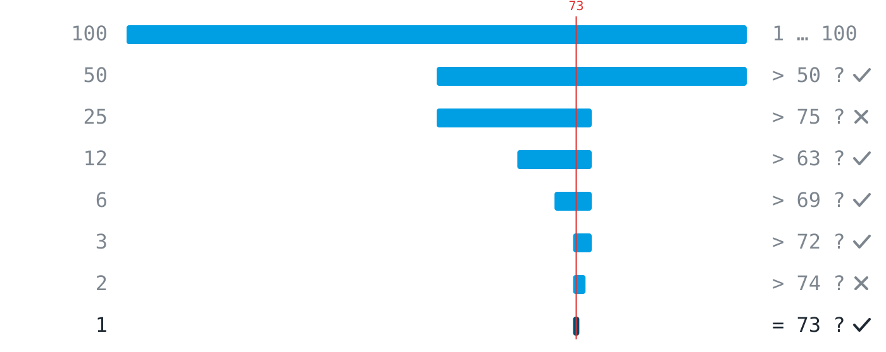

## Woran erkennt man, dass eine Teilaufgabe gut geschnitten ist? {#pd-001}

- [ ] Sie ist so klein wie möglich.
  > Kleinheit allein hilft nicht. Auch ein winziges Teil kann unprüfbar sein, und zu viele Kleinstteile erzeugen unnötigen Abstimmungsaufwand.
- [ ] Sie lässt sich in einer Stunde erledigen.
  > Die Bearbeitungszeit sagt nichts darüber, ob man hinterher weiß, ob das Teil sitzt.
- [x] Sie hat einen eingebauten Test, der Ja oder Nein sagt.
  > Genau das ist der Kern: Ein gutes Teil ist eines, bei dem man nach dem Bearbeiten prüfen kann, ob es erledigt ist.
- [ ] Sie kommt im Aufgabentext ausdrücklich vor.
  > Die Zerlegung ist eure eigene Entscheidung. Gute Schnitte stehen selten fertig in der Aufgabe.

## Vier Teams beschreiben den Stand ihrer Arbeit. Welche Beschreibung ist prüfbar? {#pd-002}

- [ ] Die Übertragung funktioniert inzwischen ziemlich zuverlässig.
  > 'Ziemlich zuverlässig' ist ein Gefühl. Es gibt keinen Test, der daraus Ja oder Nein macht.
- [x] Der Empfänger unterscheidet Rot und Blau in 50 von 50 Versuchen.
  > 50 aus 50 ist ein Messwert: Man kann den Versuch ausführen und bekommt ein eindeutiges Ergebnis.
- [ ] Der Code für den Empfänger ist fertig geschrieben.
  > 'Fertig geschrieben' sagt nichts über das Verhalten. Code kann vollständig aussehen und trotzdem das Falsche tun.
- [ ] Die LED ist hell genug für die Übertragung.
  > 'Hell genug' ist ohne Messvorschrift kein Test: hell genug wofür, gemessen wie?

## Jemand denkt sich eine Zahl zwischen 1 und 100. Ihr dürft nur Ja/Nein-Fragen stellen. Wie viele Fragen genügen im schlechtesten Fall sicher, wenn ihr geschickt fragt? {#pd-003}

- [ ] 6
  > Eine zu wenig: Sechs Halbierungen unterscheiden höchstens 64 Möglichkeiten, es gibt aber 100.
- [x] 7
  > Jede geschickte Frage halbiert den Bereich: 100, 50, 25, 13, 7, 4, 2, 1. Sieben Halbierungen unterscheiden bis zu 128 Möglichkeiten.
- [ ] 50
  > Das wäre die halbe Liste, Zahl für Zahl geraten. Halbieren des Bereichs ist viel stärker als Abfragen einzelner Zahlen.
- [ ] 99
  > So viele braucht nur, wer jede Zahl einzeln durchprobiert und nie halbiert.

## Zu Hause ist das Internet ausgefallen. Die Kette der Verdächtigen: Laptop, WLAN, Router, Anbieter. Ihr verbindet den Laptop mit dem Handy-Hotspot, und alles funktioniert. Was wisst ihr jetzt? {#pd-004}

- [x] Der Laptop scheidet als Ursache praktisch aus; das Problem liegt weiter hinten in der Kette.
  > Genau das leistet der Test: Er halbiert die Kette. Der Laptop kann ins Internet, also liegt es an WLAN, Router oder Anbieter.
- [ ] Das WLAN ist die Ursache, denn der Hotspot ersetzt genau dieses Glied, und damit läuft es.
  > Der Hotspot ersetzt nicht nur das WLAN, sondern auch Router und Anbieter. Der Test schließt den Laptop aus, unterscheidet aber nicht zwischen den drei übrigen Gliedern.
- [ ] Der Anbieter hat eine Störung, denn über das Mobilfunknetz kommt der Laptop ja problemlos ins Internet.
  > Dass ein anderer Weg funktioniert, belastet nicht den Anbieter allein. WLAN und Router liegen ebenfalls auf dem ausgefallenen Weg und bleiben Verdächtige.
- [ ] Noch nichts Belastbares, denn der Hotspot nimmt einen anderen Weg und sagt über die Heimkette nichts aus.
  > Gerade weil der Weg ein anderer ist, ist der Test aussagekräftig: Er prüft den Laptop isoliert vom Rest der Kette.

## Eure Übertragungsstrecke besteht aus Sender, LED, Luft, Sensor und Empfänger. Der Empfänger gibt nichts aus, und ihr wisst nicht, woran es liegt. Welcher erste Test grenzt das Problem am wirkungsvollsten ein? {#pd-005}

- [ ] Den Code des Senders Zeile für Zeile durchgehen und prüfen, ob die Farbwerte richtig gesetzt werden.
  > Das prüft ein einzelnes Glied am Anfang der Kette, und zwar nur durch Lesen. Selbst wenn der Code fehlerfrei ist, bleiben vier Verdächtige übrig; die Suche hat kaum etwas ausgeschlossen.
- [ ] Beide Geräte neu starten, damit ein hängen gebliebener Zustand als Ursache ausscheidet.
  > Der Neustart-Reflex. Er verändert alle Glieder auf einmal; selbst wenn es danach geht, wisst ihr nicht, welches kaputt war, und das Problem kommt wieder.
- [x] Eine Taschenlampe vor den Sensor halten und schauen, ob sich die Messwerte ändern.
  > Ein Test in der Mitte der Kette: Reagiert der Sensor, ist die Empfängerhälfte in Ordnung, und ihr sucht nur noch bei Sender und LED. Reagiert er nicht, umgekehrt.
- [ ] Den Abstand zwischen den Geräten verringern, damit mehr Licht am Sensor ankommt.
  > Das verändert eine Bedingung, prüft aber kein Kettenglied gezielt. Wenn es hilft, wisst ihr immer noch nicht warum, und wenn nicht, habt ihr nichts ausgeschlossen.

## Zwei Personen bereiten das Essen für eine Party vor. Warum funktioniert die Aufteilung "du machst die Vorspeise, ich den Nachtisch" besser als "wir machen beide irgendwie das Essen"? {#pd-006}

- [ ] Weil dann jede Person weniger Arbeit hat.
  > Die Arbeitsmenge ist in beiden Fällen gleich. Der Unterschied liegt nicht in der Menge, sondern im Schnitt.
- [x] Weil die Grenze klar ist und kaum Abstimmung nötig wird.
  > Genau: Wo man schneidet, entscheidet, wie viel man reden muss. Klare Grenzen machen Teile unabhängig bearbeitbar.
- [ ] Weil zwei getrennte Aufgaben parallel laufen und das Essen so doppelt so schnell fertig ist.
  > Parallel arbeiten könnten beide auch bei 'wir machen beide das Essen'. Der Gewinn des Schnitts liegt nicht im Tempo, sondern darin, dass jede Person ohne Rückfragen weiß, was ihres ist.
- [ ] Weil man sich bei zwei getrennten Aufgaben nicht mehr absprechen muss.
  > Fast, aber zu absolut: Was die Grenze überquert (Zeitplan, Ofen, Budget), muss weiterhin abgesprochen werden. Der gute Schnitt macht die Absprache klein, nicht überflüssig.

## In einer alphabetisch sortierten Liste mit 1000 Namen sucht ihr einen bestimmten Namen, indem ihr immer in der Mitte des verbleibenden Bereichs nachschaut. Wie oft müsst ihr höchstens nachschauen, ungefähr? {#pd-007}

- [x] Etwa 10
  > Jeder Blick halbiert den Bereich, und zehn Halbierungen unterscheiden 1024 Möglichkeiten. Deshalb wächst der Aufwand nur um eins, wenn sich die Liste verdoppelt.
- [ ] Etwa 100
  > Das unterschätzt die Kraft des Halbierens: Schon 10 Halbierungen reichen für 1000 Einträge, nicht erst 100.
- [ ] Etwa 500
  > 500 wäre der Erwartungswert, wenn man die Liste von vorn durchgeht, Name für Name, ohne zu halbieren.
- [ ] Etwa 1000
  > So oft schaut nur, wer die Sortierung ignoriert und schlimmstenfalls jeden Eintrag prüft.

## Welches Vorgehen folgt dem Muster "erst eine kleinere Version des Problems lösen"? {#pd-008}

- [ ] Sofort die vollständige Dateiübertragung bauen und danach die Fehler suchen.
  > Das ist der Big Bang: Wenn am Ende nichts funktioniert, weiß niemand, welcher der vielen Teile schuld ist.
- [ ] Mit allen Teilproblemen gleichzeitig anfangen, damit keine Zeit verloren geht.
  > Parallel anfangen ist kein Stufenplan. Ohne eine funktionierende kleine Version fehlt die Grundlage, auf der die nächste Stufe aufbaut.
- [x] Erst das Licht an- und ausschalten, dann zwei Farben unterscheiden, dann Zeichen übertragen.
  > Genau die Treppe: Jede Stufe ist eine etwas größere Fassung desselben Problems, und jede funktioniert, bevor die nächste beginnt.
- [ ] Die Aufgabe so lange verschieben, bis alle Grundlagen im Kurs behandelt wurden.
  > Warten ist keine Zerlegungsstrategie. Die kleine Version kann man sofort lösen, mit dem, was man schon kann.

## Ihr arbeitet mit dem KI-Assistenten an eurem Empfänger. Welcher Auftrag passt zur Arbeitsteilung "ihr schneidet, die Maschine löst Teile, ihr prüft"? {#pd-009}

- [ ] Baue mir den kompletten Empfänger für unsere Lichtübertragung. Ich prüfe am Ende, ob der gesendete Text ankommt.
  > Ein Test ist zwar mitgedacht, aber das Stück ist zu groß: Kommt kein Text an, wisst ihr nicht, welcher der vielen Teile schuld ist. Und die Zerlegung hätte die Maschine übernommen statt ihr.
- [x] Schreibe eine Funktion, die den Sensor zehnmal liest und den Mittelwert zurückgibt. Ich teste sie mit LED aus und LED an.
  > Kleiner Auftrag, klare Ein- und Ausgabe, und der Test ist schon mitgedacht. Ihr bleibt Herr der Lage.
- [ ] Überarbeite meinen Empfängercode so, dass er zuverlässiger wird, und erkläre mir anschließend die Änderungen.
  > 'Zuverlässiger' ist kein prüfbares Ziel, und was geändert wird, entscheidet die Maschine. Ihr könntet hinterher nicht sagen, ob der Auftrag erfüllt wurde, auch nicht mit Erklärung.
- [ ] Schreibe eine Funktion, die den Sensor liest und die erkannte Farbe zurückgibt. Wenn der Code schlüssig aussieht, übernehme ich ihn.
  > Der Schnitt ist gut, die Prüfung fehlt: 'Sieht schlüssig aus' ist ein Gefühl, kein Test. Der dritte Teil der Arbeitsteilung, das Prüfen am Gerät, wäre übersprungen.

## Im Modul gilt die Werkstattregel "fertig heißt: der Test läuft durch". Wann ist die Aufgabe "die LED blinkt einmal pro Sekunde" danach fertig? {#pd-010}

- [ ] Wenn das Programm ohne Fehlermeldung durchläuft und die LED dabei sichtbar blinkt.
  > Keine Fehlermeldung heißt nur: Die Maschine konnte ausführen, was dastand. Ob das Richtige passiert, sagt sie damit nicht.
- [ ] Wenn das Blinken beim Zuschauen gleichmäßig wirkt und ungefähr im Sekundentakt liegt.
  > 'Wirkt gleichmäßig' und 'ungefähr' sind Gefühle. Ob es wirklich eine Sekunde ist, verrät nur eine Messung mit vereinbarter Toleranz.
- [x] Wenn der vereinbarte Prüfschritt bestanden ist, etwa zehn Blinkzyklen in gemessenen zehn Sekunden.
  > Genau die Regel: Fertig ist, was seinen vereinbarten Test besteht, ausführbar von euch selbst, ohne auf jemanden zu warten.
- [ ] Wenn der KI-Assistent den Code geprüft hat und bestätigt, dass er einmal pro Sekunde blinkt.
  > Der Assistent hat keinen Zugang zur echten LED. Die Ground Truth liegt am Gerät, und geprüft wird dort, nicht im Chat.

## Die Abbildung zeigt das Zahlenraten zwischen 1 und 100: Blau ist der Bereich, in dem die gesuchte Zahl noch stecken kann, die rote Linie ist die gesuchte 73. Welche Aussagen treffen zu? (Mehrere richtige Antworten möglich.) {#pd-011}



- [x] Jede Frage halbiert ungefähr den blauen Bereich.
  > Richtig, das ist der Kern der Strategie: Jede geschickte Ja/Nein-Frage schließt etwa die Hälfte der verbleibenden Möglichkeiten aus.
- [ ] Die rote Linie wandert mit jeder Frage weiter nach rechts.
  > Falsch: Die gesuchte Zahl steht von Anfang an fest. Es bewegt sich nur der blaue Bereich, der auf sie zusammenschrumpft.
- [x] Am Ende bleibt genau eine Zahl übrig.
  > Richtig: Halbieren endet erst, wenn der Bereich nur noch eine Möglichkeit enthält, und die ist dann die Antwort.
- [x] Die erste Frage schließt die meisten Zahlen auf einmal aus.
  > Richtig: Die erste Halbierung streicht rund 50 Zahlen, die zweite noch 25, und so weiter. Absolut gesehen leistet der erste Schnitt am meisten.
- [ ] Eine Nein-Antwort liefert keine Information.
  > Falsch: Auch ein Nein halbiert den Bereich, nur eben zur anderen Seite. Beide Antworten sind gleich wertvoll.

## Der KI-Assistent liefert euch diese Funktion. Welcher Umgang damit passt zur Werkstattregel? {#pd-012}

```python static
def read_average():
    values = []
    for i in range(10):
        values.append(sensor.read())
    return sum(values) / 10
```

- [ ] Den Code Zeile für Zeile lesen und ihn übernehmen, sobald jede Zeile schlüssig ist.
  > Lesen ist gut, reicht aber nicht: 'Sieht schlüssig aus' ist ein Gefühl, kein Test. Plausibler Code kann trotzdem das Falsche tun.
- [x] Einmal mit LED an und einmal mit LED aus aufrufen und prüfen, ob sich die Rückgabe deutlich unterscheidet.
  > Genau: ein kleiner, selbst ausführbarer Test mit bekannter Eingabe und erwartbarer Ausgabe. Er prüft die Funktion am echten Gerät, der Ground Truth.
- [ ] Den Assistenten fragen, ob die Funktion korrekt ist, und die Antwort dokumentieren.
  > Der Assistent hat keinen Zugang zum echten Sensor. Er kann den Code erklären, aber nicht an der Wirklichkeit prüfen; das könnt nur ihr.
- [ ] Die Funktion behalten, wenn sie ohne Fehlermeldung durchläuft.
  > Ohne Fehlermeldung heißt nur, dass Python die Zeilen ausführen konnte. Ob der Wert stimmt, zeigt erst ein Test am echten Sensor: einmal mit LED an, einmal aus.
