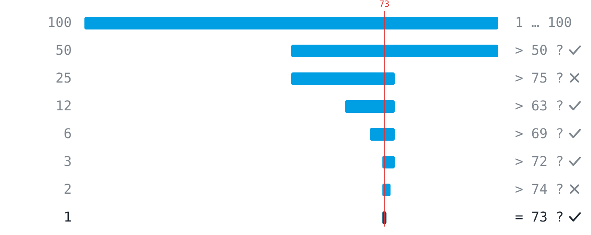

## How can you tell that a subtask has been cut well? {#pd-001}

- [ ] It is as small as possible.
  > Being small is not the point. Even a tiny piece can be untestable, and too many micro-pieces create needless coordination.
- [ ] It can be finished within one hour.
  > How long it takes says nothing about whether you can tell afterwards that the piece works.
- [x] It has a built-in test that answers yes or no.
  > That is the core idea: a good piece is one where you can check afterwards whether it is done.
- [ ] It is explicitly mentioned in the task description.
  > Decomposition is your own decision. Good cuts are rarely spelled out in the task.

## Four teams describe the state of their work. Which description is testable? {#pd-002}

- [ ] The transmission works quite reliably by now.
  > 'Quite reliably' is a feeling. There is no test that turns it into yes or no.
- [x] The receiver tells red from blue in 50 out of 50 attempts.
  > 50 out of 50 is a measurement: you can run the trial and get an unambiguous result.
- [ ] The code for the receiver is fully written.
  > 'Fully written' says nothing about behaviour. Code can look complete and still do the wrong thing.
- [ ] The LED is bright enough for the transmission.
  > 'Bright enough' is not a test without a measurement rule: bright enough for what, measured how?

## Someone thinks of a number between 1 and 100. You may only ask yes/no questions. How many questions are guaranteed to suffice in the worst case if you ask cleverly? {#pd-003}

- [ ] 6
  > One too few: six halvings distinguish at most 64 possibilities, but there are 100.
- [x] 7
  > Each clever question halves the range: 100, 50, 25, 13, 7, 4, 2, 1. Seven halvings distinguish up to 128 possibilities.
- [ ] 50
  > That would be guessing half the list, number by number. Halving the range is far stronger than probing single numbers.
- [ ] 99
  > Only someone who tries every number one by one, never halving, needs that many.

## Your home internet is down. The chain of suspects: laptop, wifi, router, provider. You connect the laptop to your phone's hotspot and everything works. What do you know now? {#pd-004}

- [x] The laptop is practically ruled out; the problem lies further down the chain.
  > That is exactly what the test does: it halves the chain. The laptop can reach the internet, so wifi, router or provider must be at fault.
- [ ] The wifi is the cause, because the hotspot replaces exactly that link, and then it works.
  > The hotspot replaces not only the wifi but also the router and the provider. The test rules out the laptop but does not distinguish between the three remaining links.
- [ ] The provider has an outage, because via the mobile network the laptop reaches the internet without trouble.
  > That a different route works does not single out the provider. Wifi and router also sit on the failed route and remain suspects.
- [ ] Nothing solid yet, since the hotspot takes a different route and says nothing about the home chain.
  > Precisely because the route is different, the test is informative: it checks the laptop in isolation from the rest of the chain.

## Your transmission chain consists of sender, LED, air, sensor and receiver. The receiver outputs nothing and you do not know why. Which first test narrows the problem down most effectively? {#pd-005}

- [ ] Go through the sender's code line by line and check whether the colour values are set correctly.
  > That checks a single link at the start of the chain, and only by reading. Even if the code is flawless, four suspects remain; the search has ruled out almost nothing.
- [ ] Restart both devices so that a stuck state can be ruled out as the cause.
  > The restart reflex. It changes all links at once; even if it works afterwards, you do not know which one was broken, and the problem will come back.
- [x] Hold a torch in front of the sensor and check whether the readings change.
  > A test in the middle of the chain: if the sensor reacts, the receiver half is fine and you only search sender and LED. If not, the other way round.
- [ ] Reduce the distance between the devices so that more light reaches the sensor.
  > That changes a condition but does not target any link. If it helps, you still do not know why, and if not, you have ruled out nothing.

## Two people prepare the food for a party. Why does the split "you do starters, I do dessert" work better than "we both kind of do the food"? {#pd-006}

- [ ] Because each person has less work that way.
  > The amount of work is the same in both cases. The difference is not the amount but the cut.
- [x] Because the boundary is clear and hardly any coordination is needed.
  > Exactly: where you cut decides how much you must talk. Clear boundaries make pieces independently workable.
- [ ] Because two separate tasks run in parallel, so the food is ready twice as fast.
  > Both could work in parallel under 'we both kind of do the food' as well. The gain of the cut is not speed but that each person knows what is theirs without asking.
- [ ] Because with two separate tasks no agreement is needed at all.
  > Close, but too absolute: whatever crosses the boundary (timing, oven, budget) still needs agreement. A good cut makes the agreement small, not unnecessary.

## In an alphabetically sorted list of 1000 names you look for one name by always checking the middle of the remaining range. Roughly how many checks do you need at most? {#pd-007}

- [x] About 10
  > Each check halves the range, and ten halvings distinguish 1024 possibilities. That is why doubling the list adds only one more check.
- [ ] About 100
  > This underestimates halving: 10 halvings already cover 1000 entries, not 100.
- [ ] About 500
  > 500 would be the average if you scanned the list from the front, name by name, without halving.
- [ ] About 1000
  > Only someone ignoring the sorting and checking every entry in the worst case needs that many.

## Which approach follows the pattern "solve a smaller version of the problem first"? {#pd-008}

- [ ] Build the complete file transfer right away and look for the errors afterwards.
  > That is the big bang: when nothing works at the end, nobody knows which of the many parts is to blame.
- [ ] Start on all subproblems at the same time so no time is lost.
  > Starting everything in parallel is not a staircase. Without a working small version there is no base for the next step.
- [x] First switch the light on and off, then tell two colours apart, then transmit characters.
  > Exactly the staircase: each step is a slightly bigger version of the same problem, and each one works before the next begins.
- [ ] Postpone the task until all the basics have been covered in class.
  > Waiting is not a decomposition strategy. The small version can be solved right away with what you already know.

## You are working on your receiver with the AI assistant. Which request fits the division of labour "you cut, the machine solves pieces, you check"? {#pd-009}

- [ ] Build me the complete receiver for our light transmission. At the end I will check whether the sent text arrives.
  > A test is planned, but the piece is too large: if no text arrives, you do not know which of the many parts is to blame. And the machine would have done the cutting instead of you.
- [x] Write a function that reads the sensor ten times and returns the average. I will test it with the LED off and on.
  > Small task, clear input and output, and the test is already planned. You stay in control.
- [ ] Rework my receiver code so that it becomes more reliable, and explain the changes to me afterwards.
  > 'More reliable' is not a testable goal, and the machine decides what gets changed. Afterwards you could not tell whether the request was fulfilled, explanation or not.
- [ ] Write a function that reads the sensor and returns the detected colour. If the code looks plausible, I will keep it.
  > The cut is fine, the check is missing: 'looks plausible' is a feeling, not a test. The third part of the division of labour, checking on the device, would be skipped.

## The module's workshop rule says "done means: the test passes". According to it, when is the task "the LED blinks once per second" done? {#pd-010}

- [ ] When the program runs without an error message and the LED visibly blinks while it does.
  > No error message only means the machine could execute what was written. It does not say the right thing happened.
- [ ] When the blinking looks even to the eye and seems to be roughly once per second.
  > 'Looks even' and 'roughly' are feelings. Only a measurement with an agreed tolerance tells whether it is really one second.
- [x] When the agreed check passes, for example ten blink cycles in a measured ten seconds.
  > Exactly the rule: done is what passes its agreed test, executable by yourselves without waiting for anyone.
- [ ] When the AI assistant has reviewed the code and confirms that it blinks once per second.
  > The assistant has no access to the real LED. The ground truth is at the device, and that is where checking happens, not in the chat.

## The figure shows the guessing game between 1 and 100: blue is the range where the number can still be, the red line is the target 73. Which statements are true? (Several answers may be correct.) {#pd-011}



- [x] Each question roughly halves the blue range.
  > Correct, that is the core of the strategy: each clever yes/no question rules out about half of the remaining possibilities.
- [ ] The red line moves further right with each question.
  > Wrong: the target number is fixed from the start. Only the blue range moves as it shrinks onto it.
- [x] In the end exactly one number remains.
  > Correct: halving only ends when the range contains a single possibility, which is then the answer.
- [x] The first question rules out the most numbers at once.
  > Correct: the first halving removes about 50 numbers, the second 25, and so on. In absolute terms the first cut does the most.
- [ ] A 'no' answer provides no information.
  > Wrong: a 'no' also halves the range, just towards the other side. Both answers are equally valuable.

## The AI assistant delivers this function. Which way of handling it fits the workshop rule? {#pd-012}

```python static
def read_average():
    values = []
    for i in range(10):
        values.append(sensor.read())
    return sum(values) / 10
```

- [ ] Read the code line by line and keep it once every line makes sense.
  > Reading is good but not enough: 'looks plausible' is a feeling, not a test. Plausible code can still do the wrong thing.
- [x] Call it once with the LED on and once with it off, and check that the return value clearly differs.
  > Exactly: a small, self-executable test with known input and expected output. It checks the function on the real device, the ground truth.
- [ ] Ask the assistant whether the function is correct and document the answer.
  > The assistant has no access to the real sensor. It can explain the code but cannot check it against reality; only you can.
- [ ] Keep the function if it runs without an error message.
  > No error message only means Python could run the lines. Whether the value is right only a test on the real sensor shows: once with the LED on, once off.
