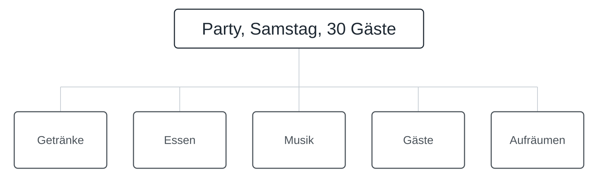
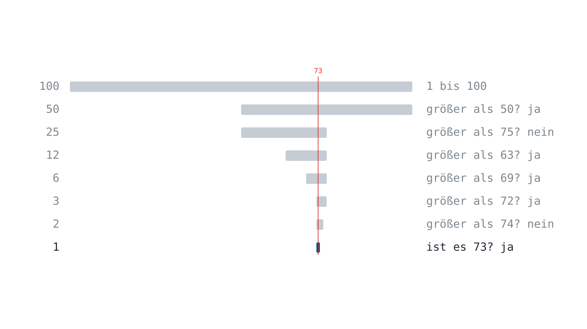
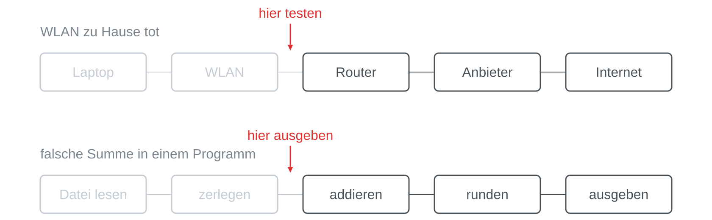
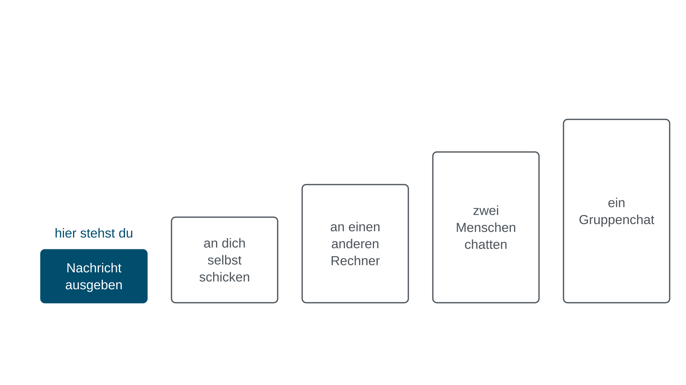
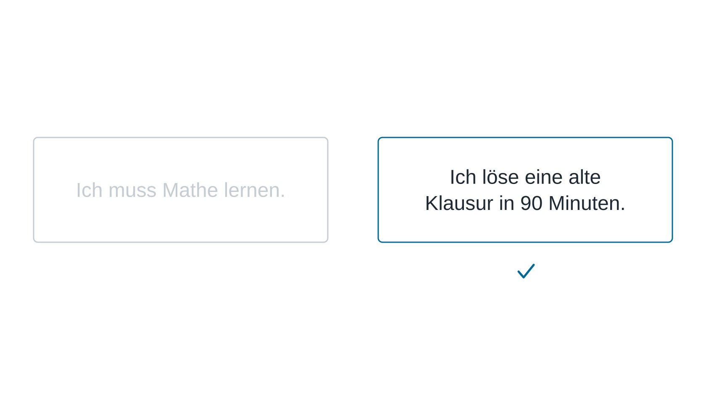
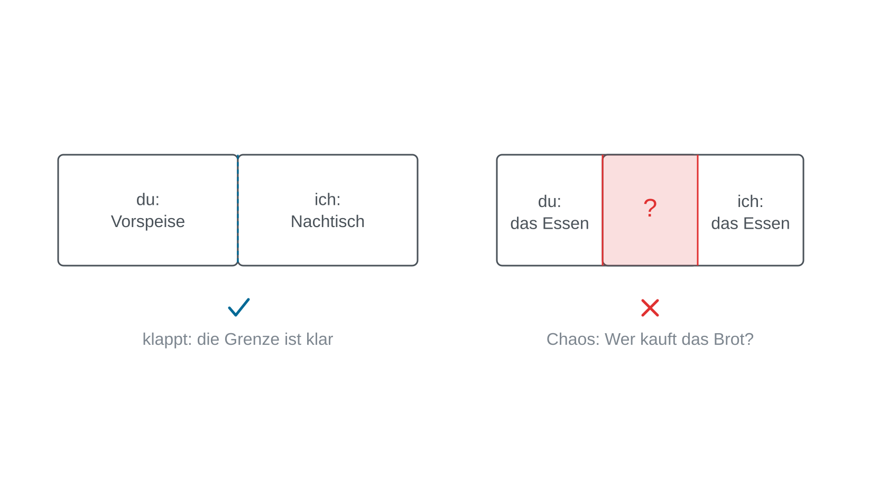

„Bau eine Chat-App“ löst niemand in einem Stück. Das sagt nichts über dich
aus, es ist der Normalzustand jedes interessanten Problems: Große Probleme
löst man nicht auf einen Schlag, man schneidet sie, immer wieder, bis die
Stücke klein genug sind, um sie zu lösen und zu prüfen.

Das kannst du übrigens schon. Am Samstag hat jemand Geburtstag, dreißig Gäste
kommen, und niemand plant „die Party“ als ein Ding. Du schneidest sie sofort in
Getränke, Essen, Musik, Gäste und Aufräumen, und dann verteilst du die Stücke.
Neu ist hier nur, dass du es mit Absicht machst und weißt, was einen Schnitt
besser macht als einen anderen.

## Drei Schnittmuster

Es gibt bewährte Arten zu schneiden, und drei davon brauchst du ständig.

### Halbieren, bis es leicht ist

Die Informatik nennt das Teile und herrsche, englisch divide and conquer.
Denk dir eine Zahl zwischen 1 und 100. Mit Ja-Nein-Fragen, die den Bereich
jedes Mal halbieren, findest du jede Zahl in höchstens sieben Fragen: hundert
Kandidaten, dann fünfzig, fünfundzwanzig, zwölf, sechs, drei, zwei, gefunden.
Die Strategie funktioniert überall, wo du nach jedem Schnitt eine Hälfte
ausschließen kannst.

Warum es gerade sieben Fragen sind, hat mit Information zu tun: Jede
Ja-Nein-Frage liefert ein Bit, und sieben Bit unterscheiden 128 Möglichkeiten,
mehr als die hundert, die es hier gibt.

### Derselbe Trick, wenn etwas kaputt ist

Auch das kennst du. Ist das WLAN tot, testest du ohne nachzudenken in der Mitte
der Kette: Geht der Hotspot des Handys, liegt es nicht am Laptop, und die Hälfte
der Verdächtigen ist weg. Jeder Test halbiert die Kette. Genauso gehst du vor,
wenn ein Programm eine falsche Summe ausgibt: Lass dir den Zwischenwert in der
Mitte ausgeben; stimmt er, liegt der Fehler dahinter, sonst davor. Wer gut
zerlegt hat, weiß nicht nur, **dass** etwas kaputt ist, sondern **wo**.

### Erst eine kleinere Fassung lösen

Ist ein Problem zu groß, löst du zuerst eine kleinere Fassung, die du wirklich
kannst, und wächst von dort aus. Niemand baut einen Gruppenchat als Erstes. Man
gibt zuerst eine Nachricht auf dem eigenen Bildschirm aus, schickt sie dann an
sich selbst und danach an einen anderen Rechner, und erst am Ende chatten
mehrere Menschen miteinander. Jede Stufe ist eine etwas größere Fassung
desselben Problems, und auf jeder läuft schon etwas.

## Ein guter Schnitt ist prüfbar

Schneiden allein genügt nicht, denn nicht jeder Schnitt ist gleich gut.
Vergleiche zwei Sätze: „Ich muss Mathe lernen“ und „Ich löse eine alte Klausur
in 90 Minuten“. Beide klingen nach Klausurvorbereitung. Beim ersten weißt du
nie, ob du fertig bist; das zweite kannst du heute Abend ausprobieren und
bekommst ein Ja oder ein Nein. Ein gutes Stück ist eines, in das ein Test
eingebaut ist.

In einem Programm ist es dasselbe. „Die App funktioniert“ ist ein Gefühl. „Ein
falsches Passwort zeigt zehnmal von zehn eine Fehlermeldung“ ist ein Test, der
mit Ja oder Nein antwortet.

Daraus folgt eine einfache Regel: **Fertig heißt, der Test läuft durch**, und
nicht „sieht gut aus“. Wer eine Aufgabe so schneidet, dass jedes Stück einen
eigenen Test hat, muss auf niemanden warten, um zu wissen, ob er fertig ist.

## Schnitte sind Absprachen

Wo du schneidest, entscheidet, wie viel ihr reden müsst. „Du machst die
Vorspeise, ich den Nachtisch“ funktioniert. „Wir machen beide irgendwie das
Essen“ wird Chaos, weil niemand weiß, wer das Brot kauft. Stücke funktionieren,
wenn die Grenze zwischen ihnen klar ist, und was über die Grenze geht, wird
aufgeschrieben.

Mit einem KI-Assistenten ist das Zerlegen die wichtigste Fähigkeit überhaupt.
„Bau mir eine Chat-App“ ist ein großer Wunsch: Der Assistent kann ihn nicht
gut erfüllen, und du könntest das Ergebnis nicht einmal prüfen, wenn er es
täte. Ein kleines Stück mit seinem Test ist etwas anderes. Es sagt genau, was
herauskommen soll, und nennt den Test gleich mit, sodass du die Antwort in
zehn Sekunden nachprüfen kannst, ohne dem Assistenten glauben zu müssen.

Du schneidest das Problem, der Assistent löst die Stücke, und du prüfst jedes
davon. Was ein geschnittenes Stück braucht, sobald ein Rechner es lösen soll,
zeigt [[input-processing-output]].

Wie das LiFi-Projekt in seine Challenges geschnitten ist und wie ihr im Team,
bei der Fehlersuche und mit dem Assistenten weiter zerlegt, zeigen die Folien
zum Projekt.

## Zum Weiterlesen

George Pólya: *How to Solve It*. Princeton University Press, 1945. Der
Klassiker über das Zerlegen von Problemen, geschrieben für die Mathematik und
weit darüber hinaus lesbar: das Problem verstehen, einen Plan machen, ihn
ausführen und zurückblicken. Seine Fragen („Kennst du ein verwandtes
Problem?“, „Kannst du einen Teil davon lösen?“) sind die lange Fassung dieser
Seite.
