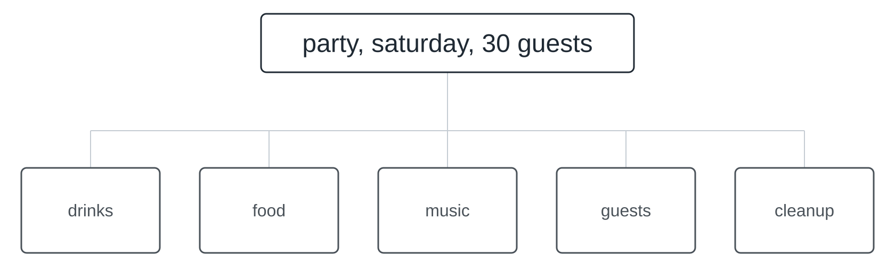
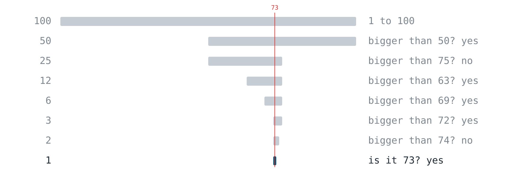
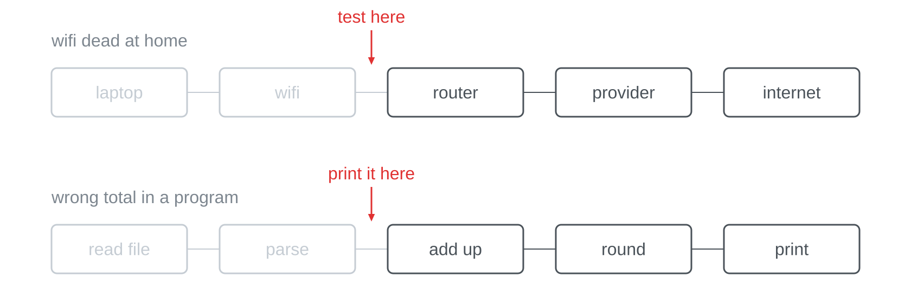
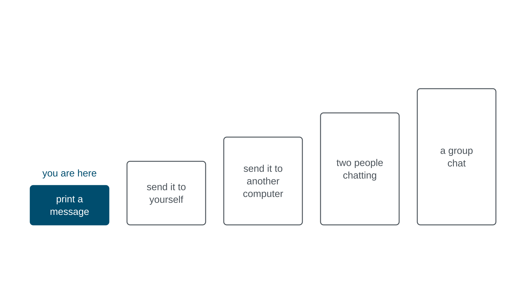
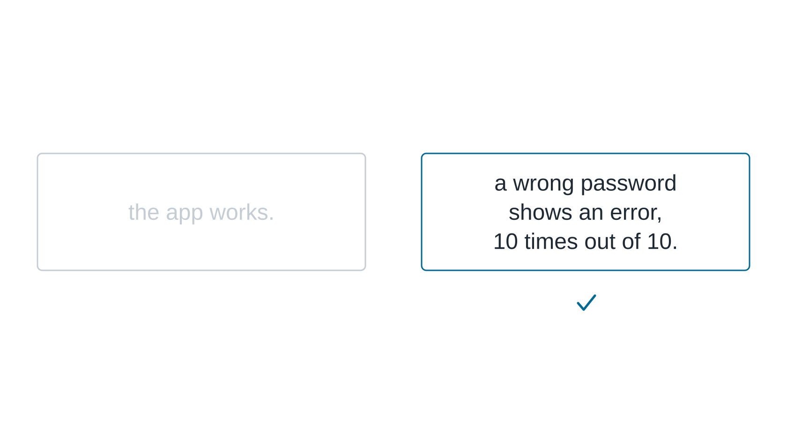
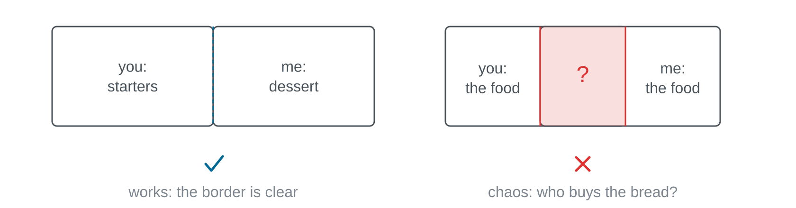
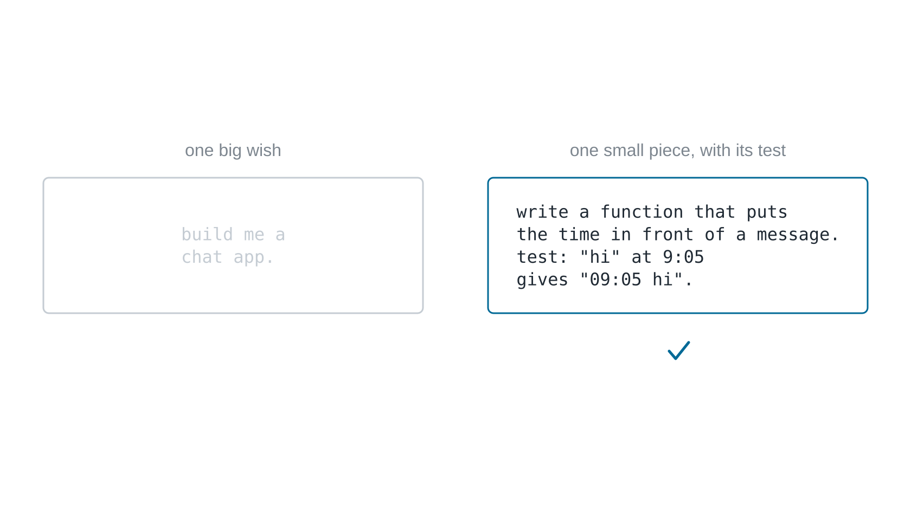

"Build a chat app" cannot be solved in one piece, by anyone. That says nothing
about you; it is the normal state of every interesting problem. Big problems
are not solved in one go: they are cut, again and again, until the pieces are
small enough to be solved and checked.

You can already do this, by the way. Somebody's birthday is on Saturday,
thirty guests are coming, and nobody plans "the party" as one thing. You cut it
at once into drinks, food, music, guests and cleaning up, and then you hand the
pieces out. What is new here is only doing it on purpose, and knowing what
makes one cut better than another.

## Three cutting patterns

There are tried and tested ways to cut, and you will use three of them all
the time.

### Halve it until it is easy

Computer science calls this divide and conquer. Think of a number between 1
and 100. With yes-or-no questions that cut the range in half every time, you
find any number in at most seven questions: a hundred candidates, then fifty,
twenty-five, twelve, six, three, two, done. The strategy works wherever you can
rule out one half after every cut.

Why it is exactly seven questions has to do with information: every yes-or-no
question delivers one bit, and seven bits tell 128 possibilities apart, more
than the hundred there are here.

### The same trick when something is broken

You know this one too. When the wifi is dead, you test in the middle of the
chain without thinking about it: if the phone hotspot works, it is not the
laptop, and half the suspects are gone. Every test halves the chain. You do the
same when a program prints a wrong total: print the value in the middle; if it
is right, the fault lies behind it, otherwise before. Whoever has cut well
knows not only **that** something is broken, but **where**.

### Solve a smaller version first

When a problem is too big, solve a smaller version of it that you really can
do, and grow from there. Nobody builds a group chat first. You start by
printing a message on your own screen, then send it to yourself and after that
to another computer, and only at the end do several people chat with each
other. Every step is a slightly bigger version of the same problem, and on
every one of them something already runs.

## A good cut is testable

Cutting alone is not enough, because not every cut is equally good. Compare two
sentences: "I need to learn maths" and "I can solve an old exam in 90
minutes". Both sound like exam preparation. With the first one you never know
whether you are done; the second one you can try out tonight, and you get a yes
or a no. A good piece is one with a test built into it.

In a program it is the same. "The app works" is a feeling. "A wrong password
shows an error, 10 times out of 10" is a test that answers yes or no.

From this follows a simple rule: **done means the test passes**, not "it looks
good". Whoever cuts a task so that every piece has a test of its own does not
have to wait for anyone to know whether they are done.

## Cuts are agreements

Where you cut decides how much you have to talk. "You do the starters, I do
the dessert" works. "We both kind of do the food" turns into chaos, because
nobody knows who buys the bread. Pieces work when the border between them is
clear, and whatever crosses the border gets written down.

With an AI assistant, cutting is the key skill of all. "Build me a chat app" is
one big wish: the assistant cannot do it well, and you could not check the
result if it did. A small piece with its test is a different thing. It says
exactly what should come out and names the test with it, so you can check the
answer in ten seconds without having to believe the assistant.

You cut the problem, the assistant solves the pieces, and you check each one.
What a cut piece needs once a computer is supposed to solve it is shown in
[[input-processing-output]].

## Further reading

George Pólya: *How to Solve It*. Princeton University Press, 1945. The classic
on cutting problems, written for mathematics and readable far beyond it:
understand the problem, make a plan, carry it out, look back. His questions
("Do you know a related problem?", "Can you solve a part of it?") are the long
version of this page.
