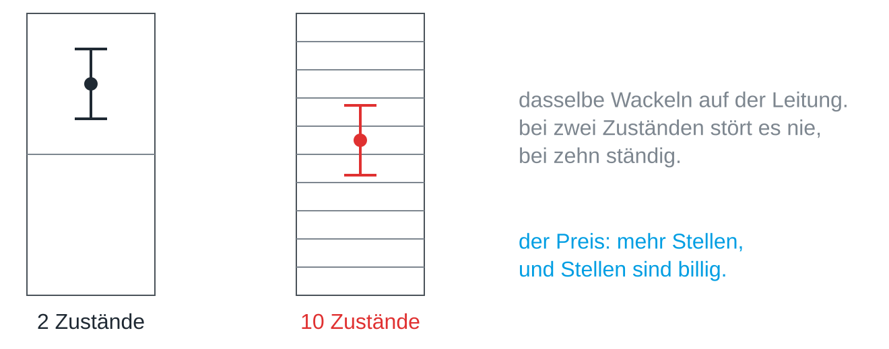

Ein Rechner könnte im Prinzip mit jeder Basis arbeiten, und in der Frühzeit
gab es tatsächlich Dezimalrechner. Sie sind ausgestorben, und der Grund dafür
lohnt sich, denn er erklärt, warum im Rechner am Ende alles zu Nullen und
Einsen wird.

## Zehn Fächer oder zwei

Stell dir eine Leitung vor, auf der eine Spannung irgendwo zwischen null und
fünf Volt liegt. Um zehn Ziffern zu senden, musst du diesen Bereich in zehn
Fächer von je einem halben Volt teilen. Für zwei Ziffern bekommst du zwei
Fächer von je zweieinhalb Volt.

Jede echte Leitung wackelt: Kabel wirken als Antennen, Bauteile werden warm,
Netzteile brummen. Dasselbe Wackeln, das bei zwei Fächern nie stört, wirft die
Ziffer bei zehn Fächern regelmäßig ins Nachbarfach.

Je mehr Zustände in denselben Bereich passen müssen, desto kleiner werden die
Abstände zwischen ihnen und desto eher gewinnt das Rauschen. Zwei Zustände
haben den größtmöglichen Abstand und lassen sich deshalb milliardenfach
hintereinander sicher unterscheiden. Darum sind an und aus, Strom und kein
Strom, hell und dunkel das robusteste Alphabet, das es gibt.

## Der Preis sind mehr Stellen

Binärzahlen sind länger als Dezimalzahlen, denn 255 braucht acht Stellen statt
drei. Rechner zahlen diesen Preis gern, weil eine Stelle fast nichts kostet,
eine falsche Ziffer aber alles kosten kann.

> [!NOTE]
> Das kurze Einmaleins der Basis 2 und die Tatsache, dass frühe Relais nur
> zwei Stellungen kannten, sind angenehme Nebenwirkungen, aber nicht der
> Grund. Der Grund ist physikalisch: Zwei Zustände überstehen Rauschen am
> besten.

## Wo es wiederkommt

Dieselbe Abwägung taucht überall auf, wo Information über einen echten Kanal
läuft, ob Kabel, Funk oder Licht: Mehr unterscheidbare Zustände tragen mehr
Information je Zeichen, aber jeder zusätzliche Zustand macht Fehler
wahrscheinlicher.
