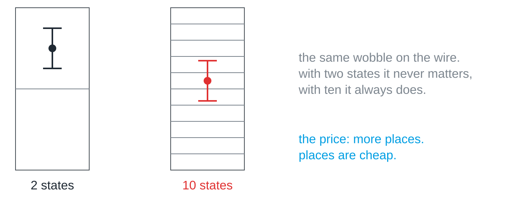

A computer could in principle use any base, and decimal computers really did
exist in the early days. They died out, and the reason is worth knowing,
because it explains why everything in a computer ends up as zeroes and ones.

## Ten compartments or two

Imagine a wire carrying a voltage somewhere between zero and five volts. To
send ten digits you have to cut that range into ten compartments, each half a
volt wide. To send two digits you get two compartments of two and a half
volts each.

Every real wire wobbles: cables act as antennas, components warm up, power
supplies hum. The same wobble that never matters with two compartments
regularly throws the digit into its neighbour's compartment with ten.

The more states you squeeze into the same range, the smaller the gaps between
them, and the sooner noise wins. Two states have the largest possible gap, so
they can be told apart reliably billions of times in a row. That is why on
and off, current and no current, bright and dark make the most robust
alphabet there is.

## The price is more places

Binary numbers are longer than decimal ones, since 255 needs eight places
instead of three. Computers pay this price happily, because a place costs
almost nothing to build while a wrong digit can cost everything.

> [!NOTE]
> The short multiplication table of base 2 and the fact that early relays
> knew only two positions are pleasant side effects, not the reason. The
> reason is physical: two states survive noise best.

## Where it comes back

The same trade-off appears wherever information travels over a real channel,
whether a cable, radio or light: more distinguishable states carry more
information per symbol, but each additional state makes errors more likely.
